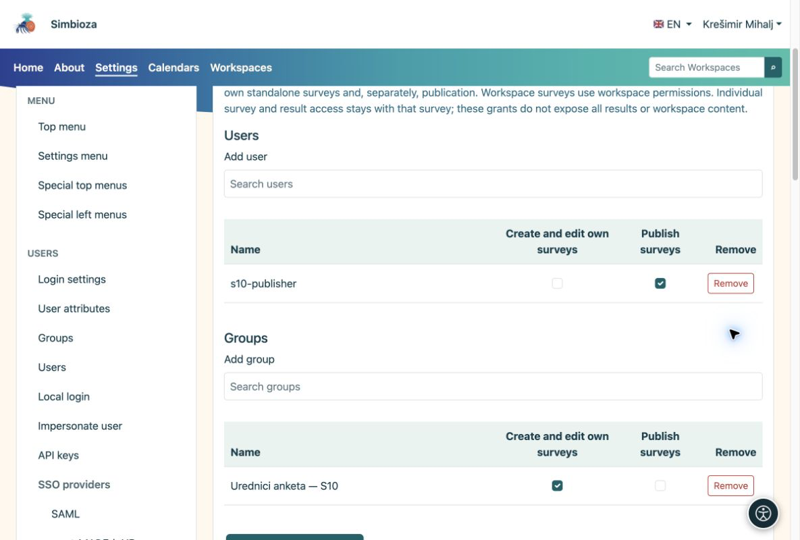

# Permisos de creación y publicación

> Las capturas de pantalla muestran la interfaz en inglés.

[Para administradores](ankete-administratori_es.md)

**Objetivo:** permitir que un editor trabaje en encuestas sin permitir la edición de todas las páginas ni la administración de aplicaciones.

1.  Abra **Configuración → Encuestas → Permisos**.
2.  Busque el usuario o grupo. El selector carga una lista acotada; no muestra todas las cuentas a la vez.
3.  Conceda el permiso para gestionar encuestas. Conceda por separado el permiso de publicación a la persona que aprueba las encuestas terminadas y guarde los cambios.

<figure>

<figcaption aria-hidden="true">Las permisos para encuestas globales son independientes del estado de administrador.</figcaption>
</figure>

## Permisos en un espacio de trabajo

En Gestión del espacio de trabajo, abra **Miembros y permisos → Encuestas**. Agregue un usuario o grupo y habilite los derechos requeridos. Los permisos de contenido que ya se aplican a las encuestas se muestran como heredados. Los derechos específicos de la encuesta no permiten la edición de páginas ordinarias. La publicación sigue siendo un permiso separado.

La participación y la lectura de resultados agregados no otorgan edición ni acceso a respuestas individuales. Los derechos de página, los grupos y las excepciones de acceso siguen siendo responsabilidades del espacio de trabajo.

**Verificar:** inicie sesión como usuario de prueba o pídale que lo verifique. Un editor debería poder crear un borrador, pero no debería aprobarlo sin el permiso de publicación.
