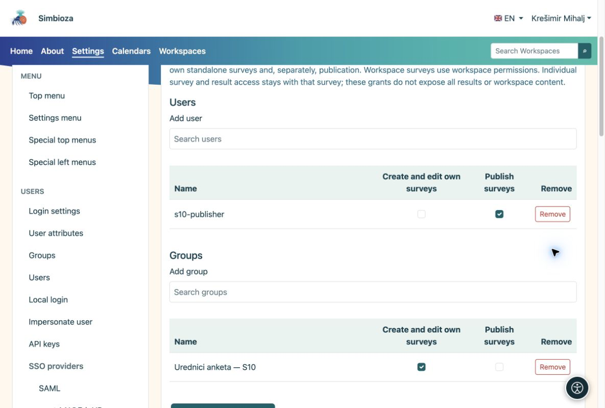

# Droits de création et de publication

> Les captures d’écran présentent l’interface en anglais.

[Pour les administrateurs](ankete-administratori_fr.md)

**Objectif :** permettre à un éditeur de travailler sur des sondages sans lui donner le droit de modifier toutes les pages ni d’administrer l’application.

1.  Ouvrez **Paramètres → Sondages → Droits**.
2.  Recherchez l’utilisateur ou le groupe. Le sélecteur charge une liste limitée ; il n’affiche pas tous les comptes à la fois.
3.  Accordez le droit de gestion des sondages. Accordez séparément le droit de publication à la personne qui approuve les sondages terminés, puis enregistrez.

<figure>

<figcaption aria-hidden="true">Les droits globaux sur les sondages sont distincts du statut d’administrateur.</figcaption>
</figure>

## Droits dans un espace de travail

Dans la gestion de l’espace de travail, ouvrez **Membres et droits → Sondages**. Ajoutez un utilisateur ou un groupe et activez les droits nécessaires. Les droits de contenu qui s’appliquent déjà aux sondages apparaissent comme hérités. Les droits spécifiques aux sondages ne donnent pas le droit de modifier les pages ordinaires. La publication reste un droit distinct.

Participer à un sondage et consulter les résultats agrégés ne donne pas le droit de le modifier ni d’accéder aux réponses individuelles. Les droits des pages, les groupes et les exceptions d’accès restent gérés par l’espace de travail.

**Vérification :** connectez-vous avec un compte de test ou demandez à son utilisateur de vérifier. Un éditeur doit pouvoir créer un brouillon, mais ne doit pas pouvoir l’approuver sans droit de publication.
