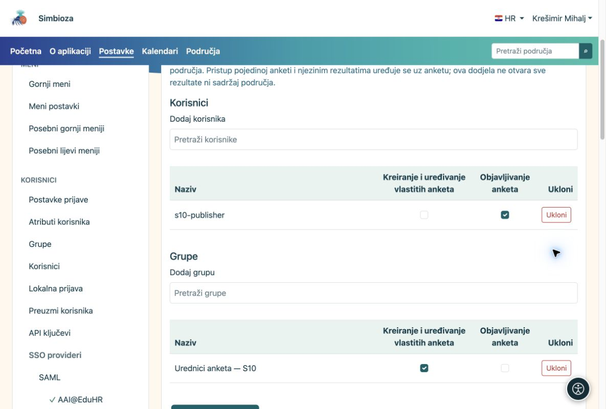

# Ovlasti za sastavljanje i objavu

[Za administratore](ankete-administratori_hr.md)

**Cilj:** uredniku omogućiti rad na anketama bez prava uređivanja svih stranica ili administracije aplikacije.

1.  Otvorite **Postavke → Ankete → Ovlasti**.
2.  Pretražite korisnika ili grupu. Birač učitava ograničeni popis; nije potrebno prikazati sve korisnike odjednom.
3.  Dodijelite pravo upravljanja anketama. Pravo objavljivanja dodijelite zasebno osobi koja odobrava gotove ankete. Spremite.

<figure>

<figcaption aria-hidden="true">Globalne ovlasti anketa odvojene su od administratorske uloge.</figcaption>
</figure>

## Ovlasti u pojedinom području

U upravljanju područjem otvorite **Članovi i prava → Ankete**. Dodajte korisnika ili grupu i označite potrebna prava. Dodjele iz odjeljka Sadržaj koje već vrijede za ankete prikazane su kao naslijeđene. Dodatna prava Ankete ne daju uređivanje običnih stranica. Objavljivanje ostaje zasebno pravo.

Pravo ispunjavanja i pravo čitanja zbirnih rezultata ne daju uređivanje ni uvid u pojedinačne predaje. Prava stranice, grupe i iznimke pristupa ostaju dio Područja.

**Provjera:** prijavite se probnim korisnikom ili zatražite da provjeri prikaz. Urednik treba moći napraviti nacrt; bez prava objavljivanja ne smije ga sam odobriti.
