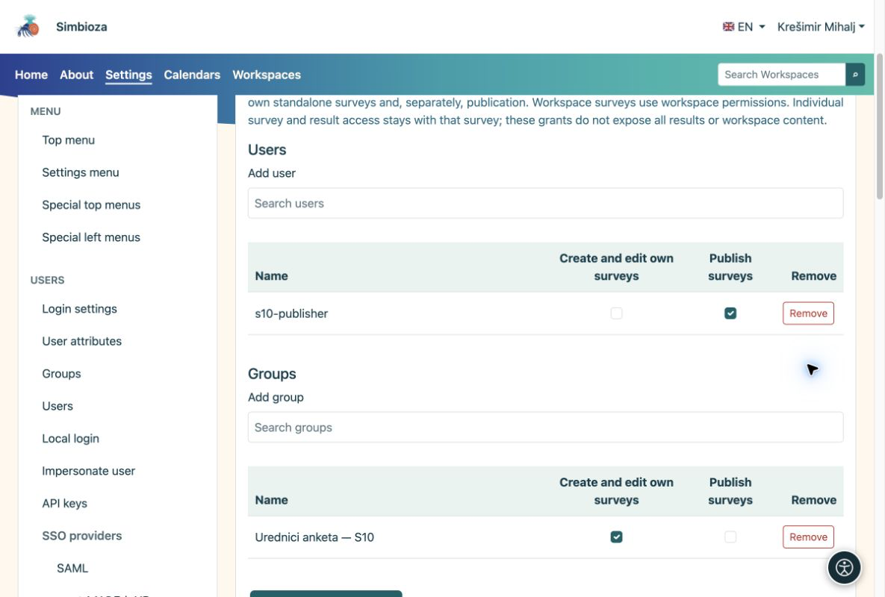

# Autorizzazioni di creazione e pubblicazione

> Le schermate mostrano l’interfaccia in inglese.

[Per amministratori](ankete-administratori_it.md)

**Obiettivo:** consentire a un redattore di lavorare sui sondaggi senza consentire la modifica di tutte le pagine o l'amministrazione dell'applicazione.

1.  Apri **Impostazioni → Sondaggi → Autorizzazioni**.
2.  Cerca l'utente o il gruppo. Il selettore carica un elenco limitato; non visualizza tutti gli account contemporaneamente.
3.  Concedi l'autorizzazione alla gestione dei sondaggi. Assegna separatamente l'autorizzazione alla pubblicazione alla persona che approva i sondaggi completati, quindi salva.

<figure>

<figcaption aria-hidden="true">Le autorizzazioni globali dei sondaggi sono distinte dallo stato di amministratore.</figcaption>
</figure>

## Autorizzazioni in un'area di lavoro

In Gestione area di lavoro, apri **Membri e autorizzazioni → Sondaggi**. Aggiungi un utente o un gruppo e abilita i diritti richiesti. Le autorizzazioni sui contenuti già applicate ai sondaggi vengono visualizzate come ereditate. I diritti specifici del sondaggio non concedono la modifica della pagina ordinaria. La pubblicazione rimane un'autorizzazione separata.

La partecipazione e la lettura dei risultati aggregati non garantiscono l'accesso alla modifica o alla risposta individuale. I diritti di pagina, i gruppi e le eccezioni di accesso rimangono responsabilità dell'area di lavoro.

**Verifica:** accedi come utente di prova o chiedi loro di verificare. Un editor dovrebbe essere in grado di creare una bozza, ma non dovrebbe approvarla senza il permesso di pubblicazione.
