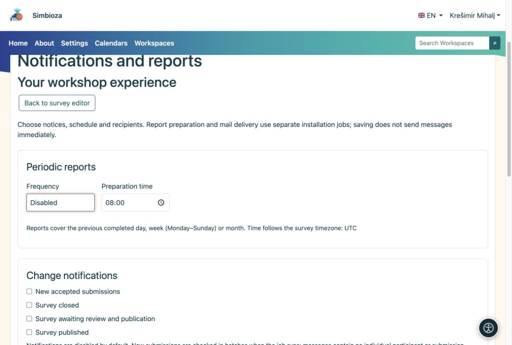

# Benachrichtigungen und Berichte zustellen

> Die Bildschirmaufnahmen zeigen die englische Benutzeroberfläche.

[Für Administratoren](ankete-administratori_de.md)

Die Autoren wählen Ereignisse, Zeitpläne und Empfänger der Umfrage aus. Administratoren bereiten Kanäle und geplante Ausführungen vor. Das alleinige Speichern eines Zeitplans sendet noch keine Nachricht.

1.  Aktivieren Sie Benachrichtigungen für In-App-Nachrichten und E-Mail für die E-Mail-Zustellung. Jeder Kanal kann unabhängig voneinander arbeiten.
2.  Konfigurieren Sie für E-Mails SMTP und die Berechtigung zum Senden von Benachrichtigungs-E-Mails in den E-Mail-Einstellungen.
3.  Führen Sie den Berichtsjob regelmäßig aus dem Anwendungsverzeichnis aus. Führen Sie den Mail-Worker separat für E-Mails aus. In diesem Beispiel werden höchstens 20 Elemente pro Lauf verarbeitet:

<!-- -->

    vendor/bin/hph survey reports:run --limit=20
    vendor/bin/hph email outbox:worker --max-messages=20

Der Berichtsjob kann jede Minute unter dem entsprechenden Dienstkonto ausgeführt werden. Verwenden Sie das richtige Arbeitsverzeichnis, die richtige Konfiguration und die richtigen privaten Protokolle. Aktivieren Sie während eines Testzeitraums keine echten Produktionsempfänger.

<figure>

<figcaption aria-hidden="true">Autoren entscheiden, was sie erhalten; Administratoren stellen Kanäle und Jobausführung bereit.</figcaption>
</figure>

**Prüfen:** Aktivieren Sie einen zukünftigen Zeitplan für eine Testumfrage für einen autorisierten Empfänger. Überprüfen Sie die letzten Ausführungen und bei E-Mails den Postausgangsstatus. Eine vorbereitete Nachricht ist kein Beweis für die SMTP-Zustellung.

Tägliche, wöchentliche und monatliche Berichte decken den zuvor abgeschlossenen Zeitraum ab. Die aktuellen Empfängerberechtigungen werden bei der Ausführung erneut überprüft. Berichte schließen individuelle Kommentare und Teilnehmeridentitäten aus. Einladungsmails mit persönlichen Links sind nicht Teil dieser Einstellungen.
