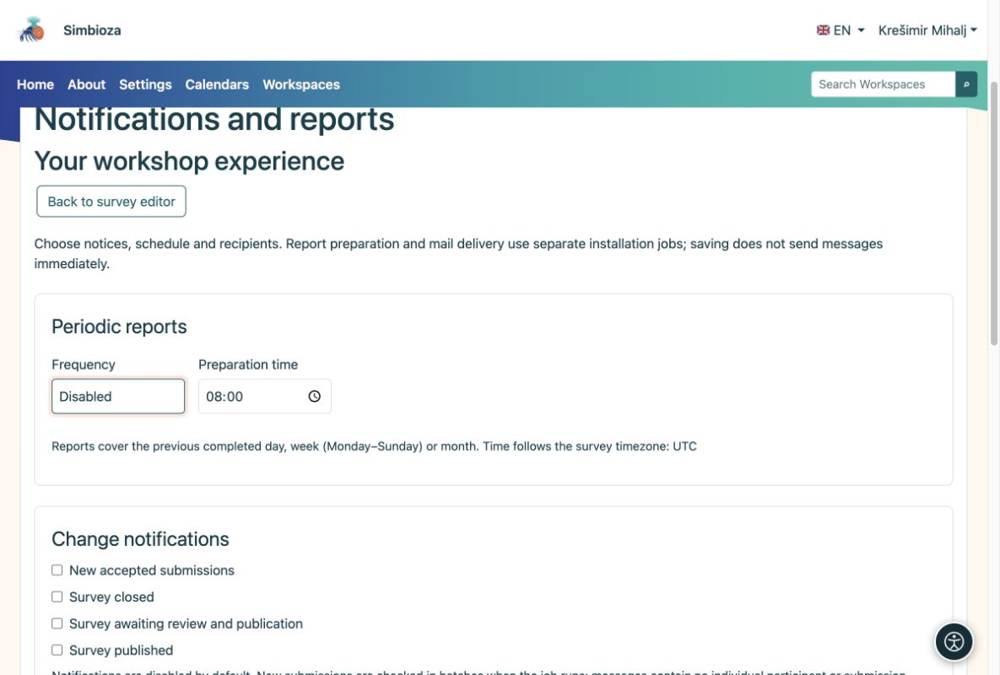

# Notification and report delivery

[For administrators](ankete-administratori_en.md)

Authors choose events, schedules and recipients on the survey. Administrators prepare channels and scheduled execution. Saving a schedule alone does not send a message.

1.  Enable Notifications for in-app messages and Email for mail delivery. Either channel can work independently.
2.  For email, configure SMTP and permission to send notification mail in Email settings.
3.  Run the report job regularly from the application directory. Run the mail worker separately for email. This example handles at most 20 items per run:

<!-- -->

    vendor/bin/hph survey reports:run --limit=20
    vendor/bin/hph email outbox:worker --max-messages=20

The report job can run every minute under the appropriate service account. Use the correct working directory, configuration and private logs. Do not enable real production recipients during a trial.

<figure>

<figcaption aria-hidden="true">Authors choose what to receive; administrators provide channels and job execution.</figcaption>
</figure>

**Check:** enable a future schedule on a test survey for an authorized recipient. Inspect recent runs and, for email, the outbox status. A prepared message does not prove SMTP delivery.

Daily, weekly and monthly reports cover the previous completed period. Current recipient permissions are checked again at execution. Reports exclude individual comments and participant identities. Invitation mail with personal links is not part of these settings.
