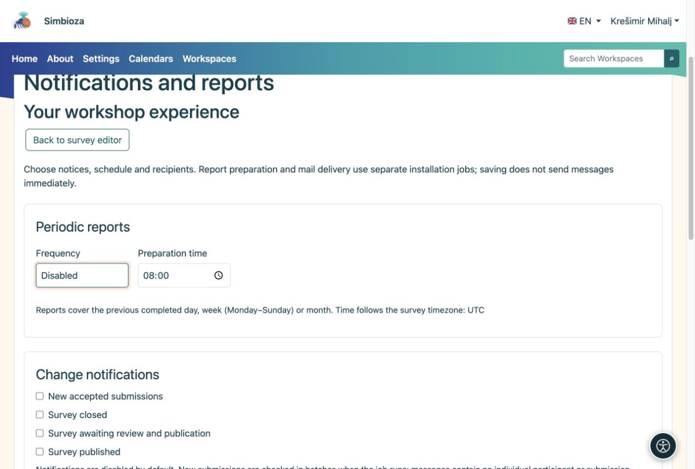

# Envío de notificaciones e informes

> Las capturas de pantalla muestran la interfaz en inglés.

[Para administradores](ankete-administratori_es.md)

Los autores eligen eventos, horarios y destinatarios de la encuesta. Los administradores preparan canales y programan la ejecución. Guardar un horario por sí solo no envíe un mensaje.

1.  Habilite Notificaciones para mensajes dentro de la aplicación y Correo electrónico para entrega de correo. Cualquier canal puede funcionar de forma independiente.
2.  Para correo electrónico, configure SMTP y permiso para enviar correo de notificación en la configuración de correo electrónico.
3.  Ejecute el trabajo de informe periódicamente desde el directorio de la aplicación. Ejecute el trabajador de correo por separado para el correo electrónico. Este ejemplo maneja como máximo 20 elementos por ejecución:

<!-- -->

    vendor/bin/hph survey reports:run --limit=20
    vendor/bin/hph email outbox:worker --max-messages=20

El trabajo de informe puede ejecutarse cada minuto con la cuenta de servicio adecuada. Utilice el directorio de trabajo, la configuración y los registros privados correctos. No habilite destinatarios de producción reales durante una prueba.

<figure>

<figcaption aria-hidden="true">Los autores eligen qué recibir; Los administradores proporcionan canales y ejecución del trabajo.</figcaption>
</figure>

**Verificar:** habilitar una programación futura en una encuesta de prueba para un destinatario autorizado. Inspeccione las ejecuciones recientes y, en el caso del correo electrónico, el estado de la bandeja de salida. Un mensaje preparado no prueba la entrega SMTP.

Los informes diarios, semanales y mensuales cubren el período completado anterior. Los permisos del destinatario actual se verifican nuevamente durante la ejecución. Los informes excluyen comentarios individuales e identidades de participantes. El correo de invitación con enlaces personales no forma parte de esta configuración.
