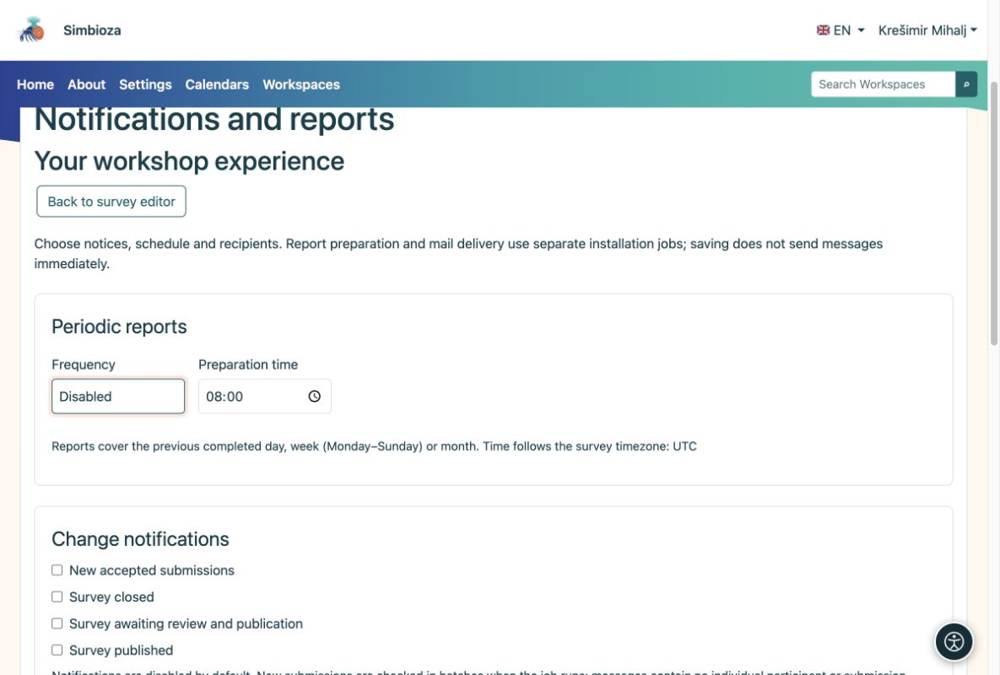

# Envoi des notifications et des rapports

> Les captures d’écran présentent l’interface en anglais.

[Pour les administrateurs](ankete-administratori_fr.md)

Les auteurs choisissent les événements, les horaires et les destinataires sur le sondage. Les administrateurs préparent les canaux et l'exécution planifiée. L’enregistrement d’un planning à lui seul n’envoie pas de message.

1.  Activez les notifications pour les messages intégrés à l'application et les e-mails pour la livraison du courrier. Chaque canal peut fonctionner indépendamment.
2.  Pour le courrier électronique, configurez SMTP et l'autorisation d'envoyer un courrier de notification dans les paramètres de courrier électronique.
3.  Exécutez régulièrement le travail de rapport à partir du répertoire de l'application. Exécutez le gestionnaire de messagerie séparément pour le courrier électronique. Cet exemple gère au maximum 20 éléments par exécution :

<!-- -->

    vendor/bin/hph survey reports:run --limit=20
    vendor/bin/hph email outbox:worker --max-messages=20

La tâche de rapport peut être exécutée toutes les minutes sous le compte de service approprié. Utilisez le répertoire de travail, la configuration et les journaux privés corrects. N’activez pas les véritables destinataires de production pendant un essai.

<figure>

<figcaption aria-hidden="true">Les auteurs choisissent ce qu'ils veulent recevoir ; les administrateurs fournissent des canaux et l'exécution des tâches.</figcaption>
</figure>

**Vérifiez :** activez une programmation future pour un sondage test pour un destinataire autorisé. Inspectez les exécutions récentes et, pour les e-mails, l'état de la boîte d'envoi. Un message préparé ne prouve pas la livraison SMTP.

Les rapports quotidiens, hebdomadaires et mensuels couvrent la période précédente terminée. Les autorisations actuelles du destinataire sont à nouveau vérifiées lors de l'exécution. Les rapports excluent les commentaires individuels et l’identité des participants. Les courriers d'invitation avec des liens personnels ne font pas partie de ces paramètres.
