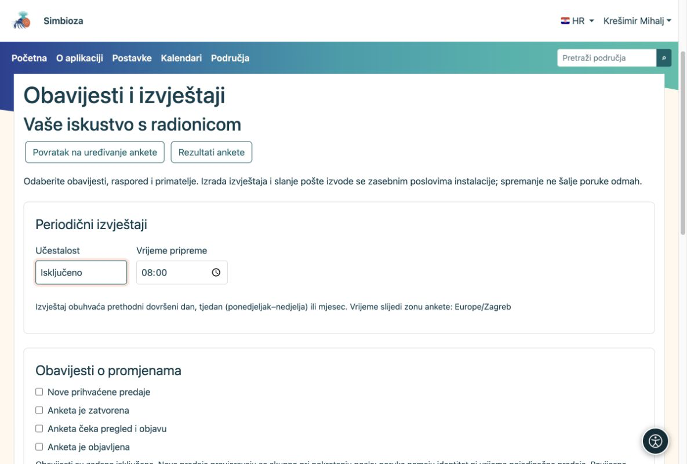

# Dostava obavijesti i izvještaja

[Za administratore](ankete-administratori_hr.md)

Autor bira događaje, raspored i primatelje u anketi. Administrator priprema kanale i redovno izvršavanje. Samo spremanje rasporeda ne šalje poruku.

1.  Provjerite je li uključen modul Obavijesti za poruke u aplikaciji, odnosno E-mail za poštu. Svaki kanal može raditi zasebno.
2.  Za poštu podesite SMTP i dopuštenje slanja obavijesti u postavkama E-maila.
3.  Iz direktorija aplikacije redovno pokrećite posao izvještaja. Za e-mail zasebno pokrećite poštanski worker. Primjer s najviše 20 stavki po pokretanju:

<!-- -->

    vendor/bin/hph survey reports:run --limit=20
    vendor/bin/hph email outbox:worker --max-messages=20

Posao izvještaja možete planirati svake minute pod odgovarajućim servisnim korisnikom. Koristite ispravan direktorij, konfiguraciju i privatne logove. Ne uključujte slanje na produkcijske adrese tijekom probe.

<figure>

<figcaption aria-hidden="true">Autor bira što želi primati; administrator osigurava rad kanala i poslova.</figcaption>
</figure>

**Provjera:** uključite budući raspored na probnoj anketi za ovlaštenog primatelja. Provjerite zadnja izvršavanja i, za e-mail, stanje poštanskog reda. Pripremljena poruka nije dokaz SMTP dostave.

Dnevni/tjedni/mjesečni izvještaji pokrivaju prethodno dovršeno razdoblje. Primateljima se pri izvršavanju ponovno provjeravaju aktualna prava. Izvještaj ne sadrži pojedinačne komentare ni identitete ispitanika. Slanje pozivnica s osobnim poveznicama nije dio ovih postavki.
