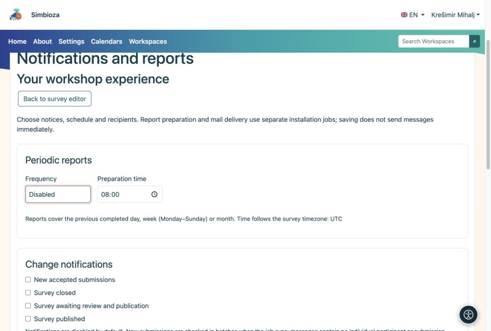

# Consegna di notifiche e rapporti

> Le schermate mostrano l’interfaccia in inglese.

[Per amministratori](ankete-administratori_it.md)

Gli autori scelgono eventi, programmi e destinatari del sondaggio. Gli amministratori preparano i canali e pianificano l'esecuzione. Il solo salvataggio di una pianificazione non invia un messaggio.

1.  Abilita le notifiche per i messaggi in-app e l'e-mail per la consegna della posta. Entrambi i canali possono funzionare in modo indipendente.
2.  Per l'e-mail, configurare SMTP e l'autorizzazione per inviare e-mail di notifica nelle Impostazioni e-mail.
3.  Eseguire regolarmente il processo di report dalla directory dell'applicazione. Esegui l'operatore di posta separatamente per la posta elettronica. Questo esempio gestisce al massimo 20 elementi per esecuzione:

<!-- -->

    vendor/bin/hph survey reports:run --limit=20
    vendor/bin/hph email outbox:worker --max-messages=20

Il processo di report può essere eseguito ogni minuto con l'account di servizio appropriato. Utilizzare la directory di lavoro, la configurazione e i registri privati corretti. Non abilitare destinatari di produzione reali durante una prova.

<figure>

<figcaption aria-hidden="true">Gli autori scelgono cosa ricevere; gli amministratori forniscono canali ed esecuzione dei lavori.</figcaption>
</figure>

**Verifica:** abilita una pianificazione futura su un sondaggio di prova per un destinatario autorizzato. Esamina le esecuzioni recenti e, per le e-mail, lo stato della posta in uscita. Un messaggio preparato non dimostra la consegna SMTP.

I rapporti giornalieri, settimanali e mensili coprono il periodo completato precedente. Le autorizzazioni correnti del destinatario vengono nuovamente controllate durante l'esecuzione. I report escludono i commenti individuali e le identità dei partecipanti. La posta di invito con collegamenti personali non fa parte di queste impostazioni.
