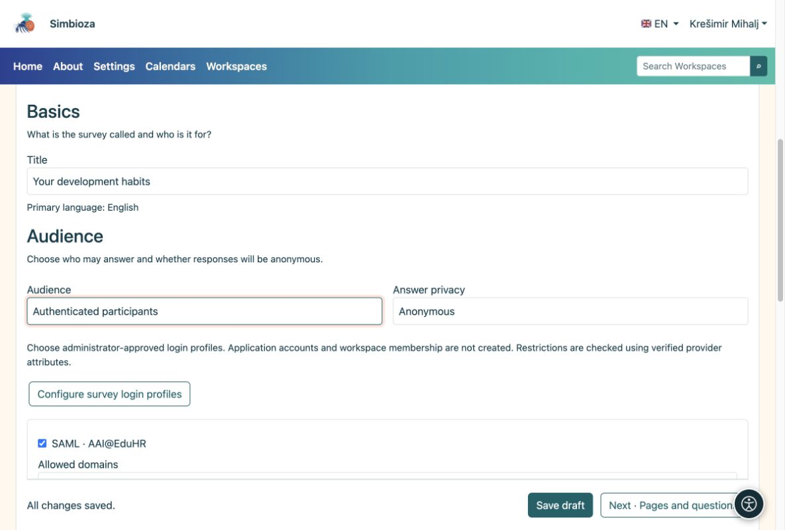

# 3. Teilnehmer und Datenschutz festlegen

> Die Bildschirmaufnahmen zeigen die englische Benutzeroberfläche.

[Für Umfrageautoren](ankete-autori_de.md)

**Ziel:** entscheiden, wer antworten darf und ob Antworten mit einer Person verknüpft werden dürfen. Öffnen Sie **Grundlagen → Zielgruppe**.

| Auswahl | Was der Teilnehmer tun muss |
|----|----|
| Öffentlich, ohne Login | Öffnen Sie die verfügbare Umfrage. Die Antworten sind immer anonym. |
| Anwendungsbenutzer | Melden Sie sich bei Simbioza an. Es ist kein zusätzlicher externer Login erforderlich. |
| Authentifizierte Teilnehmer | Melden Sie sich nur für die Umfrage mit einem zulässigen Profil an. Es wird kein Simbioza-Konto erstellt. |

Wählen Sie für die letzten beiden Optionen **Anonym** oder **Identifiziert**. Anonym bedeutet, dass bei den Antworten kein Name gespeichert wird. Durch die Anmeldung kann weiterhin die Berechtigung überprüft und eine erneute Einreichung verhindert werden. In einer identifizierten Umfrage kann ein autorisierter Manager Antworten mit einer Person verknüpfen. Die Teilnehmer sehen diesen Hinweis, bevor sie antworten.

<figure>

<figcaption aria-hidden="true">Zielgruppen- und Antwortdatenschutz sind getrennte Optionen.</figcaption>
</figure>

## Wenn Sie eine kleinere Gruppe benötigen

Wählen Sie für die externe Anmeldung die vom Administrator vorbereiteten zulässigen Profile aus. Wenn Domänenregeln verfügbar sind, geben Sie zulässige und ausgeschlossene Domänen an. Eine leere Liste zugelassener Domänen fügt keine zusätzliche Autorenbeschränkung hinzu.

Aktivieren Sie für benannte Eingeladene die E-Mail-Adressliste und öffnen Sie **Zulässige Umfrageteilnehmer**. Fügen Sie durch Kommas, Semikolons oder Zeilenumbrüche getrennte Adressen ein. Jede bei der Anmeldung zurückgegebene Adresse kann mit der Liste übereinstimmen. Beim Speichern dieser Liste werden noch keine Einladungen versendet.

## Eine Umfrage in einem Arbeitsbereich

Der Seitenzugriff wird vor umfragespezifischen Bedingungen überprüft. Eine private Umfrage bleibt privat. Seiteneinstellungen können das Lesen explizit einem Benutzer, einer Gruppe oder der **öffentlichen** Zielgruppe gewähren. Dadurch kann eine Seite in einem privaten Arbeitsbereich verfügbar gemacht werden, ohne dass die anderen Seiten verfügbar gemacht werden. Fragen Sie den Arbeitsbereichs-Manager, wenn Sie Seitenberechtigungen nicht bearbeiten können.

**Ergebnis:** Die ausgewählten Personen können mit klar erklärter Privatsphäre teilnehmen. Speichern Sie den Entwurf.
