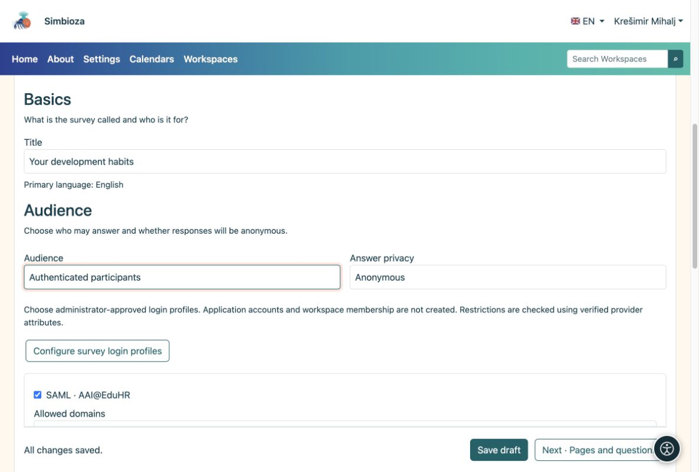

# 3. Choose participants and privacy

[For survey authors](ankete-autori_en.md)

**Goal:** decide who can answer and whether answers may be linked to a person. Open **Basics → Audience**.

| Choice | What the participant must do |
|----|----|
| Public, without login | Open the available survey. Answers are always anonymous. |
| Application users | Sign in to Simbioza. No additional external login is needed. |
| Authenticated participants | Sign in just for the survey using an allowed profile. No Simbioza account is created. |

For the last two options choose **Anonymous** or **Identified**. Anonymous means no name is stored with the answers. Sign-in can still check eligibility and prevent a repeat submission. In an identified survey an authorized manager can link answers to a person. Participants see this notice before answering.

<figure>

<figcaption aria-hidden="true">Audience and answer privacy are separate choices.</figcaption>
</figure>

## When you need a smaller group

For external sign-in select the allowed profiles prepared by the administrator. If domain rules are available, specify allowed and excluded domains. An empty allowed-domain list adds no extra author restriction.

For named invitees, enable the email-address list and open **Allowed survey participants**. Paste addresses separated by commas, semicolons or line breaks. Any one address returned by sign-in may match the list. Saving this list does not send invitations yet.

## A survey in a Workspace

Page access is checked before survey-specific conditions. A private survey stays private. Page settings may explicitly grant reading to a user, group or the **Public** audience. This can expose one page in a private Workspace without exposing its other pages. Ask the Workspace manager if you cannot edit page permissions.

**Result:** the selected people can participate with privacy explained clearly. Save the draft.
