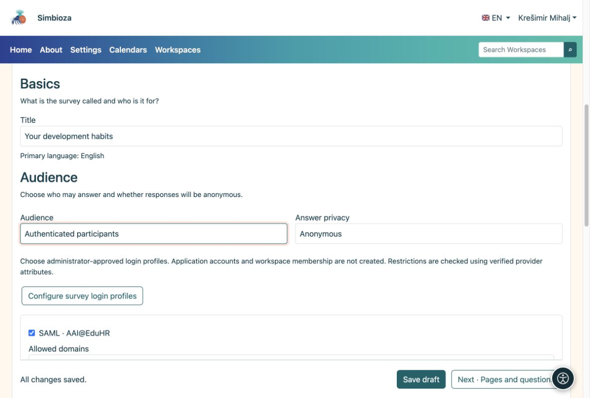

# 3. Elegir participantes y opciones de privacidad

> Las capturas de pantalla muestran la interfaz en inglés.

[Para autores de encuestas](ankete-autori_es.md)

**Objetivo:** decidir quién puede responder y si las respuestas pueden estar vinculadas a una persona. Abra **Conceptos básicos → Audiencia**.

| Elección | Qué debe hacer el participante |
|----|----|
| Público, sin iniciar sesión | Abra la encuesta disponible. Las respuestas son siempre anónimas. |
| Usuarios de la aplicación | Inicie sesión en Simbioza. No se necesita ningún inicio de sesión externo adicional. |
| Participantes autenticados | Inicie sesión solo para la encuesta utilizando un perfil permitido. No se crea ninguna cuenta Simbioza. |

Para las dos últimas opciones, elija **Anónimo** o **Identificado**. Anónimo significa que no se almacena ningún nombre con las respuestas. El inicio de sesión aún puede verificar la elegibilidad y evitar que se repita el envío. En una encuesta identificada, un gestor autorizado puede vincular las respuestas a una persona. Los participantes ven este aviso antes de responder.

<figure>

<figcaption aria-hidden="true">La privacidad de la audiencia y la respuesta son opciones separadas.</figcaption>
</figure>

## Cuando necesitas un grupo más pequeño

Para el inicio de sesión externo, seleccione los perfiles permitidos preparados por el administrador. Si hay reglas de dominio disponibles, especifique los dominios permitidos y excluidos. Una lista de dominios permitidos vacía no agrega ninguna restricción de autor adicional.

Para los invitados nombrados, habilite la lista de direcciones de correo electrónico y abra **Participantes permitidos de la encuesta**. Pegue direcciones separadas por comas, punto y coma o saltos de línea. Cualquier dirección devuelta al iniciar sesión puede coincidir con la lista. Al guardar esta lista no se envían invitaciones todavía.

## Una encuesta en un espacio de trabajo

El acceso a la página se verifica antes de las condiciones específicas de la encuesta. Una encuesta privada permanece privada. La configuración de la página puede otorgar explícitamente la lectura a un usuario, grupo o audiencia **Pública**. Esto puede exponer una página en un espacio de trabajo privado sin exponer las demás páginas. Pregúntele al gestor del espacio de trabajo si no puede editar los permisos de la página.

**Resultado:** las personas seleccionadas pueden participar con la privacidad explicada claramente. Guarde el borrador.
