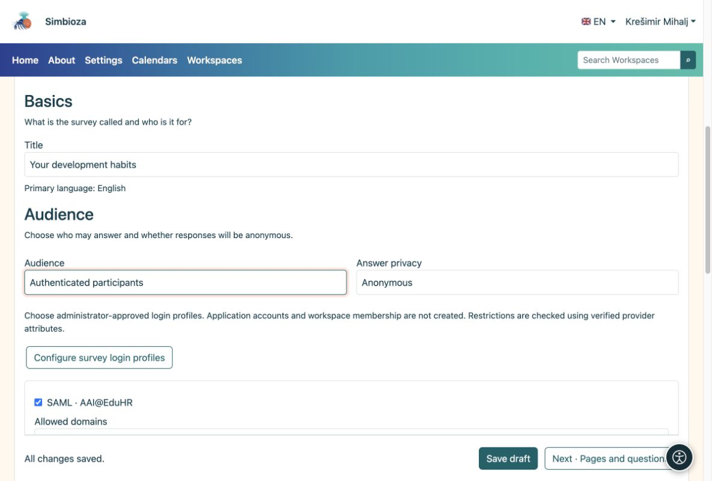

# 3. Choisir les participants et la confidentialité

> Les captures d’écran présentent l’interface en anglais.

[Pour les auteurs du sondage](ankete-autori_fr.md)

**Objectif :** décidez qui peut répondre et si les réponses peuvent être liées à une personne. Ouvrez **Bases → Audience**.

| Choix | Ce que le participant doit faire |
|----|----|
| Public, sans connexion | Ouvrez le sondage disponible. Les réponses sont toujours anonymes. |
| Utilisateurs d'applications | Connectez-vous à Simbioza. Aucune connexion externe supplémentaire n’est nécessaire. |
| Participants authentifiés | Connectez-vous uniquement au sondage en utilisant un profil autorisé. Aucun compte Simbioza n'est créé. |

Pour les deux dernières options, choisissez **Anonyme** ou **Identifié**. Anonyme signifie qu'aucun nom n'est stocké avec les réponses. La connexion peut toujours vérifier l’éligibilité et empêcher une nouvelle soumission. Dans un sondage identifié, un responsable autorisé peut associer les réponses à une personne. Les participants voient cet avis avant de répondre.

<figure>

<figcaption aria-hidden="true">L’audience et la confidentialité des réponses sont des choix distincts.</figcaption>
</figure>

## Quand vous avez besoin d'un groupe plus petit

Pour la connexion externe, sélectionnez les profils autorisés préparés par l'administrateur. Si des règles de domaine sont disponibles, spécifiez les domaines autorisés et exclus. Une liste de domaines autorisés vide n’ajoute aucune restriction d’auteur supplémentaire.

Pour les invités nommés, activez la liste d'adresses e-mail et ouvrez **Participants autorisés au sondage**. Collez les adresses séparées par des virgules, des points-virgules ou des sauts de ligne. Toute adresse renvoyée par la connexion peut correspondre à la liste. L'enregistrement de cette liste n'envoie pas encore d'invitations.

## Un sondage dans un espace de travail

L'accès à la page est vérifié avant les conditions spécifiques au sondage. Un sondage privé reste privé. Les paramètres de page peuvent explicitement accorder la lecture à un utilisateur, un groupe ou l'audience **Public**. Cela peut exposer une page dans un espace de travail privé sans exposer ses autres pages. Demandez au gestionnaire de l'espace de travail si vous ne pouvez pas modifier les autorisations de page.

**Résultat :** les personnes sélectionnées peuvent participer en toute confidentialité. Enregistrez le brouillon.
