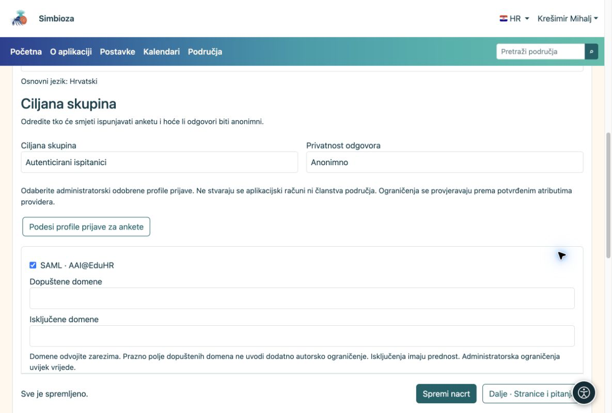

# 3. Odaberite ispitanike i privatnost

[Za sastavljače anketa](ankete-autori_hr.md)

**Cilj:** odlučiti tko odgovara i smije li se odgovor povezati s osobom. Otvorite **Osnovni podaci → Ciljana skupina**.

| Odabir | Što osoba mora napraviti |
|----|----|
| Javnost, bez prijave | Otvoriti dostupnu anketu. Odgovori su uvijek anonimni. |
| Korisnici aplikacije | Prijaviti se u Simbiozu. Nema dodatne prijave na vanjski sustav. |
| Autenticirani ispitanici | Prijaviti se samo radi ankete jednim od ponuđenih profila. Ne stvara se račun u Simbiozi. |

Za posljednja dva odabira birate **Anonimno** ili **Identificirano**. Anonimno znači da se uz odgovore ne sprema ime. Prijava se ipak može koristiti za provjeru prava i sprečavanje ponovne predaje. Kod identificirane ankete ovlašteni upravitelj može povezati odgovore s osobom. Ispitanik prije odgovaranja vidi tu obavijest.

<figure>

<figcaption aria-hidden="true">Ciljana skupina i privatnost podešavaju se odvojeno.</figcaption>
</figure>

## Ako trebate užu skupinu

Kod vanjske prijave označite dopuštene profile. Koristite samo one koje je pripremio administrator. Ako je administrator dopustio domenska pravila, možete navesti dopuštene i isključene domene. Prazan popis dopuštenih domena ne uvodi dodatno ograničenje.

Za točno određene osobe uključite popis e-mail adresa i otvorite **Dopušteni ispitanici ankete**. Zalijepite adrese odvojene zarezom, točkom sa zarezom ili novim retkom. Dovoljno je da se jedna adresa vraćena prijavom podudara s popisom. Spremanje popisa još ne šalje pozivnice.

## Anketa u području

Pravo na stranicu provjerava se prije uvjeta ankete. Privatna anketa ostaje privatna. U postavkama stranice možete dodijeliti izričit pregled korisniku, grupi ili publici **Javno**. Tako jedna stranica može biti javna i u privatnom području, bez otvaranja ostalih stranica. Ako ne vidite postavke prava, obratite se upravitelju područja.

**Rezultat:** odabrane osobe mogu pristupiti anketi uz jasno objašnjenu privatnost. Spremite nacrt.
