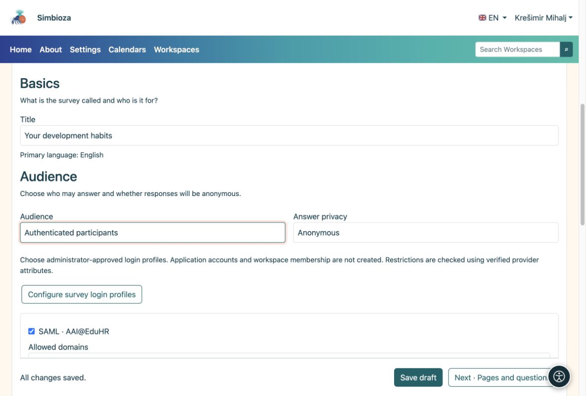

# 3. Scegli i partecipanti e la privacy

> Le schermate mostrano l’interfaccia in inglese.

[Per gli autori del sondaggio](ankete-autori_it.md)

**Obiettivo:** decidere chi può rispondere e se le risposte possono essere collegate a una persona. Apri **Nozioni di base → Pubblico**.

| Scelta | Cosa deve fare il partecipante |
|----|----|
| Pubblico, senza login | Apri il sondaggio disponibile. Le risposte sono sempre anonime. |
| Utenti dell'applicazione | Accedi a Simbioza. Non è necessario alcun accesso esterno aggiuntivo. |
| Partecipanti autenticati | Accedi solo per il sondaggio utilizzando un profilo consentito. Nessun account Simbioza creato. |

Per le ultime due opzioni scegli **Anonimo** o **Identificato**. Anonimo significa che nessun nome viene memorizzato con le risposte. L'accesso può comunque verificare l'idoneità e impedire un invio ripetuto. In un sondaggio identificato un responsabile autorizzato può collegare le risposte ad una persona. I partecipanti vedono questo avviso prima di rispondere.

<figure>

<figcaption aria-hidden="true">La privacy del pubblico e della risposta sono scelte separate.</figcaption>
</figure>

## Quando hai bisogno di un gruppo più piccolo

Per l'accesso esterno selezionare i profili consentiti preparati dall'amministratore. Se sono disponibili regole di dominio, specificare i domini consentiti ed esclusi. Un elenco di domini consentiti vuoto non aggiunge ulteriori restrizioni all'autore.

Per gli invitati nominativi, abilita l'elenco di indirizzi e-mail e apri **Partecipanti al sondaggio consentiti**. Incolla gli indirizzi separati da virgole, punto e virgola o interruzioni di riga. Qualsiasi indirizzo restituito dall'accesso può corrispondere all'elenco. Il salvataggio di questo elenco non invia ancora gli inviti.

## Un sondaggio in un'area di lavoro

L'accesso alla pagina viene controllato prima delle condizioni specifiche del sondaggio. Un sondaggio privato rimane privato. Le impostazioni della pagina possono concedere esplicitamente la lettura a un utente, un gruppo o un pubblico **pubblico**. Ciò può esporre una pagina in un'area di lavoro privata senza esporre le altre pagine. Chiedi al gestore dell'area di lavoro se non puoi modificare le autorizzazioni della pagina.

**Risultato:** le persone selezionate possono partecipare con la privacy spiegata chiaramente. Salva la bozza.
