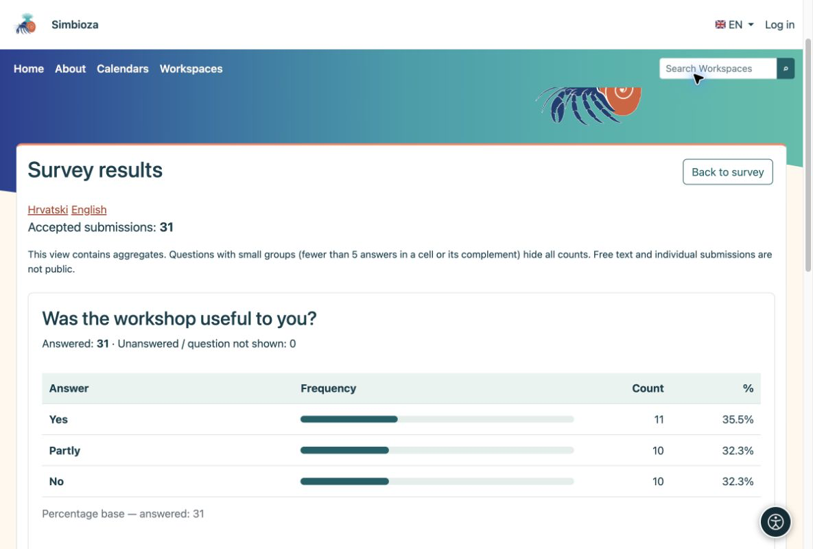
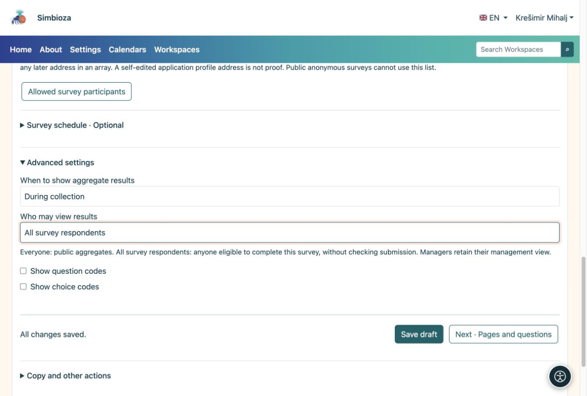

# 5. Ergebnisse und Benachrichtigungen ansehen

> Die Bildschirmaufnahmen zeigen die englische Benutzeroberfläche.

[Für Umfrageautoren](ankete-autori_de.md)

**Ziel:** Sehen Sie, was die Leute geantwortet haben, und entscheiden Sie, wer die Gesamtergebnisse sehen kann.

1.  Öffnen Sie die Umfrage und wählen Sie **Umfrageergebnisse**. Jede Frage hat ihr eigenes Diagramm und zählt. Wechseln Sie zu einem angebotenen Tisch.
2.  Öffnen Sie **Einzeleinsendungen**, um ausgefüllte Fragebögen einzusehen. Dies ist eine Managementansicht, kein öffentliches Ergebnis.
3.  Wählen Sie den Export CSV, um in einer Tabellenkalkulationsanwendung zu arbeiten. Der Identitätsexport ist nur für identifizierte Umfragen verfügbar und muss explizit aktiviert werden.

<figure>

<figcaption aria-hidden="true">Jedes Diagramm wird mit der darin beschriebenen Frage angezeigt.</figcaption>
</figure>

Multiple-Choice-Prozentsätze können insgesamt mehr als 100 % betragen, da eine Person möglicherweise mehrere Optionen auswählt. Anonyme Einsendungen haben keinen Teilnehmernamen. Öffentliche Ergebnisse geben keine individuellen Kommentare oder Identitäten preis.

## Wer sieht Ergebnisse und wann?

Legen Sie unter **Grundlagen → Erweiterte Einstellungen** das Timing getrennt von der Zielgruppe fest. Eine permanente Umfrage verwendet normalerweise **Während der Erfassung**; Wählen Sie **Nach Schließung**, um die Ergebnisse zu verzögern.

| Zielgruppe | Bedeutung |
|----|----|
| Alle | Jeder darf auf die Umfrageseite zugreifen; auch anonyme Besucher, wenn diese Seite öffentlich ist. |
| Alle Umfrageteilnehmer | Die Teilnahmebedingungen gelten für alle Teilnehmer, unabhängig davon, ob sie Antworten abgegeben haben oder nicht. |
| Nur autorisierte Manager | Nur Personen, die die Umfrage verwalten. |
| Autorisierte Personen | Ausgewählte Benutzer und Gruppen; das Auslesen der Ergebnisse gewährt keine Bearbeitungsberechtigung. |

<figure>

<figcaption aria-hidden="true">Berechtigungen zum Zusammenfassen von Ergebnissen gewähren keine Bearbeitung oder keinen Zugriff auf einzelne Übermittlungen.</figcaption>
</figure>

Wenn in einer öffentlichen Tabelle Zählungen ausgeblendet werden, gibt es möglicherweise noch nicht genügend Antworten, um kleine Gruppen zu schützen. Die Antworten sind nicht verloren gegangen.

## Möchten Sie eine Zusammenfassung ohne wiederholte Überprüfung?

Öffnen Sie **Benachrichtigungen und Berichte**, wählen Sie Ereignisse oder tägliche/wöchentliche/monatliche Berichte, Empfänger und verfügbare Kanäle aus und speichern Sie dann. Empfänger benötigen weiterhin Zugriff auf Berichte. Bitten Sie den Administrator, die Zustellungseinstellungen zu überprüfen, wenn E-Mail oder geplante Berichte nicht funktionieren.
