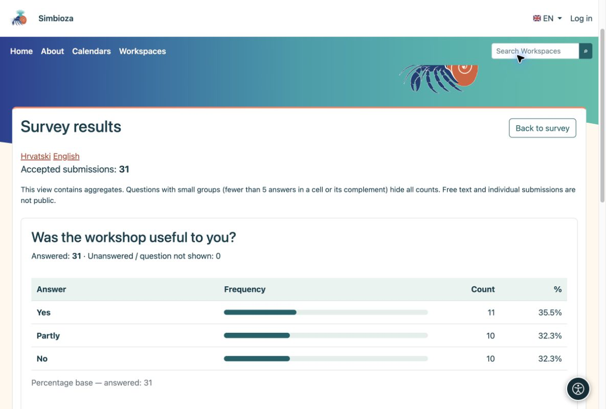
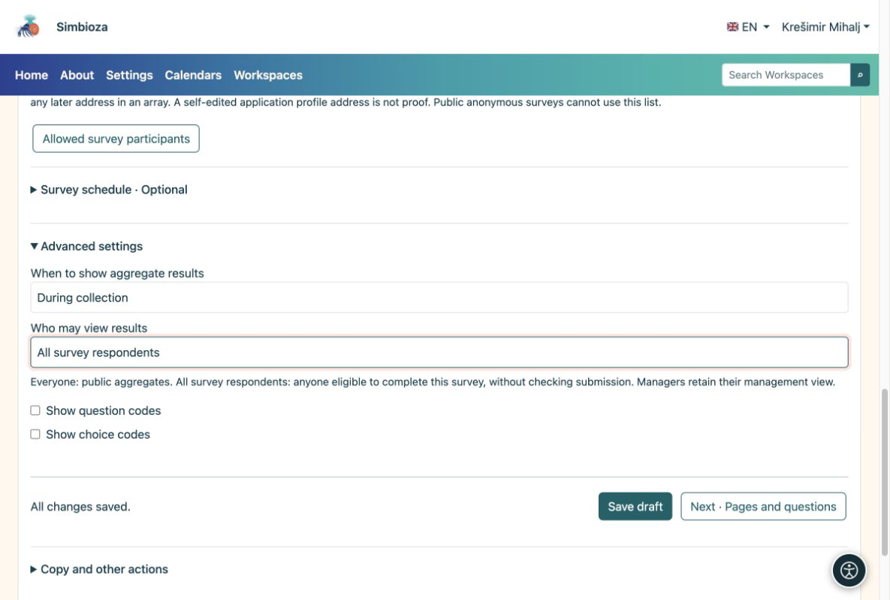

# 5. View results and notifications

[For survey authors](ankete-autori_en.md)

**Goal:** see what people answered and decide who can view aggregate results.

1.  Open the survey and choose **Survey results**. Each question has its own chart and counts. Switch to a table where offered.
2.  Open **Individual submissions** to inspect completed questionnaires. This is a management view, not a public result.
3.  Choose CSV export to work in a spreadsheet application. Identity export is available only for identified surveys and must be enabled explicitly.

<figure>

<figcaption aria-hidden="true">Each chart is shown with the question it describes.</figcaption>
</figure>

Multiple-choice percentages can total more than 100% because one person may select several choices. Anonymous submissions have no participant name. Public results do not expose individual comments or identities.

## Who sees results, and when?

Under **Basics → Advanced settings**, set timing separately from audience. A permanent survey normally uses **During collection**; choose **After closure** to delay results.

| Audience | Meaning |
|----|----|
| Everyone | Everyone allowed to access the survey page; anonymous visitors too when that page is public. |
| All survey respondents | Everyone meeting participation rules, whether or not they have submitted answers. |
| Authorized managers only | Only people who manage the survey. |
| Authorized people | Selected users and groups; result reading does not grant editing permission. |

<figure>

<figcaption aria-hidden="true">Aggregate-result permissions do not grant editing or access to individual submissions.</figcaption>
</figure>

If a public chart hides counts, there may not yet be enough answers to protect small groups. The answers have not been lost.

## Want a summary without repeatedly checking?

Open **Notifications and reports**, select events or daily/weekly/monthly reports, recipients and available channels, then save. Recipients still need report access. Ask the administrator to check delivery settings if email or scheduled reporting does not work.
