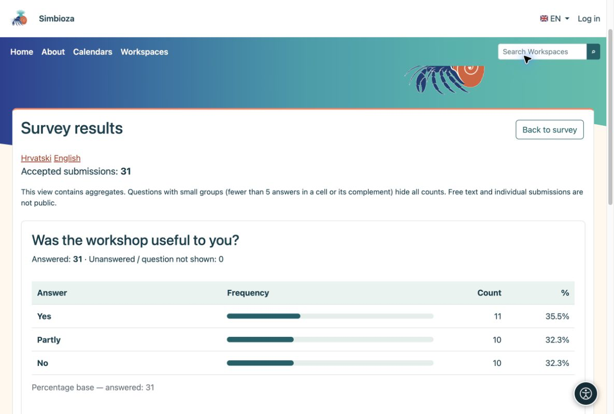
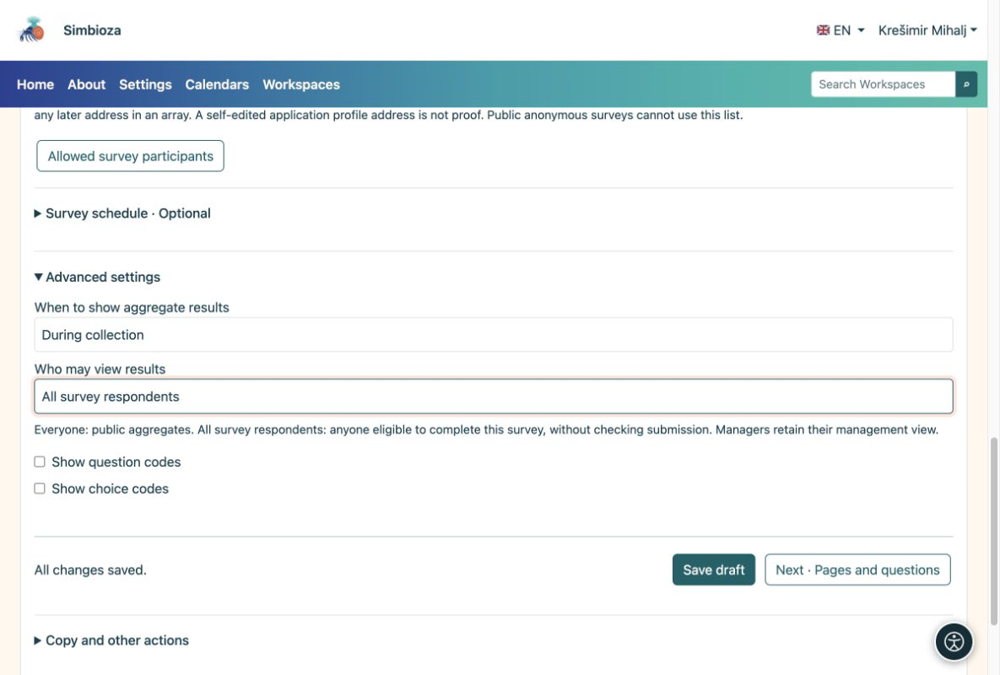

# 5. Consultar resultados y notificaciones

> Las capturas de pantalla muestran la interfaz en inglés.

[Para autores de encuestas](ankete-autori_es.md)

**Objetivo:** ver qué respondieron las personas y decidir quién puede ver los resultados agregados.

1.  Abra la encuesta y elija **Resultados de la encuesta**. Cada pregunta tiene su propio cuadro y cuenta. Cambie a una mesa donde se ofrezca.
2.  Abra **Envíos individuales** para inspeccionar los cuestionarios completados. Esta es una visión de gestión, no un resultado público.
3.  Elija CSV exportar para trabajar en una aplicación de hoja de cálculo. La exportación de identidad está disponible solo para encuestas identificadas y debe habilitarse explícitamente.

<figure>

<figcaption aria-hidden="true">Cada gráfico se muestra con la pregunta que describe.</figcaption>
</figure>

Los porcentajes de opción múltiple pueden sumar más del 100% porque una persona puede seleccionar varias opciones. Los envíos anónimos no tienen nombre de participante. Los resultados públicos no exponen comentarios o identidades individuales.

## ¿Quién ve los resultados y cuándo?

En **Conceptos básicos → Configuración avanzada**, establece el tiempo por separado de la audiencia. Una encuesta permanente normalmente utiliza **Durante la recolección**; elija **Después del cierre** para retrasar los resultados.

| Destinatarios | Significado |
|----|----|
| Todos | Todos pueden acceder a la página de la encuesta; visitantes anónimos también cuando esa página es pública. |
| Todos los encuestados | Todos los que cumplan las normas de participación, hayan enviado o no respuestas. |
| Solo gestores autorizados | Sólo las personas que gestionan la encuesta. |
| personas autorizadas | Usuarios y grupos seleccionados; La lectura de resultados no otorga permiso de edición. |

<figure>

<figcaption aria-hidden="true">Los permisos de resultados agregados no otorgan edición ni acceso a envíos individuales.</figcaption>
</figure>

Si un cuadro público oculta los recuentos, es posible que todavía no haya suficientes respuestas para proteger a los grupos pequeños. Las respuestas no se han perdido.

## ¿Quieres un resumen sin comprobarlo repetidamente?

Abra **Notificaciones e informes**, seleccione eventos o informes diarios/semanales/mensuales, destinatarios y canales disponibles, luego guarde. Los destinatarios aún necesitan acceso a los informes. Pídale al administrador que verifique la configuración de entrega si el correo electrónico o los informes programados no funcionan.
