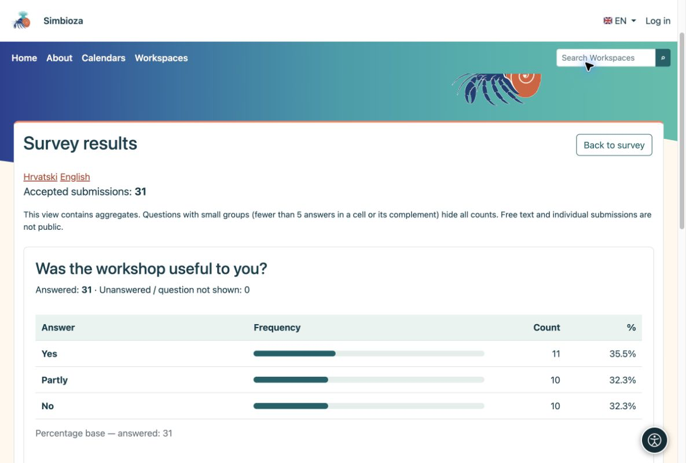
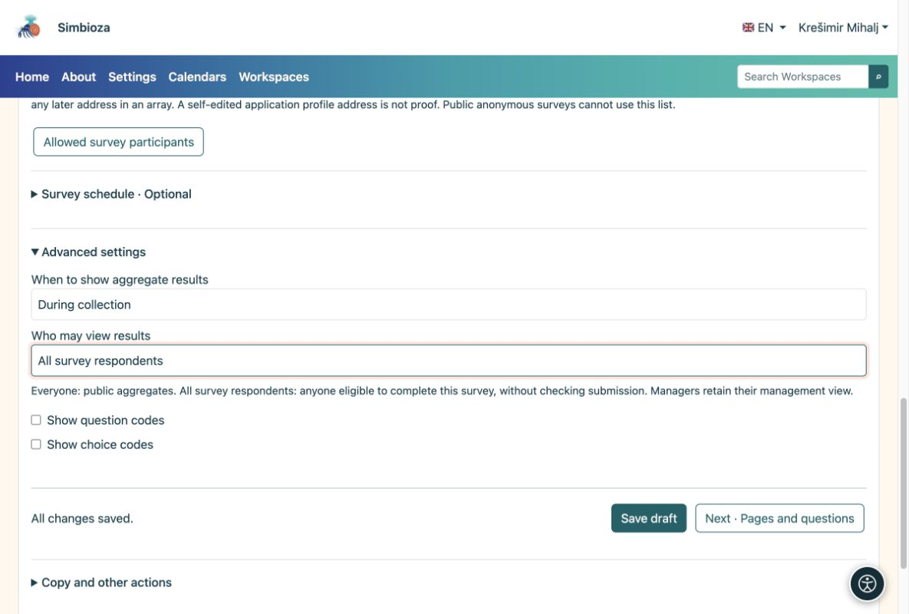

# 5. Consulter les résultats et les notifications

> Les captures d’écran présentent l’interface en anglais.

[Pour les auteurs du sondage](ankete-autori_fr.md)

**Objectif :** consultez les réponses des internautes et décidez qui peut consulter les résultats globaux.

1.  Ouvrez le sondage et choisissez **Résultats du sondage**. Chaque question a son propre tableau et compte. Passez à une table là où elle est proposée.
2.  Ouvrez les **Soumissions individuelles** pour inspecter les questionnaires remplis. Il s’agit d’un point de vue de la direction, pas d’un résultat public.
3.  Choisissez l'exportation CSV pour travailler dans une application de feuille de calcul. L'exportation d'identité est disponible uniquement pour les sondages identifiés et doit être activée explicitement.

<figure>

<figcaption aria-hidden="true">Chaque graphique est présenté avec la question qu'il décrit.</figcaption>
</figure>

Les pourcentages à choix multiples peuvent totaliser plus de 100 % car une personne peut sélectionner plusieurs choix. Les soumissions anonymes n'ont pas de nom de participant. Les résultats publics ne révèlent pas les commentaires ou les identités individuelles.

## Qui voit les résultats et quand ?

Sous **Bases → Paramètres avancés**, définissez la durée séparément de l'audience. Un sondage permanent utilise normalement **Pendant la collecte** ; choisissez **Après fermeture** pour retarder les résultats.

| Public | Signification |
|----|----|
| Tout le monde | Tout le monde est autorisé à accéder à la page du sondage ; les visiteurs anonymes également lorsque cette page est publique. |
| Tous les répondants au sondage | Toute personne respectant les règles de participation, qu'elle ait ou non soumis ses réponses. |
| Gestionnaires autorisés uniquement | Uniquement les personnes qui gèrent le sondage. |
| Personnes autorisées | Utilisateurs et groupes sélectionnés ; la lecture du résultat n’accorde pas l’autorisation de modification. |

<figure>

<figcaption aria-hidden="true">Les autorisations relatives aux résultats agrégés n'accordent pas de modification ni d'accès aux soumissions individuelles.</figcaption>
</figure>

Si un tableau public cache les décomptes, il se peut qu’il n’y ait pas encore suffisamment de réponses pour protéger les petits groupes. Les réponses n'ont pas été perdues.

## Vous voulez un résumé sans vérifier à plusieurs reprises ?

Ouvrez **Notifications et rapports**, sélectionnez des événements ou des rapports quotidiens/hebdomadaires/mensuels, des destinataires et des canaux disponibles, puis enregistrez. Les destinataires doivent toujours avoir accès aux rapports. Demandez à l'administrateur de vérifier les paramètres de livraison si le courrier électronique ou les rapports planifiés ne fonctionnent pas.
