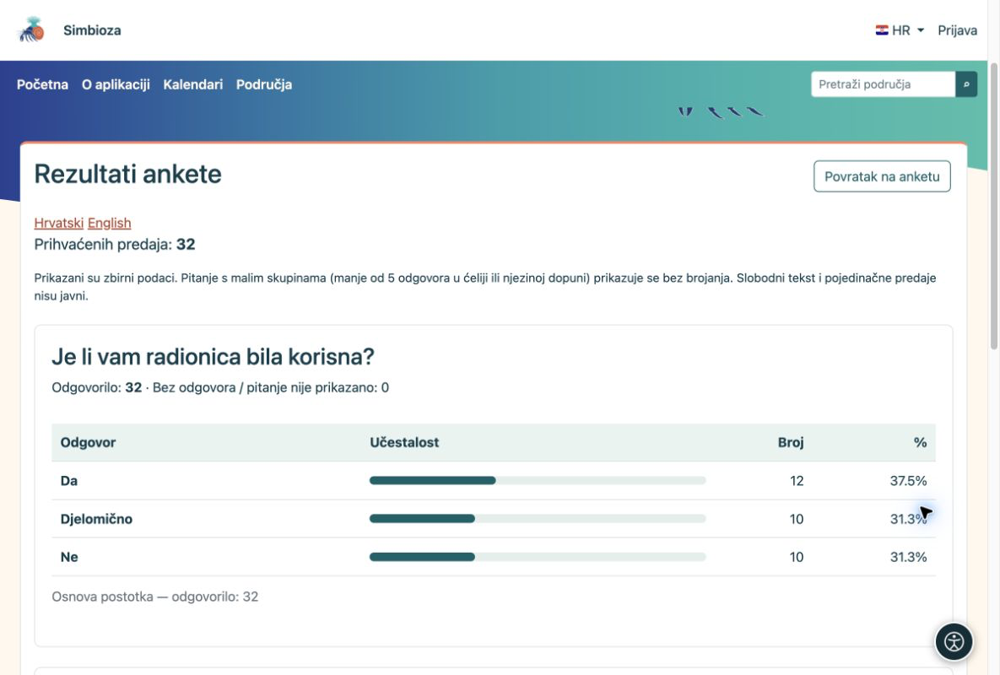
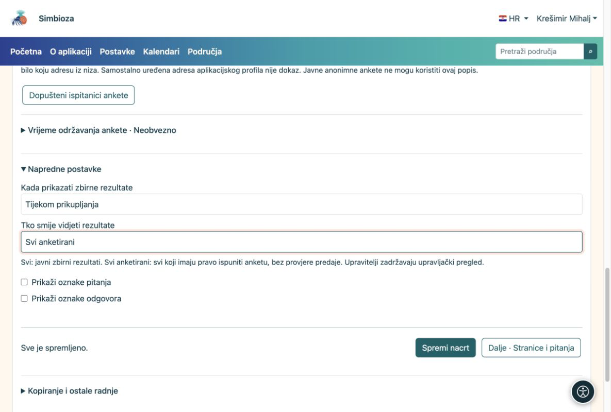

# 5. Pogledajte rezultate i obavijesti

[Za sastavljače anketa](ankete-autori_hr.md)

**Cilj:** vidjeti što su ljudi odgovorili i odrediti tko smije gledati zbirne rezultate.

1.  Otvorite anketu pa **Rezultati ankete**. Uz svako pitanje vidite graf i broj odgovora. Gdje je ponuđeno, prebacite se na tablični prikaz.
2.  Za pojedinačno ispunjene upitnike otvorite **Pojedinačne predaje**. To je upravljački prikaz, a ne javni rezultat.
3.  Za rad u tabličnom programu odaberite CSV izvoz. Izvoz s identitetom postoji samo za identificiranu anketu i posebno se uključuje.

<figure>

<figcaption aria-hidden="true">Grafovi pokazuju odgovore uz tekst pripadajućeg pitanja.</figcaption>
</figure>

Kod više odabira zbroj postotaka može biti veći od 100%: jedna osoba bira više odgovora. U anonimnoj anketi nećete vidjeti ime uz predaju. Javni rezultati ne prikazuju pojedinačne komentare ni identitete.

## Tko vidi rezultate i kada?

U **Osnovni podaci → Napredne postavke** odvojeno podesite vrijeme i publiku. Za trajnu anketu obično odaberite **Tijekom prikupljanja**; za odgođene rezultate **Nakon zatvaranja**.

| Publika | Značenje |
|----|----|
| Svi | Svi koji smiju pristupiti stranici ankete; kod javne stranice i neprijavljeni posjetitelji. |
| Svi anketirani | Svi koji zadovoljavaju uvjete za ispunjavanje; ne moraju prethodno predati odgovore. |
| Samo ovlašteni upravitelji | Samo osobe koje upravljaju anketom. |
| Ovlaštene osobe | Posebno odabrani korisnici i grupe; čitanje rezultata ne daje pravo uređivanja. |

<figure>

<figcaption aria-hidden="true">Prava pregleda zbirnih rezultata ne daju pravo uređivanja ili uvida u pojedinačne predaje.</figcaption>
</figure>

Ako javni graf još ne pokazuje brojanja, možda nema dovoljno odgovora za zaštitu malih skupina. Odgovori nisu izgubljeni.

## Želite sažetak bez stalnog otvaranja?

Otvorite **Obavijesti i izvještaji**, odaberite događaje ili dnevni/tjedni/mjesečni izvještaj te primatelje i dostupne kanale. Spremite. Primatelj i dalje mora imati pravo na izvještaj. Ako e-mail ili raspored ne rade, administrator treba provjeriti postavke dostave.
