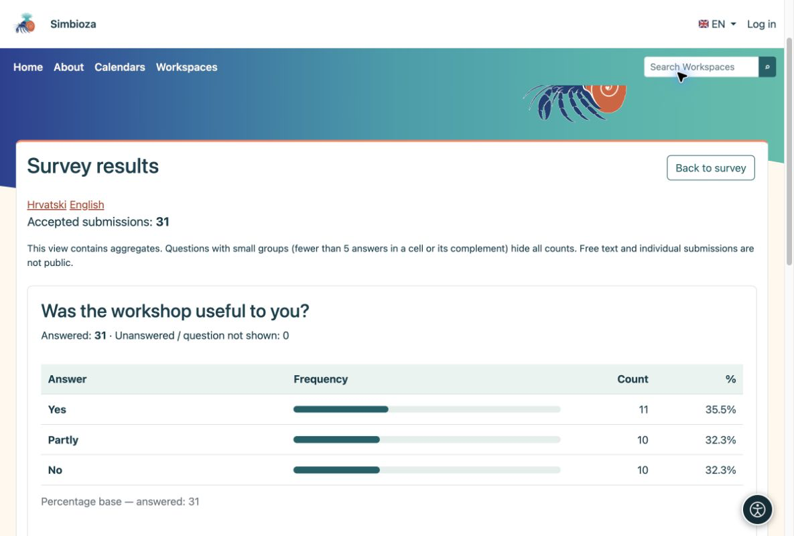
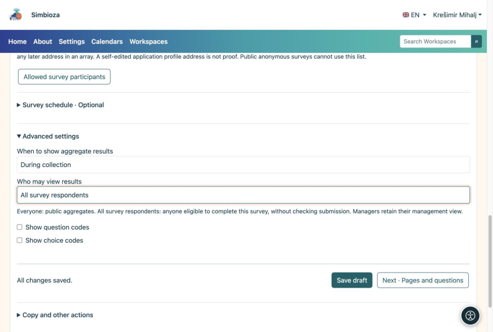

# 5. Visualizza risultati e notifiche

> Le schermate mostrano l’interfaccia in inglese.

[Per gli autori del sondaggio](ankete-autori_it.md)

**Obiettivo:** vedere cosa hanno risposto le persone e decidere chi può visualizzare i risultati aggregati.

1.  Apri il sondaggio e scegli **Risultati del sondaggio**. Ogni domanda dispone del proprio grafico e dei propri conteggi. Passa alla tabella quando disponibile.
2.  Apri **Invii individuali** per controllare i questionari completati. Si tratta di una visione gestionale, non di un risultato pubblico.
3.  Scegli l'esportazione CSV per lavorare con un foglio di calcolo. L'esportazione delle identità è disponibile soltanto per i sondaggi con risposte identificate e deve essere abilitata esplicitamente.

<figure>

<figcaption aria-hidden="true">Ogni grafico viene mostrato con la domanda che descrive.</figcaption>
</figure>

Le percentuali a scelta multipla possono superare il 100% perché una persona può selezionare più scelte. Gli invii anonimi non hanno il nome del partecipante. I risultati pubblici non espongono commenti o identità individuali.

## Chi vede i risultati e quando?

In **Nozioni di base → Impostazioni avanzate**, imposta i tempi separatamente dal pubblico. Un sondaggio permanente normalmente utilizza **Durante la raccolta**; scegli **Dopo la chiusura** per ritardare i risultati.

| Pubblico | Significato |
|----|----|
| Tutti | Tutti possono accedere alla pagina del sondaggio; anche i visitatori anonimi quando la pagina è pubblica. |
| Tutti gli intervistati | Tutti coloro che rispettano le regole di partecipazione, indipendentemente dal fatto che abbiano inviato o meno risposte. |
| Solo gestori autorizzati | Solo le persone che gestiscono il sondaggio. |
| Persone autorizzate | Utenti e gruppi selezionati; la lettura dei risultati non concede l'autorizzazione alla modifica. |

<figure>

<figcaption aria-hidden="true">Le autorizzazioni per i risultati aggregati non concedono la modifica o l'accesso ai singoli invii.</figcaption>
</figure>

Se una carta pubblica nasconde i conteggi, potrebbero non esserci ancora risposte sufficienti per proteggere piccoli gruppi. Le risposte non sono andate perdute.

## Vuoi un riepilogo senza controllare ripetutamente?

Apri **Notifiche e report**, seleziona eventi o report giornalieri/settimanali/mensili, destinatari e canali disponibili, quindi salva. I destinatari necessitano comunque dell'accesso ai report. Chiedi all'amministratore di verificare le impostazioni di consegna se la posta elettronica o i rapporti pianificati non funzionano.
