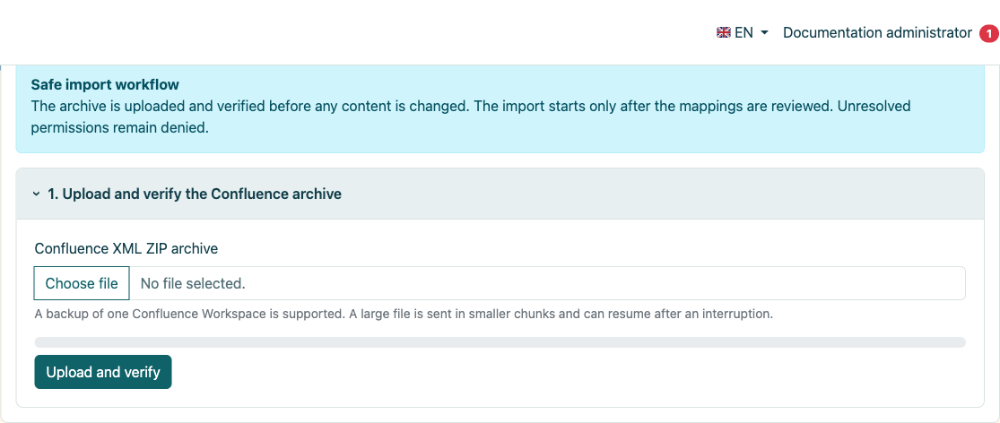
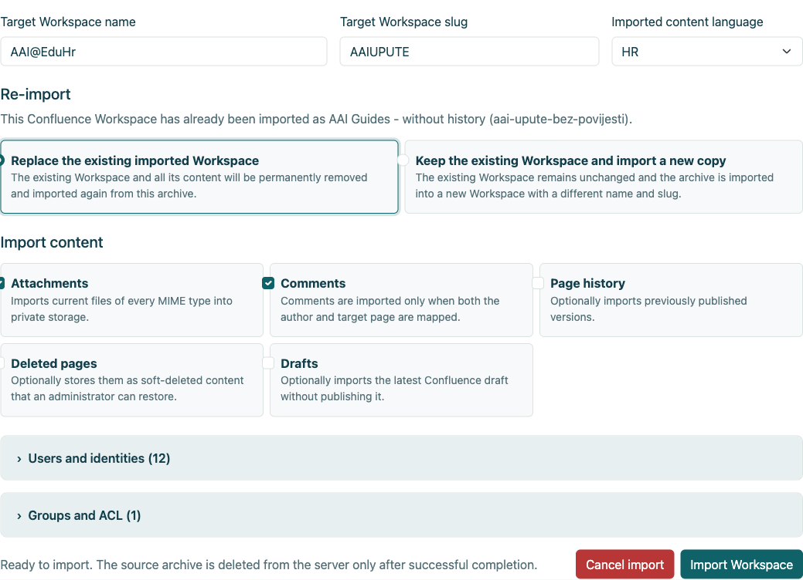
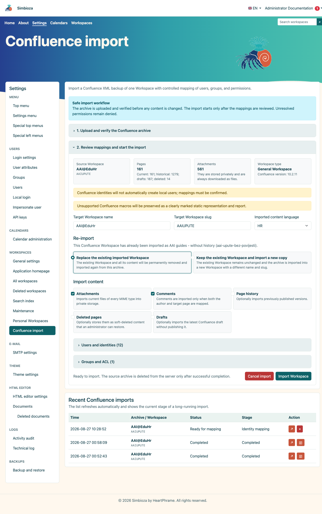
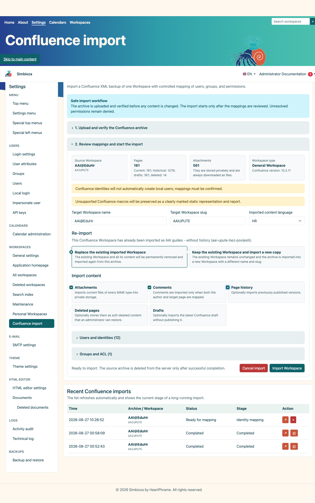
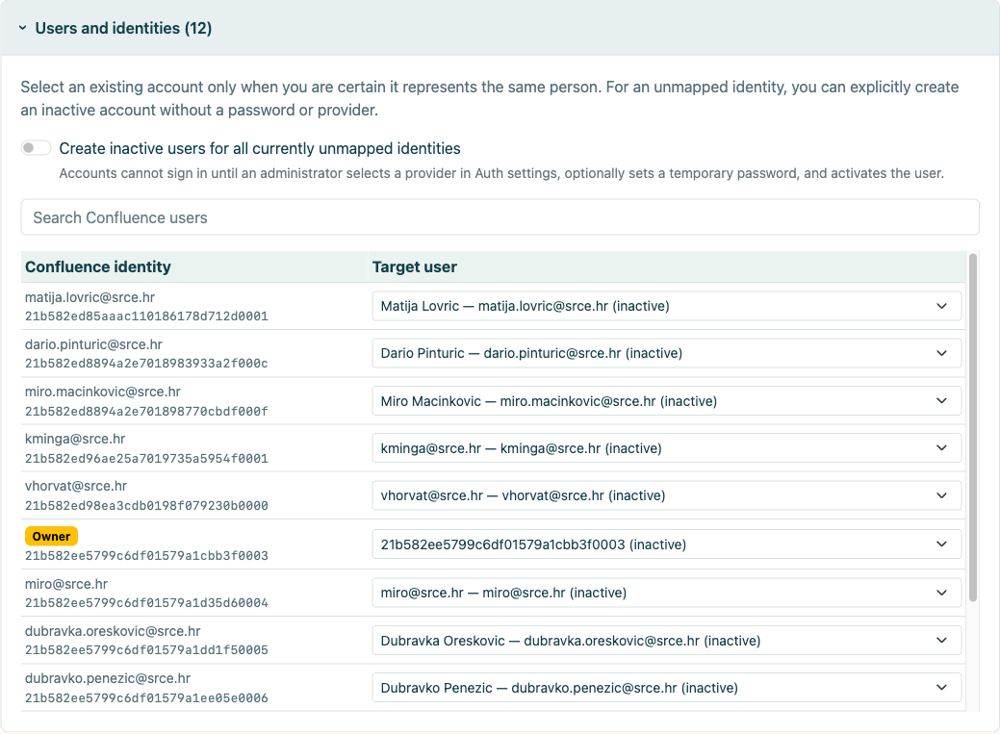
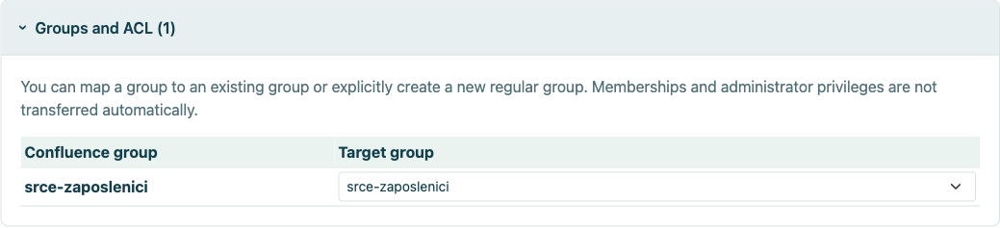
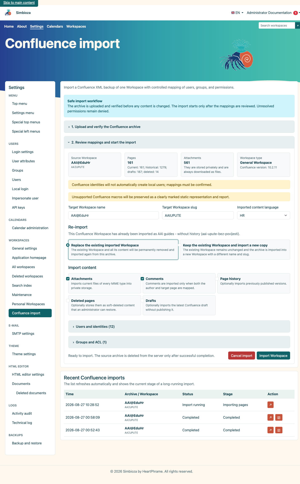
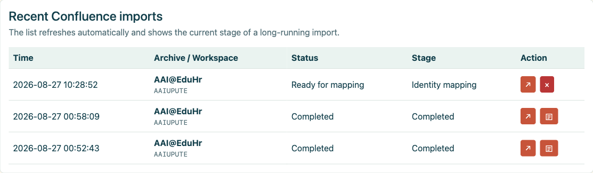
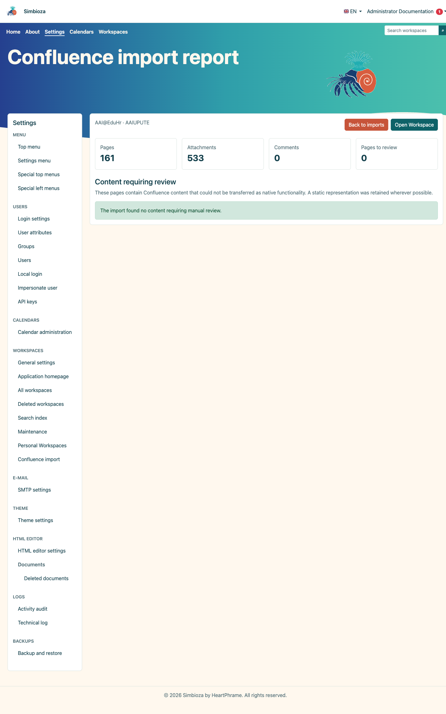
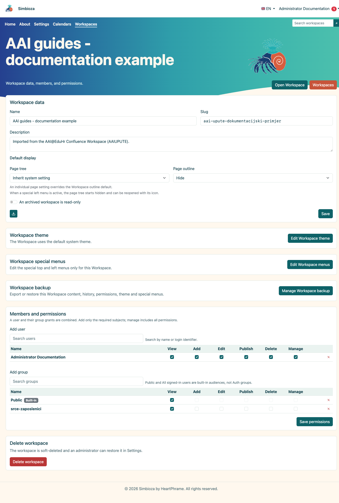

# Import aus Confluence

> Die Bildschirmaufnahmen zeigen die englische Benutzeroberfläche.

## Video: Umstellung von Confluence auf Simbioza

<video class="img-fluid rounded border w-100" controls src="images/3d2e536b-c610-44d6-a7d1-9109c83e198c.mp4" poster="images/7c772a1f-55e8-4f57-985d-ddd5dec554dc.png"></video>

Exportieren Sie einen Bereich, importieren Sie sein Archiv XML ZIP und überprüfen Sie das Ergebnis in Simbioza (3 Min. 46 Sek.). Erzählung in britischem Englisch und englische Bildunterschriften. Die integrierte Seitengliederung von Simbioza ersetzt das Inhaltsverzeichnis-Makro von Confluence. Das Video zeigt das Verstecken und Anzeigen.

Confluence Import überträgt einen Confluence Space XML ZIP Export in einen neuen oder vorhandenen Simbioza Arbeitsbereich. Der Workflow validiert das Archiv, wählt Inhalte aus, ordnet Benutzer und Gruppen zu und führt einen kontrollierten fortsetzbaren Job mit einem dauerhaften Bericht aus.

In diesem Handbuch wird ein echter AAI@EduHr-Confluence-Export auf einer separaten SQLite-Installation verwendet. Identitätsdaten werden aus den Screenshots ausgeschnitten. Es wurde ein nur aktueller Testimport durchgeführt, während die Variante mit aktivierter Historie als Vergleichskonfiguration angezeigt wird.

## Inhalt

1.  [Anforderungen und Exportvorbereitung](#requirements)
2.  [Preflight hochladen und archivieren](#preflight)
3.  [Aktuelle Seiten, Verlauf, Entwürfe und gelöschte Seiten](#options)
4.  [Benutzer- und Gruppenzuordnung](#mapping)
5.  [Import in einen vorhandenen oder neuen Arbeitsbereich wiederholen](#repeat)
6.  [Lauf, Fortschritt und Ergebnis](#run)
7.  [Überprüfung nach dem Import](#verify)

## 1. Anforderungen und Exportvorbereitung

- Exportieren Sie **einen Confluence-Bereich** als XML ZIP-Archiv.
- Extrahieren Sie das Archiv nicht vor dem Hochladen.
- Stellen Sie Speicherplatz für ZIP, temporäre Extraktion und privat gespeicherte Anhänge bereit.
- Legen Sie vor dem Import den Zielnamen, den Slug, die Sprache und die Identitätszuordnungsrichtlinie fest.
- Sichern Sie ein vorhandenes Ziel oder verwenden Sie ein neues Slug für einen Testimport.

Der Administrator öffnet **Einstellungen → Arbeitsbereiche → Confluence-Import**.

<figure class="my-4">

<figcaption>Der kontrollierte Workflow erklärt Upload, Preflight, Mapping und Archivaufbewahrung bis zum Abschluss.</figcaption>
</figure>

## 2. Preflight hochladen und archivieren

1.  Wählen Sie das Confluence-Archiv XML ZIP aus.
2.  Wählen Sie **Hochladen und validieren**.
3.  Überprüfen Sie den Namen/Schlüssel des Quellraums, die Confluence-Version, aktuelle und historische Seitenzahlen und Anhänge.
4.  Geben Sie den Namen des Zielarbeitsbereichs, den Slug und die Sprache des importierten Inhalts ein.

Preflight importiert keine Inhalte. Es validiert die Struktur, entdeckt optionale Teile und bereitet Zuordnungen vor. Das verwaltete temporäre Archiv wird nach erfolgreichem Abschluss oder explizitem Abbruch entfernt.

<figure class="my-4">

<figcaption>Der Administrator wählt den Zielnamen, den Slug und die Sprache, die Strategie für den wiederholten Import und ob Anhänge, Kommentare, Verlauf, gelöschte Seiten und Entwürfe einbezogen werden sollen. Benutzer- und Gruppenzuordnungen werden auf demselben Bildschirm geöffnet, bevor der Import beginnt.</figcaption>
</figure>

## 3. Aktuelle Seiten, Verlauf, Entwürfe und gelöschte Seiten

| Option | Verwenden Sie wann | Ergebnis |
|----|----|----|
| **Anhänge** | Bilder und Dateien sind Bestandteil der Dokumentation. | Aktuelle Dateien aller MIME-Typen werden privat gespeichert. |
| **Kommentare** | Kommentare haben dokumentarischen Wert und Autoren können zugeordnet werden. | Wird nur importiert, wenn sowohl Autor als auch Zielseite zugeordnet sind. |
| **Seitenverlauf** | Frühere veröffentlichte Versionen sind für die Prüfung oder Archivierung erforderlich. | Mehrere Versionen pro Seite; wesentlich mehr Arbeit und Speicherplatz. |
| **Gelöschte Seiten** | Administratoren müssen sie möglicherweise wiederherstellen. | Als vorläufig gelöschter Inhalt gespeichert. |
| **Entwürfe** | Der letzte unveröffentlichte Entwurf ist wertvoll. | Als Entwurf importiert, nicht automatisch veröffentlicht. |

### 3.1. Import ohne Verlauf

Bei einem Nur-Aktuell-Import wird die aktuell veröffentlichte Version jeder Seite übertragen. Es ist schneller und kleiner und eignet sich, wenn das Ziel eine aktive Dokumentation ist, während die historische Prüfung im Quellsystem oder einem separaten Archiv verbleibt.

<figure class="my-4">

<figcaption>Aktuelle Seiten, Anhänge und Kommentare werden ohne historische Versionen ausgewählt.</figcaption>
</figure>

### 3.2. Import mit Verlauf

Ein Historienimport überträgt auch zuvor veröffentlichte Versionen. Auf einer großen Fläche kann es die Laufzeit und den Speicher vervielfachen. Überprüfen Sie mehrere Seiten mit bekannten Änderungen und vergleichen Sie nach Abschluss die Anzahl der Versionen.

<figure class="my-4">

<figcaption>Der Seitenverlauf ist aktiviert. Auf demselben Bildschirm wird auch die Entscheidung zum wiederholten Import angezeigt.</figcaption>
</figure>

## 4. Benutzer- und Gruppenzuordnung

Eine Confluence-Identität darf nicht automatisch mit einem lokalen Konto verknüpft werden, nur weil die Namen ähnlich aussehen. Ordnen Sie jede Identität einem bestätigten vorhandenen Konto zu, lassen Sie sie nicht zugeordnet oder erstellen Sie explizit ein inaktives bereitgestelltes Konto.

<figure class="my-4">

<figcaption>Der erweiterte Abschnitt zeigt Quellidentitäten, Quellrollen und ihre Zielzuordnungen. Die Suche schränkt die Liste ein, während eine separate Kontrolle darüber entscheidet, ob nicht zugeordnete Identitäten inaktive Konten ohne Anmeldezugriff erstellen dürfen.</figcaption>
</figure>

- **Bestehender Benutzer**: Nur auswählen, wenn Sie dieselbe Person bestätigt haben.
- **Nicht zugeordnet**: Inhalte werden importiert, aber die Identität erhält keinen lokalen Zugriff.
- **Inaktiver Benutzer**: Erstellt ein Konto ohne Anmeldung, das ein Administrator später mit dem richtigen Anbieter verknüpfen oder gemäß den Organisationsrichtlinien aktivieren kann.

Eine Quellgruppe kann einer vorhandenen gewöhnlichen Gruppe zugeordnet werden, eine neue gewöhnliche Gruppe erstellen oder nicht zugeordnet bleiben. Mitgliedschaften und Verwaltungsrechte werden niemals allein aufgrund der Anerkennung einer Gruppe übernommen.

<figure class="my-4">

<figcaption>Der erweiterte Abschnitt zeigt jede Quellgruppe und ihr Ziel. Eine Gruppe kann einer vorhandenen gewöhnlichen Gruppe zugeordnet werden, eine neue gewöhnliche Gruppe erstellen oder nicht zugeordnet bleiben.</figcaption>
</figure>

## 5. Wiederholen Sie den Import in einen vorhandenen oder neuen Arbeitsbereich

- **Den vorhandenen importierten Arbeitsbereich ersetzen**: Entfernt dauerhaft den zuvor importierten Inhalt und importiert das neue Archiv. Sichern Sie es zunächst und stellen Sie sicher, dass keine manuell hinzugefügten Inhalte verloren gehen.
- **Bestehenden Arbeitsbereich beibehalten und eine neue Kopie importieren**: Der vorherige Import bleibt unverändert und es werden ein anderer Name und Slug verwendet. Bevorzugen Sie dies zum Vergleich.

## 6. Lauf, Fortschritt und Ergebnis

Wählen Sie **Arbeitsbereich importieren** erst aus, nachdem Sie den Ziel-Slug und die Zuordnungen bestätigt haben. Der Job wird in fortsetzbaren Schritten ausgeführt. Ein großer Raum kann einige Zeit dauern; Starten Sie dieselbe Aktion nicht erneut, nur weil sie nicht sofort abgeschlossen wird.

<figure class="my-4">

<figcaption>In der Tabelle „Letzte Importe“ werden der laufende Job und seine aktuelle Phase „Seiten importieren“ aufgezeichnet.</figcaption>
</figure>

Nachdem Sie zur Confluence-Import-Startseite zurückgekehrt sind, verwenden Sie die Tabelle **Letzte Confluence-Importe**, um den Auftragsstatus und die Phase zu überprüfen. Die Pfeilschaltfläche öffnet den ausgewählten Job erneut. Eine abgeschlossene Zeile zeigt auch eine separate Dokumentschaltfläche an; Wählen Sie es aus, um den dauerhaften Importbericht zu öffnen.

<figure class="my-4">

<figcaption>Eine abgeschlossene Zeile zeigt den Status „Abgeschlossen“ und eine Dokumentschaltfläche in der Spalte „Aktion“ an. Wählen Sie diese Schaltfläche aus, um den Bericht zu öffnen. Ein Job, der noch zum Mapping bereit ist, verfügt noch über keinen Bericht.</figcaption>
</figure>

<figure class="my-4">

<figcaption>Nach Auswahl der Schaltfläche „Dokument“ zeigt der Bericht 161 importierte aktuelle Seiten, 533 Anhänge und die Anzahl der Seiten an, die eine manuelle Überprüfung erfordern.</figcaption>
</figure>

<figure class="my-4">

<figcaption>Der abgeschlossene Import erscheint in der normalen Arbeitsbereichs-Verwaltung und kann wie jeder andere Arbeitsbereich geöffnet werden.</figcaption>
</figure>

## 7. Überprüfung nach dem Import

1.  Öffnen Sie die Startseite und mehrere tiefe Äste.
2.  Überprüfen Sie interne/externe Links, Anhänge, Bilder, Tabellen und Codeblöcke.
3.  Öffnen Sie den dauerhaften Bericht unter **Letzte Confluence-Importe**. Nicht unterstützte Makros bleiben eindeutig als statischer Inhalt gekennzeichnet, der eine manuelle Überprüfung erfordert.
4.  Vergleichen Sie die aktuelle Seitenzahl und, falls ausgewählt, die bisherige Versionszahl.
5.  Testen Sie die Zuordnung von ACL und Gruppen als normaler Benutzer, nicht nur als Administrator.
6.  Erstellen Sie den Suchindex neu, wenn importierte Inhalte nicht sofort erkennbar sind.
7.  Löschen Sie die Testkopie oder planen Sie den Austausch des Ziels erst nach der Abnahme.

Der Import konvertiert Inhalte, kann jedoch nicht automatisch die Organisationsidentität, die Bedeutung jedes benutzerdefinierten Makros oder die beabsichtigte Wirkung älterer ACL-Regeln nachweisen. Diese Entscheidungen erfordern eine Überprüfung durch den Administrator.

