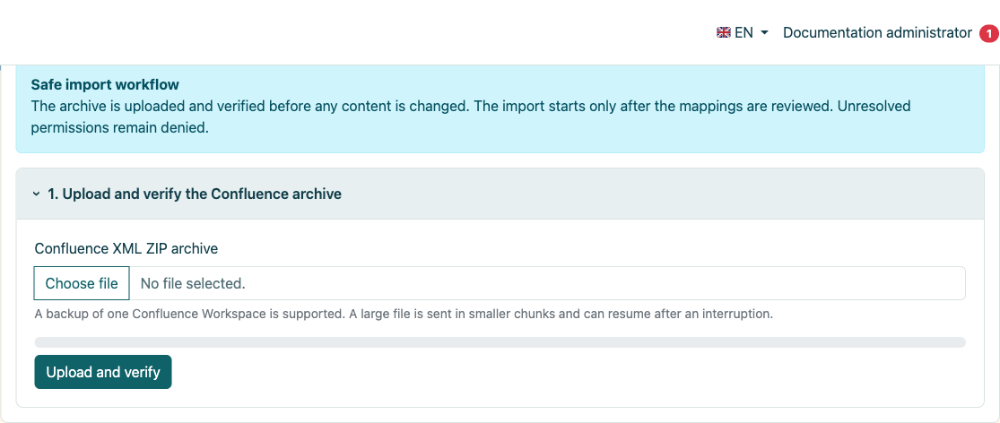
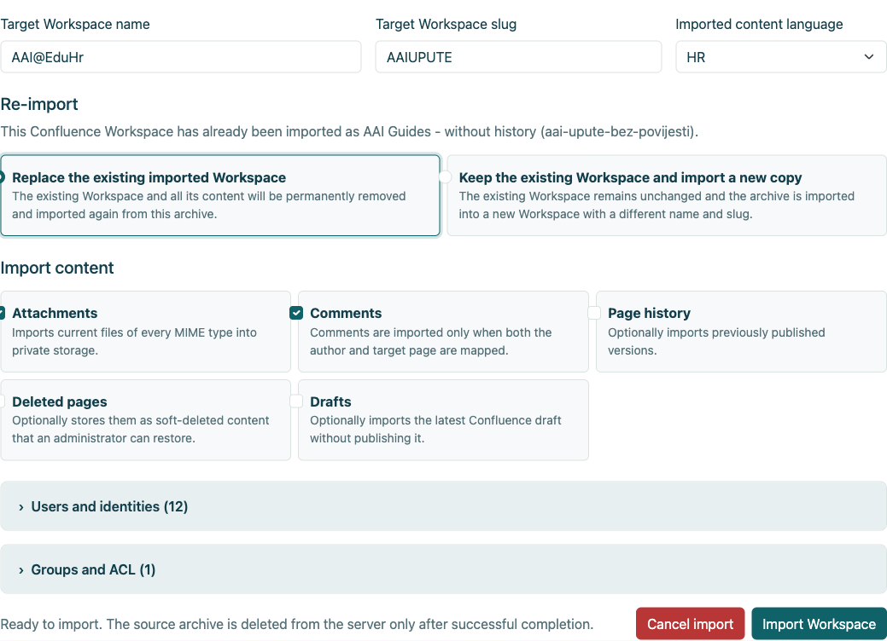
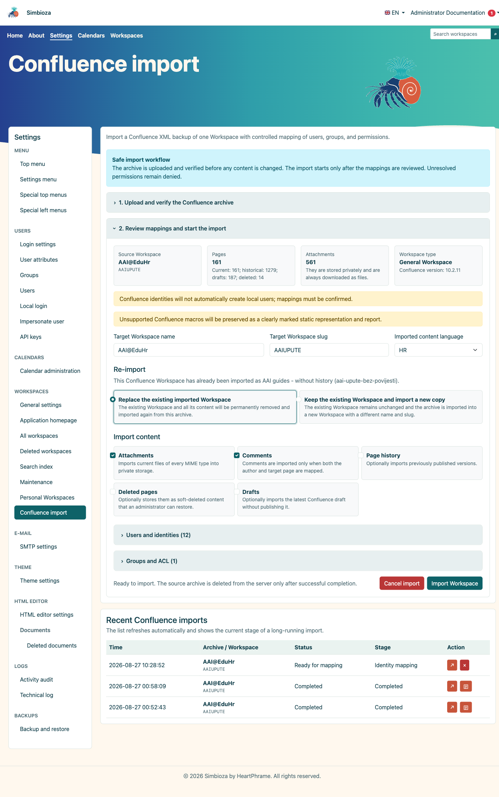
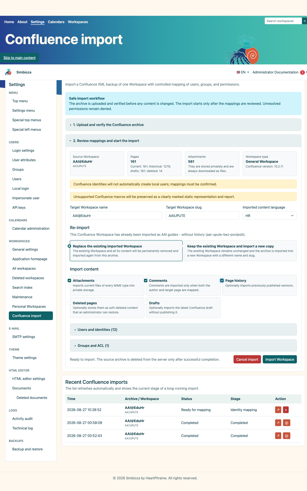
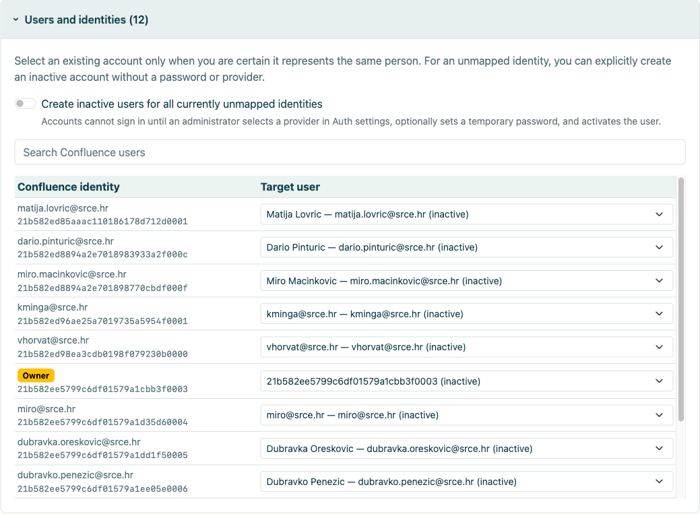
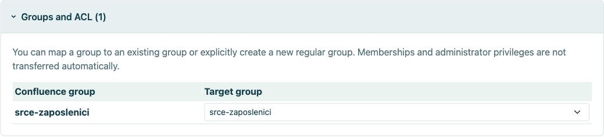
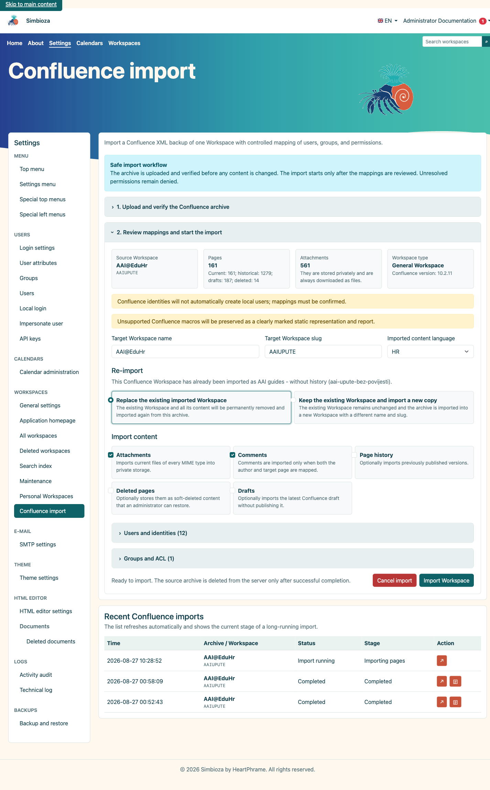
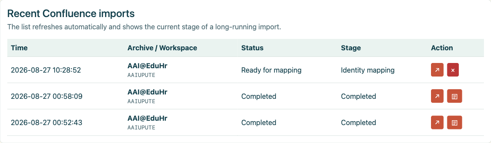
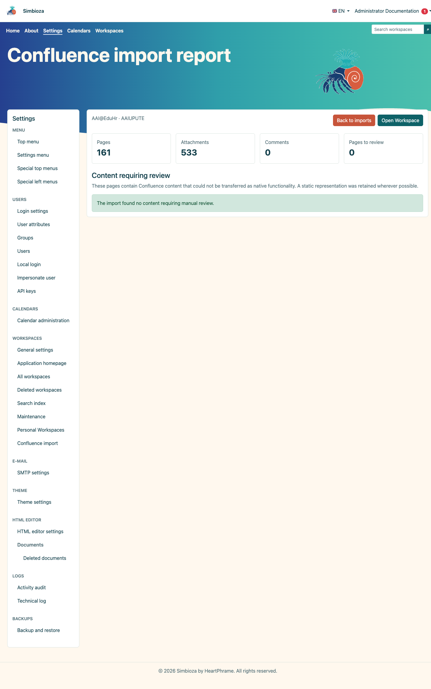
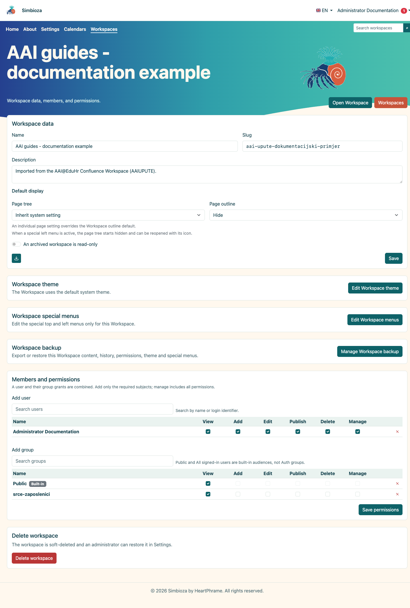

# Confluence import

## Video: moving from Confluence to Simbioza

<video class="img-fluid rounded border w-100" controls src="images/3d2e536b-c610-44d6-a7d1-9109c83e198c.mp4" poster="images/7c772a1f-55e8-4f57-985d-ddd5dec554dc.png"></video>

Export a space, import its XML ZIP archive, and inspect the result in Simbioza (3 min 46 sec). British English narration and English captions. Simbioza’s built-in page outline replaces Confluence’s table-of-contents macro; the video shows hiding and displaying it.

Confluence Import transfers one Confluence space XML ZIP export into a new or existing Simbioza Workspace. The workflow validates the archive, selects content, maps users and groups, and runs a controlled resumable job with a durable report.

This guide uses a real AAI@EduHr Confluence export on a separate SQLite installation. Identity data is cropped from the screenshots. A current-only trial import was completed, while the history-enabled variant is shown as a comparison configuration.

## Contents

1.  [Requirements and export preparation](#requirements)
2.  [Upload and archive preflight](#preflight)
3.  [Current pages, history, drafts and deleted pages](#options)
4.  [User and group mapping](#mapping)
5.  [Repeat import into an existing or new Workspace](#repeat)
6.  [Run, progress and result](#run)
7.  [Post-import verification](#verify)

## 1. Requirements and export preparation

- Export **one Confluence space** as an XML ZIP archive.
- Do not extract the archive before upload.
- Provide storage for the ZIP, temporary extraction and privately stored attachments.
- Decide the target name, slug, language and identity-mapping policy before import.
- Back up an existing target or use a new slug for a trial import.

The administrator opens **Settings → Workspaces → Confluence import**.

<figure class="my-4">

<figcaption>The controlled workflow explains upload, preflight, mapping and archive retention until completion.</figcaption>
</figure>

## 2. Upload and archive preflight

1.  Select the Confluence XML ZIP archive.
2.  Select **Upload and validate**.
3.  Review the source space name/key, Confluence version, current and historical page counts and attachments.
4.  Enter the target Workspace name, slug and imported content language.

Preflight does not import content. It validates structure, discovers optional parts and prepares mappings. The managed temporary archive is removed after successful completion or explicit cancellation.

<figure class="my-4">

<figcaption>The administrator chooses the target name, slug and language, the repeat-import strategy, and whether to include attachments, comments, history, deleted pages and drafts. User and group mappings are opened from the same screen before the import starts.</figcaption>
</figure>

## 3. Current pages, history, drafts and deleted pages

| Option | Use when | Result |
|----|----|----|
| **Attachments** | Images and files are part of the documentation. | Current files of all MIME types are stored privately. |
| **Comments** | Comments have documentary value and authors can be mapped. | Imported only when both author and target page are mapped. |
| **Page history** | Earlier published versions are required for audit or archive. | Multiple versions per page; substantially more work and storage. |
| **Deleted pages** | Administrators may need to recover them. | Stored as soft-deleted content. |
| **Drafts** | The last unpublished draft is valuable. | Imported as a draft, not automatically published. |

### 3.1. Import without history

A current-only import transfers the current published version of each page. It is faster and smaller, and is appropriate when the target is active documentation while historical audit remains in the source system or a separate archive.

<figure class="my-4">

<figcaption>Current pages, attachments and comments are selected without historical versions.</figcaption>
</figure>

### 3.2. Import with history

A history import also transfers previous published versions. On a large space it may multiply runtime and storage. Verify several pages with known changes and compare version counts after completion.

<figure class="my-4">

<figcaption>Page history is enabled; the same screen also shows the repeat-import decision.</figcaption>
</figure>

## 4. User and group mapping

A Confluence identity must not be automatically linked to a local account merely because the names look similar. Map each identity to a confirmed existing account, leave it unmapped or explicitly create an inactive staged account.

<figure class="my-4">

<figcaption>The expanded section shows source identities, source roles and their target mappings. Search narrows the list, while a separate control decides whether unmapped identities may create inactive accounts without login access.</figcaption>
</figure>

- **Existing user**: select only when you have confirmed the same person.
- **Unmapped**: content is imported, but the identity receives no local access.
- **Inactive user**: creates a non-login account that an administrator can later link to the correct provider or activate under organisational policy.

A source group may map to an existing ordinary group, create a new ordinary group or remain unmapped. Memberships and administrative rights are never assumed merely because a group was recognised.

<figure class="my-4">

<figcaption>The expanded section shows each source group and its destination. A group can map to an existing ordinary group, create a new ordinary group or remain unmapped.</figcaption>
</figure>

## 5. Repeat import into an existing or new Workspace

- **Replace the existing imported Workspace**: permanently removes the previous imported content and imports the new archive. Back it up first and confirm no manually added content would be lost.
- **Keep the existing Workspace and import a new copy**: leaves the previous import unchanged and uses a different name and slug. Prefer this for comparison.

## 6. Run, progress and result

Select **Import Workspace** only after confirming the target slug and mappings. The job runs in resumable steps. A large space may take time; do not restart the same action just because it does not finish immediately.

<figure class="my-4">

<figcaption>The recent-imports table records the running job and its current Importing pages phase.</figcaption>
</figure>

After returning to the Confluence Import start page, use the **Recent Confluence imports** table to check the job status and stage. The arrow button reopens the selected job. A completed row also shows a separate document button; select it to open the durable import report.

<figure class="my-4">

<figcaption>A completed row shows the Completed status and a document button in the Action column. Select that button to open the report; a job that is still ready for mapping does not yet have a report.</figcaption>
</figure>

<figure class="my-4">

<figcaption>After selecting the document button, the report shows 161 imported current pages, 533 attachments and the number of pages requiring manual review.</figcaption>
</figure>

<figure class="my-4">

<figcaption>The completed import appears in normal Workspace management and can be opened like any other Workspace.</figcaption>
</figure>

## 7. Post-import verification

1.  Open the home page and several deep tree branches.
2.  Check internal/external links, attachments, images, tables and code blocks.
3.  Open the durable report under **Recent Confluence imports**. Unsupported macros remain clearly marked static content requiring manual review.
4.  Compare current page counts and, when selected, historical version counts.
5.  Test mapped ACL and groups as an ordinary user, not only as an administrator.
6.  Rebuild the search index when imported content is not immediately discoverable.
7.  Delete the trial copy or plan target replacement only after acceptance.

Import converts content, but cannot automatically prove organisational identity, the meaning of every custom macro or the intended effect of legacy ACL rules. Those decisions require administrator review.

