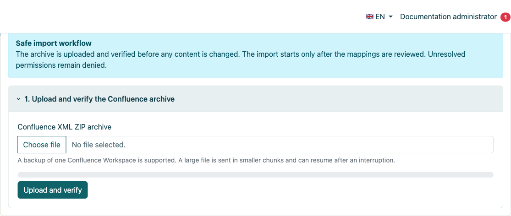
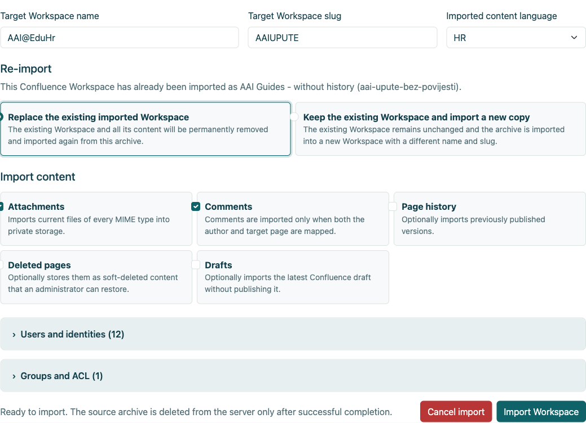
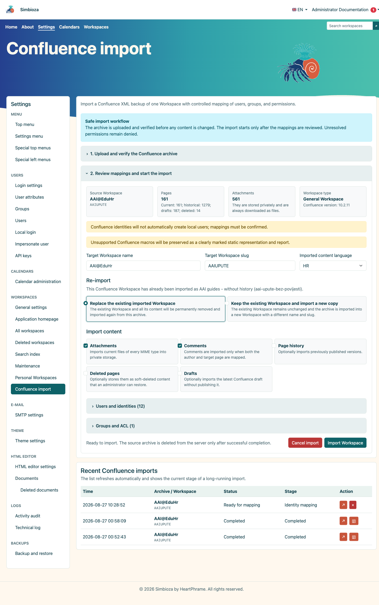
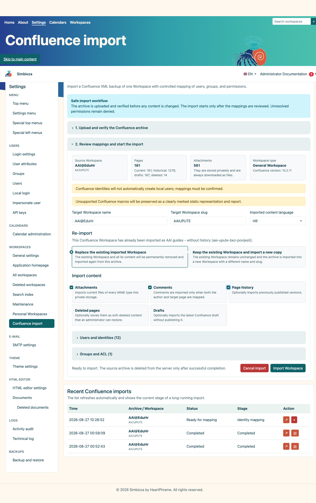
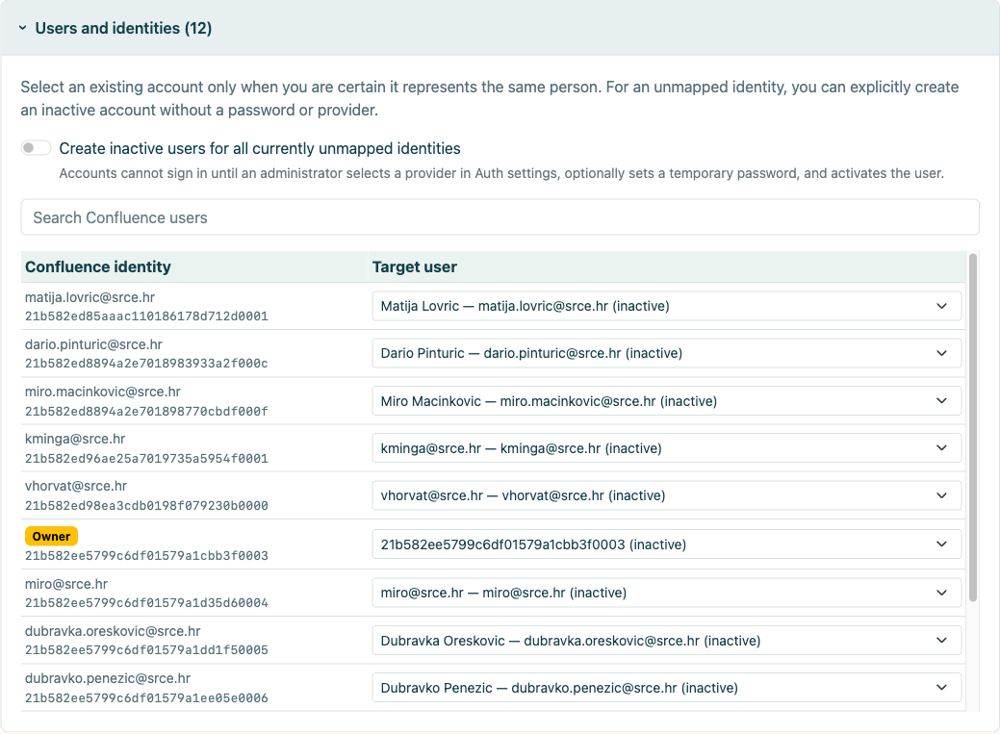
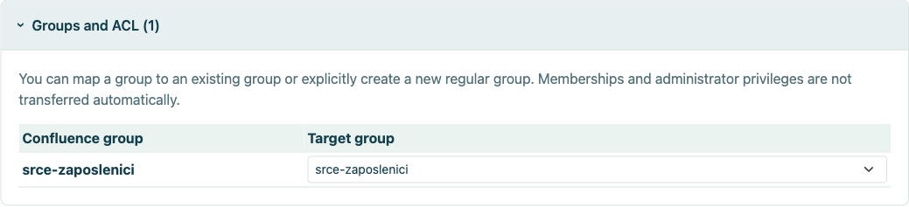
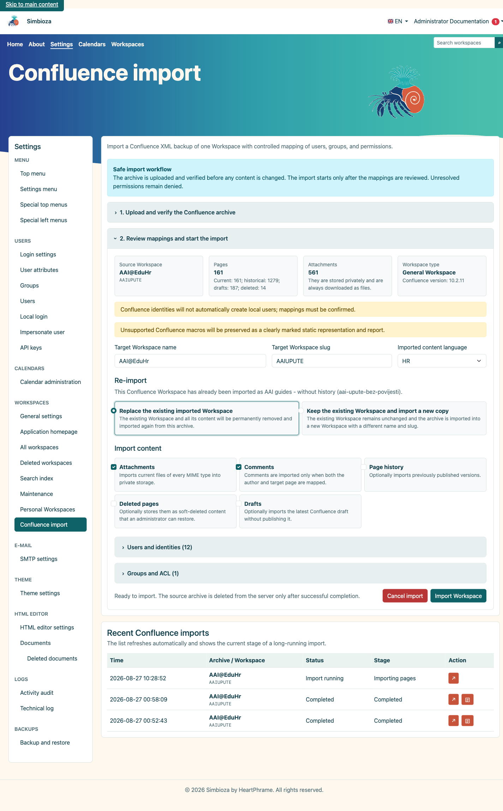
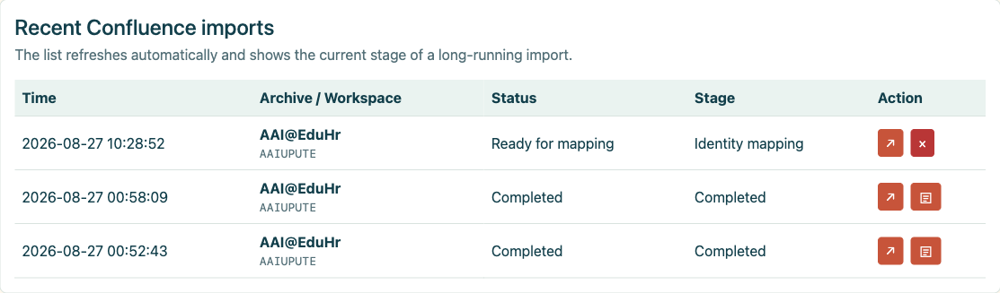
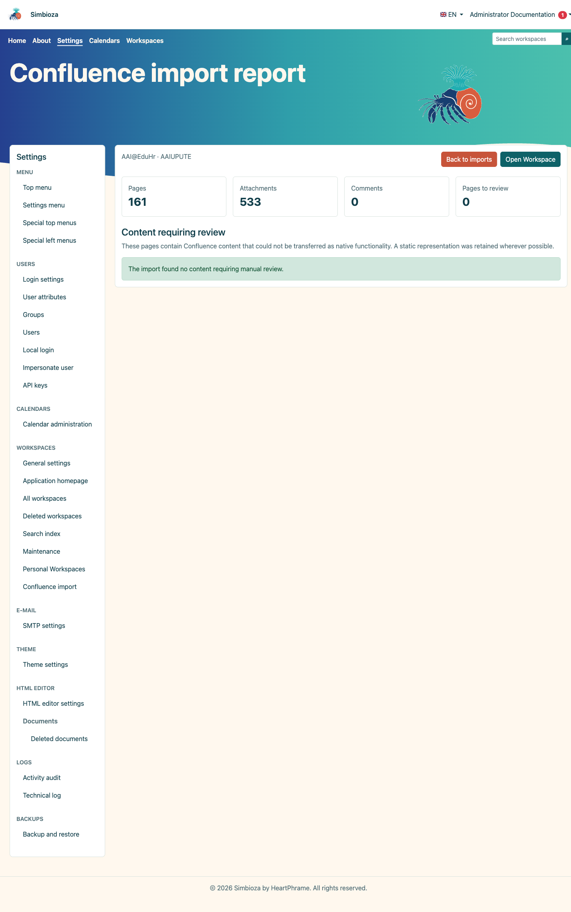
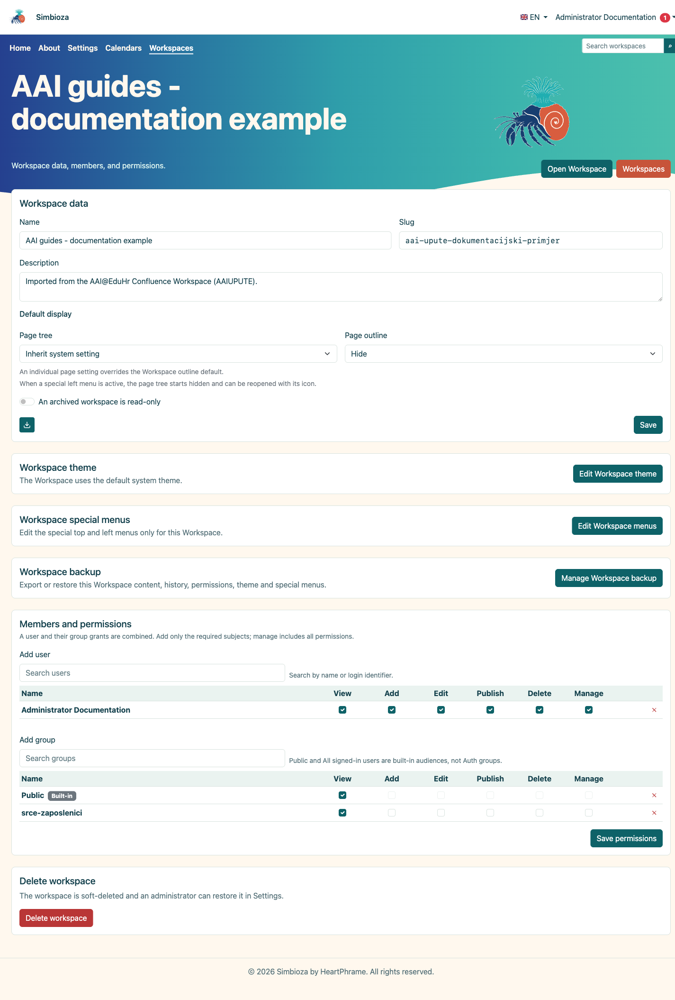

# Importar desde Confluence

> Las capturas de pantalla muestran la interfaz en inglés.

## Vídeo: pasar de Confluence a Simbioza

<video class="img-fluid rounded border w-100" controls src="images/3d2e536b-c610-44d6-a7d1-9109c83e198c.mp4" poster="images/7c772a1f-55e8-4f57-985d-ddd5dec554dc.png"></video>

Exporte un espacio, importe su archivo XML ZIP e inspeccione el resultado en Simbioza (3 min 46 seg). Narración en inglés británico y subtítulos en inglés. El esquema de página integrado de Simbioza reemplaza la macro de tabla de contenido de Confluence; el video muestra ocultándolo y mostrándolo.

Confluence Import transfiere un espacio de Confluence XML ZIP exportado a un espacio de trabajo Simbioza nuevo o existente. El flujo de trabajo valida el archivo, selecciona contenido, asigna usuarios y grupos y ejecuta un trabajo reanudable controlado con un informe duradero.

Esta guía utiliza una exportación real de AAI@EduHr Confluence en una instalación SQLite separada. Los datos de identidad se recortan de las capturas de pantalla. Se completó una importación de prueba solo actual, mientras que la variante con historial habilitado se muestra como una configuración de comparación.

## Contenido

1.  [Requisitos y preparación para la exportación](#requirements)
2.  [Cargar y archivar verificación previa](#preflight)
3.  [Páginas actuales, historial, borradores y páginas eliminadas](#options)
4.  [Mapeo de usuarios y grupos](#mapping)
5.  [Repetir importación en un espacio de trabajo nuevo o existente](#repeat)
6.  [Ejecución, progreso y resultado](#run)
7.  [Verificación posterior a la importación](#verify)

## 1. Requisitos y preparación para la exportación

- Exporte **un espacio de Confluence** como un archivo XML ZIP.
- No extraiga el archivo antes de cargarlo.
- Proporcione almacenamiento para ZIP, extracción temporal y archivos adjuntos almacenados de forma privada.
- Decida el nombre de destino, el slug, el idioma y la política de mapeo de identidad antes de importar.
- Haga una copia de seguridad de un objetivo existente o utilice un nuevo slug para una importación de prueba.

El administrador abre **Configuración → Espacios de trabajo → Importación de Confluence**.

<figure class="my-4">

<figcaption>El flujo de trabajo controlado explica la carga, la verificación previa, el mapeo y la retención de archivos hasta su finalización.</figcaption>
</figure>

## 2. Cargar y archivar la verificación previa

1.  Seleccione el archivo Confluence XML ZIP.
2.  Seleccione **Cargar y validar**.
3.  Revise el nombre/clave del espacio de origen, la versión de Confluence, el recuento de páginas actual e histórica y los archivos adjuntos.
4.  Ingrese el nombre del espacio de trabajo de destino, el slug y el idioma del contenido importado.

La verificación previa no importa contenido. Valida la estructura, descubre piezas opcionales y prepara mapeos. El archivo temporal administrado se elimina después de una finalización exitosa o una cancelación explícita.

<figure class="my-4">

<figcaption>El administrador elige el nombre de destino, el slug y el idioma, la estrategia de repetición de importación y si se incluyen archivos adjuntos, comentarios, historial, páginas eliminadas y borradores. Las asignaciones de usuarios y grupos se abren desde la misma pantalla antes de que comience la importación.</figcaption>
</figure>

## 3. Páginas actuales, historial, borradores y páginas eliminadas.

| Opción | Usar cuando | Resultado |
|----|----|----|
| **Adjuntos** | Imágenes y archivos son parte de la documentación. | Los archivos actuales de todos los tipos MIME se almacenan de forma privada. |
| **Comentarios** | Los comentarios tienen valor documental y los autores pueden ser mapeados. | Se importa solo cuando se asignan tanto el autor como la página de destino. |
| **Historial de la página** | Se requieren versiones publicadas anteriormente para auditoría o archivo. | Múltiples versiones por página; sustancialmente más trabajo y almacenamiento. |
| **Páginas eliminadas** | Es posible que los administradores necesiten recuperarlos. | Almacenado como contenido eliminado temporalmente. |
| **Damas** | El último borrador inédito es valioso. | Importado como borrador, no publicado automáticamente. |

### 3.1. Importar sin historial

Una importación solo actual transfiere la versión publicada actual de cada página. Es más rápido y más pequeño, y es apropiado cuando el objetivo es la documentación activa mientras la auditoría histórica permanece en el sistema fuente o en un archivo separado.

<figure class="my-4">

<figcaption>Las páginas actuales, archivos adjuntos y comentarios se seleccionan sin versiones históricas.</figcaption>
</figure>

### 3.2. Importar con historial

Una importación de historial también transfiere versiones publicadas anteriormente. En un espacio grande, puede multiplicar el tiempo de ejecución y el almacenamiento. Verifique varias páginas con cambios conocidos y compare el recuento de versiones una vez finalizado.

<figure class="my-4">

<figcaption>El historial de páginas está habilitado; la misma pantalla también muestra la decisión de repetir la importación.</figcaption>
</figure>

## 4. Mapeo de usuarios y grupos

Una identidad de Confluence no debe vincularse automáticamente a una cuenta local simplemente porque los nombres parecen similares. Asigne cada identidad a una cuenta existente confirmada, déjela sin asignar o cree explícitamente una cuenta provisional inactiva.

<figure class="my-4">

<figcaption>La sección ampliada muestra las identidades de origen, los roles de origen y sus asignaciones de destino. La búsqueda reduce la lista, mientras que un control separado decide si las identidades no asignadas pueden crear cuentas inactivas sin acceso de inicio de sesión.</figcaption>
</figure>

- **Usuario existente**: seleccione solo cuando haya confirmado a la misma persona.
- **Sin asignar**: el contenido se importa, pero la identidad no recibe acceso local.
- **Usuario inactivo**: crea una cuenta sin inicio de sesión que un administrador puede vincular posteriormente al proveedor correcto o activar según la política organizacional.

Un grupo de origen puede asignarse a un grupo ordinario existente, crear un nuevo grupo ordinario o permanecer sin asignar. La membresía y los derechos administrativos nunca se asumen simplemente porque un grupo fue reconocido.

<figure class="my-4">

<figcaption>La sección ampliada muestra cada grupo de origen y su destino. Un grupo puede asignarse a un grupo ordinario existente, crear un nuevo grupo ordinario o permanecer sin asignar.</figcaption>
</figure>

## 5. Repita la importación en un espacio de trabajo nuevo o existente

- **Reemplazar el espacio de trabajo importado existente**: elimina permanentemente el contenido importado anterior e importa el nuevo archivo. Primero haga una copia de seguridad y confirme que no se perderá ningún contenido agregado manualmente.
- **Mantener el espacio de trabajo existente e importar una nueva copia**: deja la importación anterior sin cambios y usa un nombre y slug diferentes. Prefiero esto para comparar.

## 6. Carrera, progreso y resultado.

Seleccione **Importar espacio de trabajo** solo después de confirmar el slug y las asignaciones de destino. El trabajo se ejecuta en pasos reanudables. Un espacio grande puede llevar tiempo; No reinicie la misma acción sólo porque no finaliza inmediatamente.

<figure class="my-4">

<figcaption>La tabla de importaciones recientes registra el trabajo en ejecución y su fase actual de importación de páginas.</figcaption>
</figure>

Después de regresar a la página de inicio de Confluence Import, use la tabla **Importaciones recientes de Confluence** para verificar el estado y la etapa del trabajo. El botón de flecha vuelve a abrir el trabajo seleccionado. Una fila completa también muestra un botón de documento separado; selecciónelo para abrir el informe de importación duradera.

<figure class="my-4">

<figcaption>Una fila completa muestra el estado Completado y un botón de documento en la columna Acción. Seleccione ese botón para abrir el informe; un trabajo que todavía está listo para el mapeo aún no tiene un informe.</figcaption>
</figure>

<figure class="my-4">

<figcaption>Después de seleccionar el botón de documento, el informe muestra 161 páginas actuales importadas, 533 archivos adjuntos y la cantidad de páginas que requieren revisión manual.</figcaption>
</figure>

<figure class="my-4">

<figcaption>La importación completada aparece en la gestión normal del espacio de trabajo y se puede abrir como cualquier otro espacio de trabajo.</figcaption>
</figure>

## 7. Verificación posterior a la importación

1.  Abra la página de inicio y varias ramas de árboles profundas.
2.  Consulte enlaces internos/externos, archivos adjuntos, imágenes, tablas y bloques de código.
3.  Abra el informe duradero en **Importaciones recientes de Confluence**. Las macros no compatibles siguen siendo contenido estático claramente marcado que requiere revisión manual.
4.  Compare los recuentos de páginas actuales y, cuando se seleccione, los recuentos de versiones históricas.
5.  Pruebe mapeó ACL y grupos como un usuario normal, no solo como administrador.
6.  Reconstruya el índice de búsqueda cuando el contenido importado no sea detectable de inmediato.
7.  Elimine la copia de prueba o planifique el reemplazo de destino solo después de la aceptación.

La importación convierte el contenido, pero no puede probar automáticamente la identidad de la organización, el significado de cada macro personalizada o el efecto previsto de las reglas heredadas ACL. Esas decisiones requieren la revisión del administrador.

