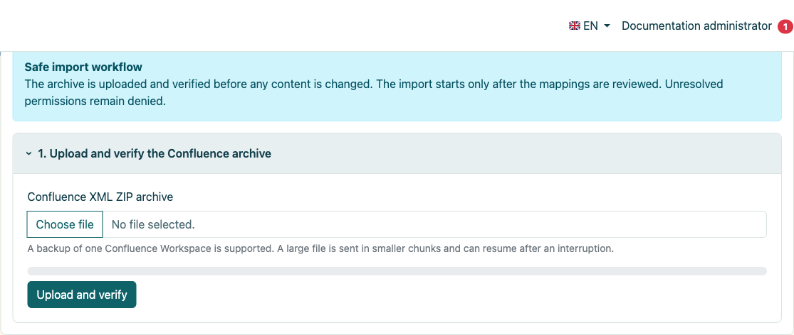
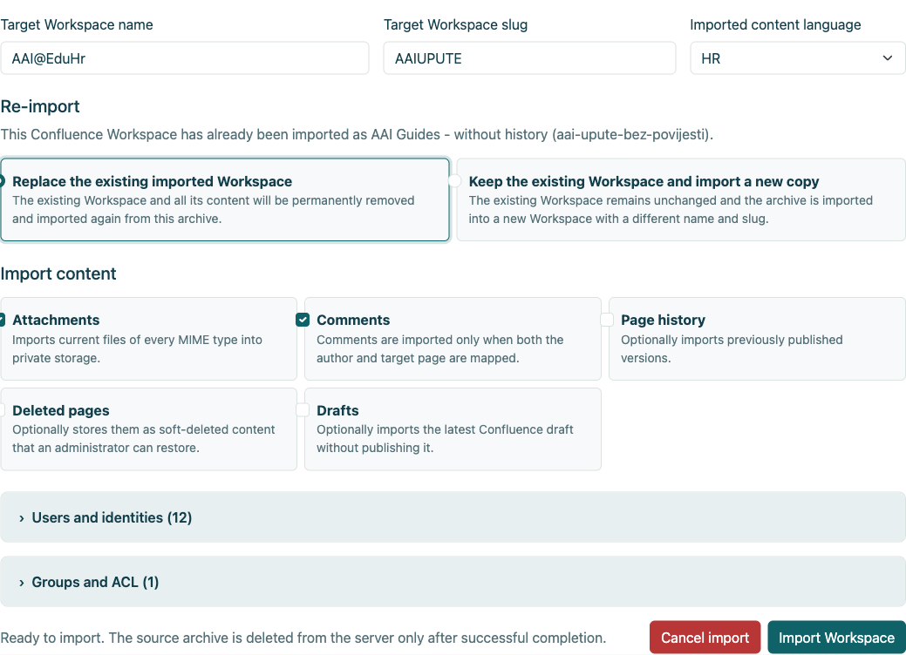
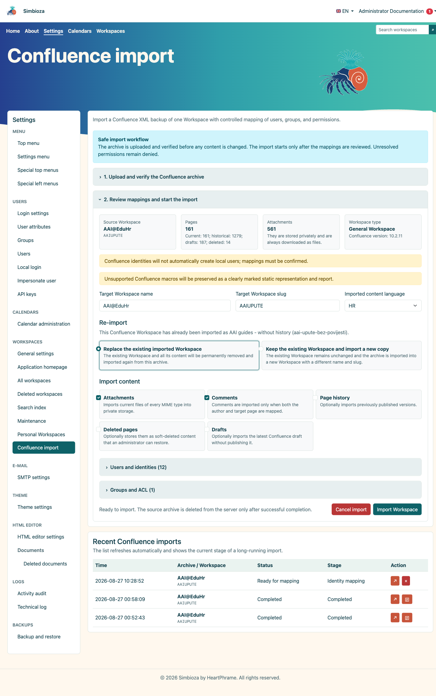
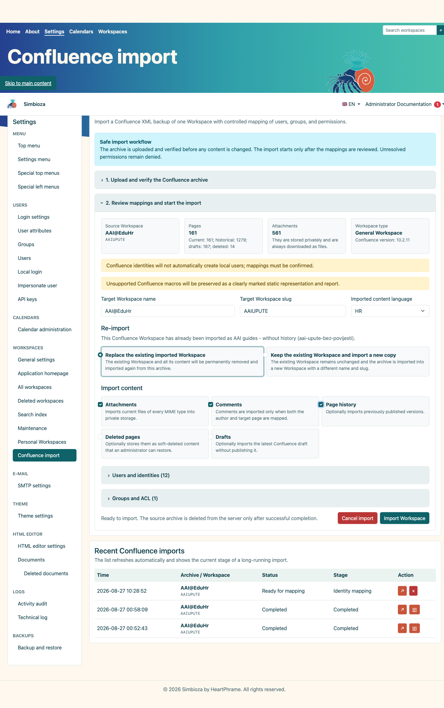
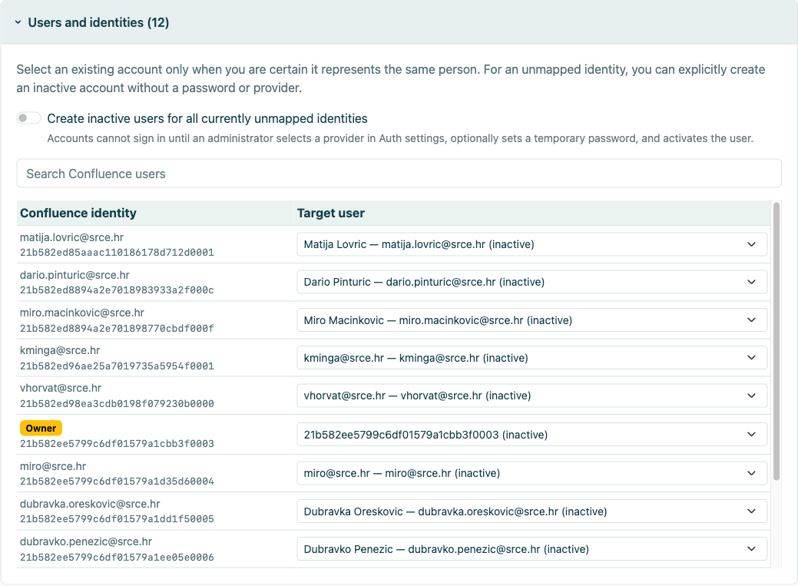
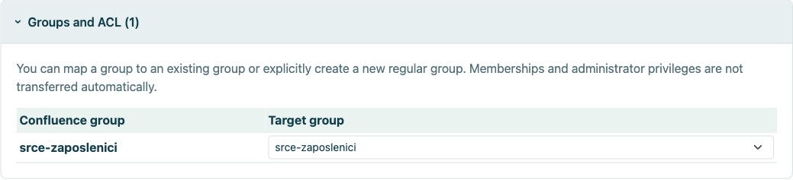
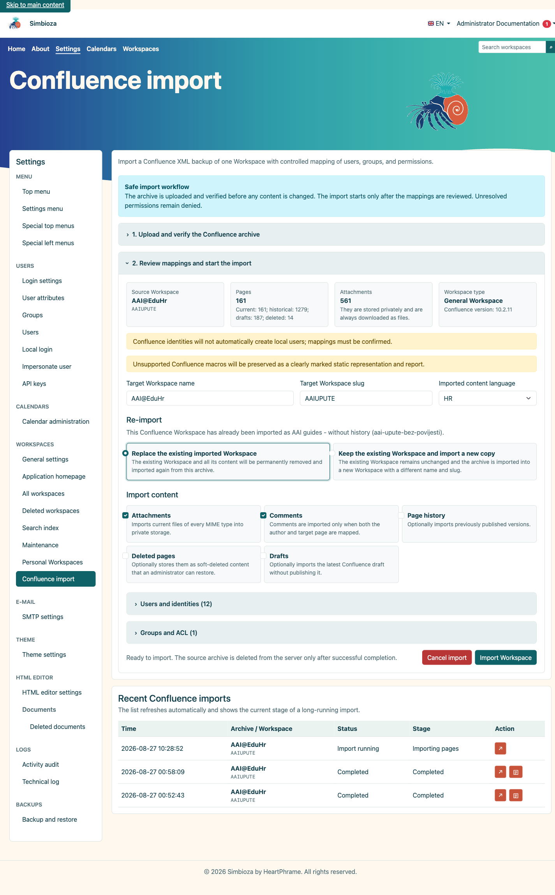
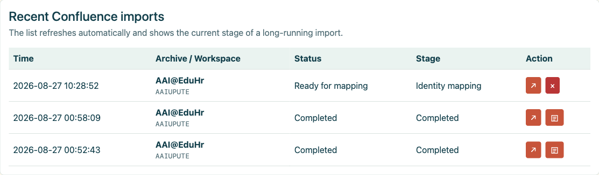
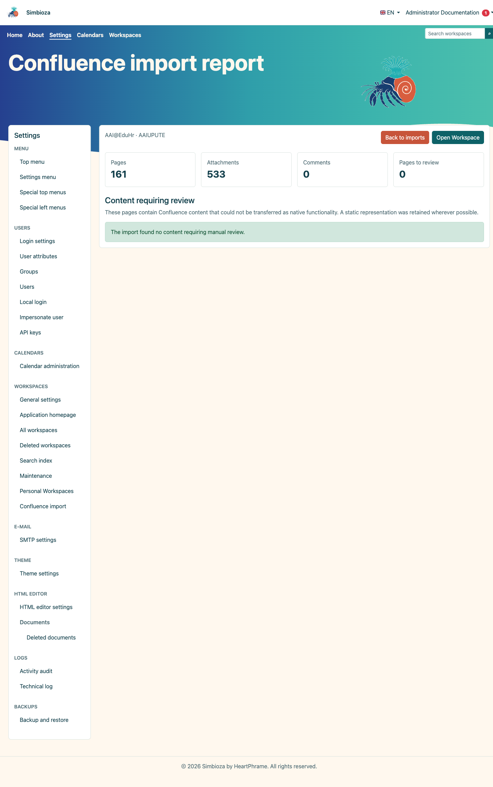
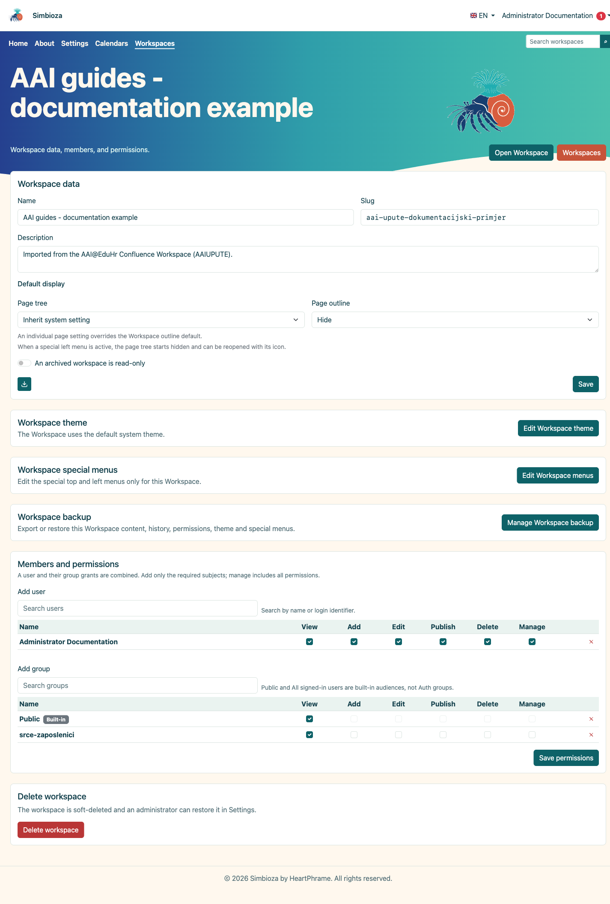

# Importer depuis Confluence

> Les captures d’écran présentent l’interface en anglais.

## Vidéo : passer de Confluence à Simbioza

<video class="img-fluid rounded border w-100" controls src="images/3d2e536b-c610-44d6-a7d1-9109c83e198c.mp4" poster="images/7c772a1f-55e8-4f57-985d-ddd5dec554dc.png"></video>

Exportez un espace, importez son archive XML ZIP et inspectez le résultat dans Simbioza (3 min 46 sec). Narration en anglais britannique et légendes en anglais. Le plan de page intégré de Simbioza remplace la macro de table des matières de Confluence ; la vidéo montre le cacher et l'afficher.

Confluence Import transfère une exportation XML ZIP d'espace Confluence vers un espace de travail Simbioza nouveau ou existant. Le flux de travail valide l'archive, sélectionne le contenu, mappe les utilisateurs et les groupes et exécute une tâche contrôlée avec reprise avec un rapport durable.

Ce guide utilise un véritable export AAI@EduHr Confluence sur une installation SQLite distincte. Les données d'identité sont recadrées des captures d'écran. Une importation d'essai actuelle uniquement a été effectuée, tandis que la variante compatible avec l'historique est affichée comme configuration de comparaison.

## Contenu

1.  [Exigences et préparation à l'exportation](#requirements)
2.  [Télécharger et archiver le contrôle en amont](#preflight)
3.  [Pages actuelles, historique, brouillons et pages supprimées](#options)
4.  [Mappage des utilisateurs et des groupes](#mapping)
5.  [Répéter l'importation dans un espace de travail existant ou nouveau](#repeat)
6.  [Exécution, progression et résultat](#run)
7.  [Vérification après importation](#verify)

## 1. Exigences et préparation à l'exportation

- Exportez **un espace Confluence** en tant qu'archive XML ZIP.
- N'extrayez pas l'archive avant le téléchargement.
- Assurer le stockage du ZIP, l'extraction temporaire et les pièces jointes stockées en privé.
- Décidez du nom de la cible, du slug, de la langue et de la politique de mappage d'identité avant l'importation.
- Sauvegardez une cible existante ou utilisez un nouveau slug pour une importation d'essai.

L'administrateur ouvre **Paramètres → Espaces de travail → Importation Confluence**.

<figure class="my-4">

<figcaption>Le flux de travail contrôlé explique le téléchargement, le contrôle en amont, le mappage et la conservation des archives jusqu'à la fin.</figcaption>
</figure>

## 2. Télécharger et archiver le contrôle en amont

1.  Sélectionnez l'archive Confluence XML ZIP.
2.  Sélectionnez **Télécharger et valider**.
3.  Vérifiez le nom/la clé de l'espace source, la version de Confluence, le nombre de pages actuel et historique et les pièces jointes.
4.  Entrez le nom de l'espace de travail cible, le slug et la langue du contenu importé.

Le contrôle en amont n'importe pas de contenu. Il valide la structure, découvre les parties facultatives et prépare les mappages. L'archive temporaire gérée est supprimée après une exécution réussie ou une annulation explicite.

<figure class="my-4">

<figcaption>L'administrateur choisit le nom de la cible, le slug et la langue, la stratégie de répétition d'importation et s'il doit inclure les pièces jointes, les commentaires, l'historique, les pages supprimées et les brouillons. Les mappages d'utilisateurs et de groupes sont ouverts à partir du même écran avant le démarrage de l'importation.</figcaption>
</figure>

## 3. Pages actuelles, historique, brouillons et pages supprimées

| Option | Utiliser quand | Résultat |
|----|----|----|
| **Pièces jointes** | Les images et les fichiers font partie de la documentation. | Les fichiers actuels de tous les types MIME sont stockés en privé. |
| **Commentaires** | Les commentaires ont une valeur documentaire et les auteurs peuvent être cartographiés. | Importé uniquement lorsque l'auteur et la page cible sont mappés. |
| **Historique des pages** | Les versions publiées antérieures sont requises pour l'audit ou l'archivage. | Plusieurs versions par page ; beaucoup plus de travail et de stockage. |
| **Pages supprimées** | Les administrateurs devront peut-être les récupérer. | Stocké en tant que contenu supprimé de manière logicielle. |
| **Brouillons** | La dernière version inédite est précieuse. | Importé en tant que brouillon, non publié automatiquement. |

### 3.1. Importer sans historique

Une importation actuelle uniquement transfère la version publiée actuelle de chaque page. Il est plus rapide et plus petit, et convient lorsque la cible est une documentation active tandis que l'audit historique reste dans le système source ou dans une archive distincte.

<figure class="my-4">

<figcaption>Les pages actuelles, les pièces jointes et les commentaires sont sélectionnés sans versions historiques.</figcaption>
</figure>

### 3.2. Importer avec historique

Une importation d'historique transfère également les versions publiées précédentes. Sur un grand espace, cela peut multiplier la durée d'exécution et le stockage. Vérifiez plusieurs pages avec des modifications connues et comparez le nombre de versions une fois terminées.

<figure class="my-4">

<figcaption>L'historique des pages est activé ; le même écran affiche également la décision de réimportation.</figcaption>
</figure>

## 4. Cartographie des utilisateurs et des groupes

Une identité Confluence ne doit pas être automatiquement liée à un compte local simplement parce que les noms se ressemblent. Mappez chaque identité à un compte existant confirmé, laissez-la non mappée ou créez explicitement un compte intermédiaire inactif.

<figure class="my-4">

<figcaption>La section développée affiche les identités sources, les rôles sources et leurs mappages cibles. La recherche réduit la liste, tandis qu'un contrôle distinct décide si les identités non mappées peuvent créer des comptes inactifs sans accès à la connexion.</figcaption>
</figure>

- **Utilisateur existant** : sélectionnez uniquement lorsque vous avez confirmé la même personne.
- **Non mappé** : le contenu est importé, mais l'identité ne reçoit aucun accès local.
- **Utilisateur inactif** : crée un compte sans connexion qu'un administrateur peut ultérieurement lier au bon fournisseur ou activer conformément à la politique de l'organisation.

Un groupe source peut être mappé à un groupe ordinaire existant, créer un nouveau groupe ordinaire ou rester non mappé. Les adhésions et les droits administratifs ne sont jamais acquis simplement parce qu'un groupe a été reconnu.

<figure class="my-4">

<figcaption>La section développée affiche chaque groupe source et sa destination. Un groupe peut être mappé à un groupe ordinaire existant, créer un nouveau groupe ordinaire ou rester non mappé.</figcaption>
</figure>

## 5. Répétez l'importation dans un espace de travail existant ou nouveau

- **Remplacer l'espace de travail importé existant** : supprime définitivement le contenu importé précédent et importe la nouvelle archive. Sauvegardez-le d’abord et confirmez qu’aucun contenu ajouté manuellement ne sera perdu.
- **Conservez l'espace de travail existant et importez une nouvelle copie** : laisse l'importation précédente inchangée et utilise un nom et un slug différents. Préférez ceci pour comparaison.

## 6. Course, progression et résultat

Sélectionnez **Importer un espace de travail** uniquement après avoir confirmé le slug cible et les mappages. Le travail s'exécute par étapes pouvant être reprises. Un grand espace peut prendre du temps ; ne relancez pas la même action simplement parce qu’elle ne se termine pas immédiatement.

<figure class="my-4">

<figcaption>Le tableau des importations récentes enregistre le travail en cours d'exécution et sa phase d'importation de pages en cours.</figcaption>
</figure>

Après être revenu à la page de démarrage de Confluence Import, utilisez le tableau **Importations Confluence récentes** pour vérifier l'état et l'étape de la tâche. Le bouton fléché rouvre le travail sélectionné. Une ligne complétée affiche également un bouton de document distinct ; sélectionnez-le pour ouvrir le rapport d'importation durable.

<figure class="my-4">

<figcaption>Une ligne terminée affiche le statut Terminé et un bouton de document dans la colonne Action. Sélectionnez ce bouton pour ouvrir le rapport ; une tâche encore prête pour le mappage n'a pas encore de rapport.</figcaption>
</figure>

<figure class="my-4">

<figcaption>Après avoir sélectionné le bouton Document, le rapport affiche 161 pages actuelles importées, 533 pièces jointes et le nombre de pages nécessitant une révision manuelle.</figcaption>
</figure>

<figure class="my-4">

<figcaption>L'importation terminée apparaît dans la gestion normale de l'espace de travail et peut être ouverte comme n'importe quel autre espace de travail.</figcaption>
</figure>

## 7. Vérification après importation

1.  Ouvrez la page d'accueil et plusieurs branches d'arbres profondes.
2.  Vérifiez les liens internes/externes, les pièces jointes, les images, les tableaux et les blocs de code.
3.  Ouvrez le rapport durable sous **Importations Confluence récentes**. Les macros non prises en charge restent un contenu statique clairement marqué nécessitant une révision manuelle.
4.  Comparez le nombre de pages actuelles et, lorsque cette option est sélectionnée, le nombre de versions historiques.
5.  Testez les ACL et les groupes mappés en tant qu'utilisateur ordinaire, et pas seulement en tant qu'administrateur.
6.  Reconstruisez l'index de recherche lorsque le contenu importé n'est pas immédiatement détectable.
7.  Supprimez la copie d'essai ou planifiez le remplacement de la cible uniquement après acceptation.

L'importation convertit le contenu, mais ne peut pas prouver automatiquement l'identité de l'organisation, la signification de chaque macro personnalisée ou l'effet attendu des règles ACL héritées. Ces décisions nécessitent un examen par l'administrateur.

