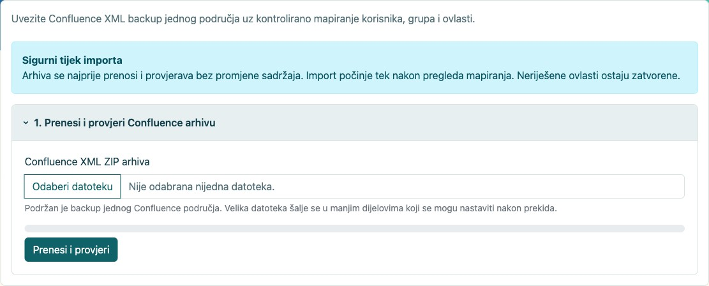
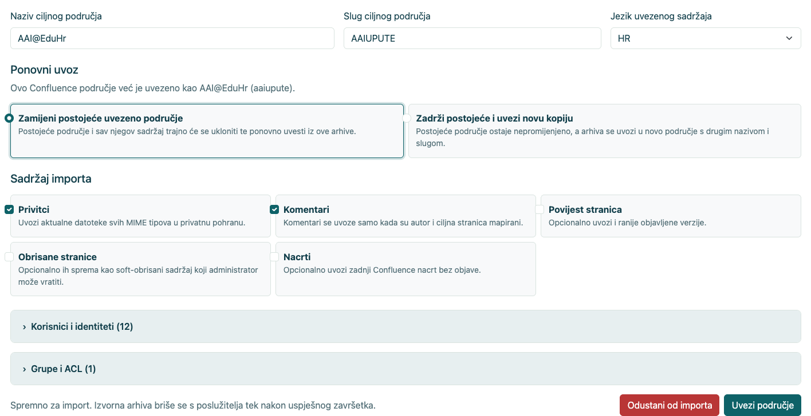
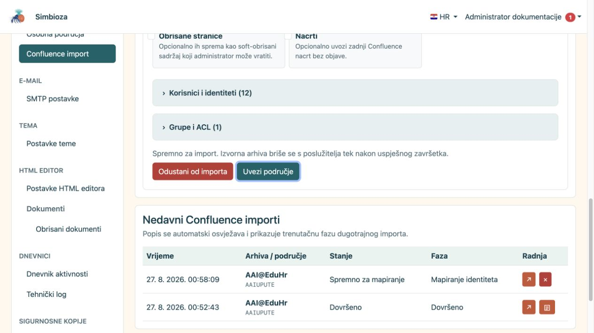
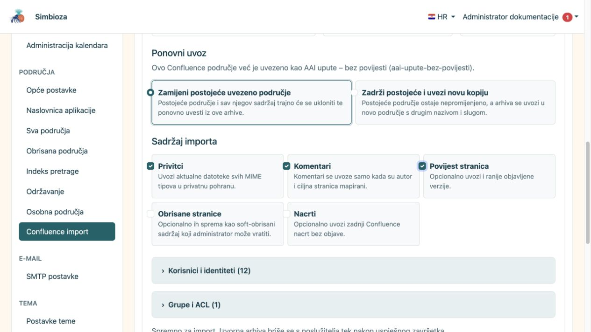
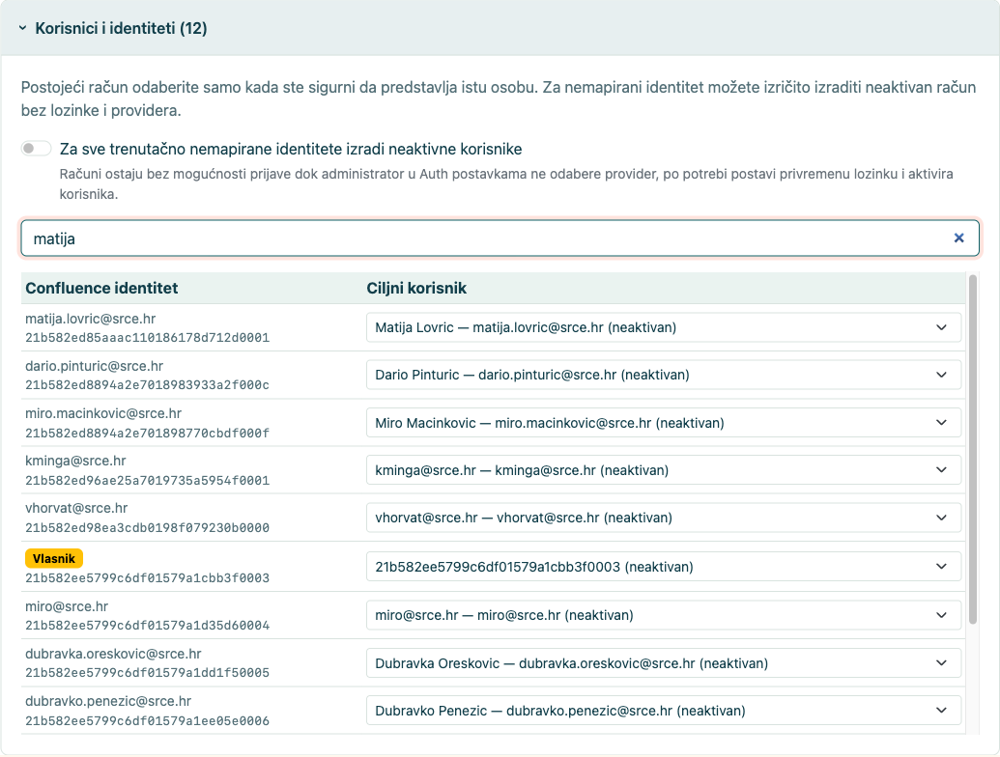
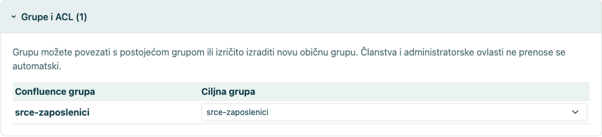
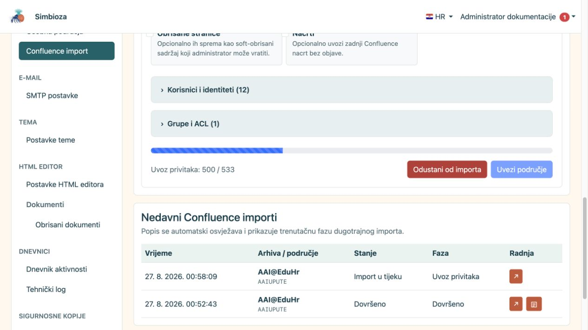
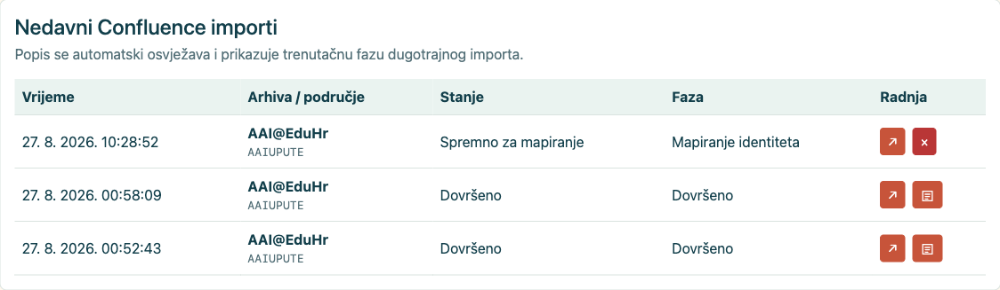
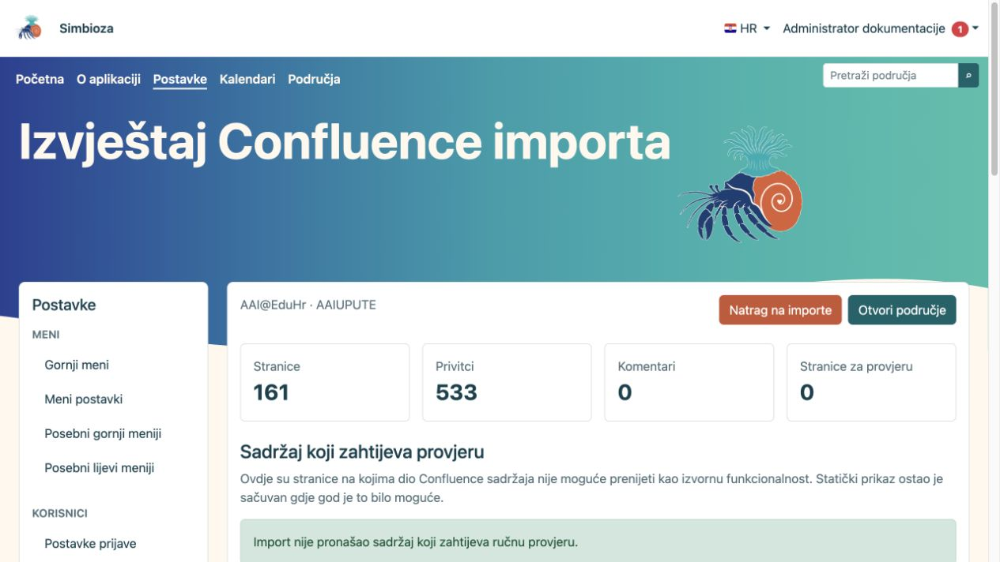
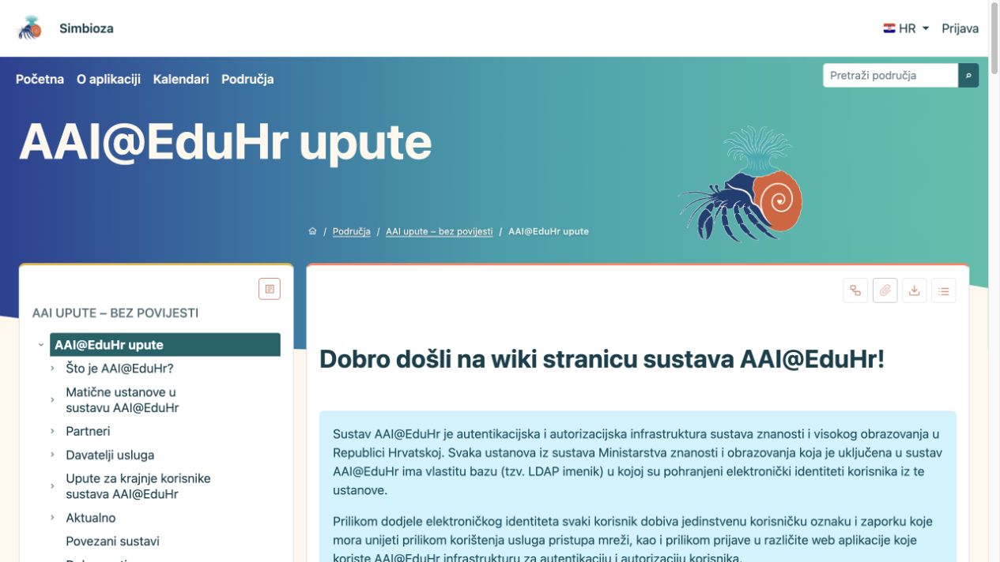

# Confluence import

## Video: prijelaz iz Confluencea u Simbiozu

<video class="img-fluid rounded border w-100" controls src="images/3d2e536b-c610-44d6-a7d1-9109c83e198c.mp4" poster="images/7c772a1f-55e8-4f57-985d-ddd5dec554dc.png"></video>

Izvoz područja, uvoz XML ZIP arhive i pregled rezultata u Simbiozi (3 min 46 s). Naracija i titlovi su na engleskom. Ugrađeno kazalo Simbioze zamjenjuje Confluenceov makro za kazalo; video pokazuje njegovo skrivanje i prikazivanje.

Confluence import prenosi jedan XML ZIP izvoz Confluence prostora u novo ili postojeće Simbioza područje. Uvoz se provodi kroz provjeru arhive, izbor sadržaja, mapiranje korisnika i grupa te kontrolirani, nastavljivi posao s trajnim izvještajem.

Ova uputa koristi stvarni AAI@EduHr Confluence izvoz na zasebnoj SQLite instalaciji. Podaci identiteta na snimkama su skriveni ili izrezani. Uvoz je dovršen u probno područje bez povijesti, a varijanta s poviješću prikazana je kao usporedna konfiguracija.

## Sadržaj

1.  [Preduvjeti i priprema izvoza](#preduvjeti)
2.  [Prijenos i provjera arhive](#provjera)
3.  [Aktualne stranice, povijest, nacrti i brisane stranice](#opcije)
4.  [Mapiranje korisnika i grupa](#identiteti)
5.  [Ponovni uvoz u postojeće ili novo područje](#ponovni)
6.  [Pokretanje, napredak i rezultat](#pokretanje)
7.  [Provjera nakon uvoza](#provjera-nakon)

## 1. Preduvjeti i priprema izvoza

- U Confluenceu izvezite **jedan prostor** u XML ZIP formatu.
- Ne raspakiravajte arhivu prije prijenosa.
- Provjerite slobodan prostor za ZIP, privremeno raspakiravanje i privatno pohranjene privitke.
- Pripremite odluku o ciljnom nazivu, slugu, jeziku i načinu mapiranja identiteta.
- Za veći uvoz prvo napravite backup ciljnog područja ili odaberite novi slug.

Import je administratorska funkcija u **Postavke → Područja → Confluence import**.

<figure class="my-4">

<figcaption>Sigurni tijek objašnjava prijenos, provjeru, mapiranje i zadržavanje arhive do uspješnog završetka.</figcaption>
</figure>

## 2. Prijenos i provjera arhive

1.  Odaberite XML ZIP arhivu.
2.  Odaberite **Prenesi i provjeri**.
3.  Provjerite naziv i ključ izvornog prostora, Confluence verziju, broj aktualnih i povijesnih stranica te broj privitaka.
4.  Upišite naziv i slug ciljnog područja te jezik sadržaja.

Preflight ne uvozi sadržaj. On provjerava strukturu, utvrđuje dostupne dijelove izvoza i priprema mapiranja. Izvorna arhiva u upravljanoj privremenoj pohrani briše se nakon uspješnog završetka ili odustajanja.

<figure class="my-4">

<figcaption>Administrator određuje naziv, slug i jezik ciljnog područja, način ponovnog uvoza te hoće li uključiti privitke, komentare, povijest, obrisane stranice i nacrte. Isti ekran otvara mapiranja korisnika i grupa prije pokretanja importa.</figcaption>
</figure>

## 3. Aktualne stranice, povijest, nacrti i brisane stranice

| Opcija | Kada je uključiti | Rezultat |
|----|----|----|
| **Privitci** | Kad su slike i datoteke dio dokumentacije. | Aktualne datoteke svih MIME tipova spremaju se u privatnu pohranu. |
| **Komentari** | Kad komentari imaju dokumentacijsku vrijednost i autori se mogu mapirati. | Uvoze se samo uz mapiranog autora i ciljnu stranicu. |
| **Povijest stranica** | Kad morate sačuvati ranije objavljene verzije radi revizije ili arhive. | Uvozi se više verzija po stranici; posao i baza bit će znatno veći. |
| **Obrisane stranice** | Kad želite zadržati mogućnost administratorskog vraćanja. | Spremaju se kao soft-obrisani sadržaj. |
| **Nacrti** | Kad neobjavljeni zadnji nacrt ima vrijednost. | Uvozi se kao nacrt bez automatske objave. |

### 3.1. Uvoz bez povijesti

Uvoz bez povijesti prenosi samo aktualnu objavljenu verziju svake stranice. Brži je, zauzima manje prostora i pogodan je kada je cilj živa dokumentacija, a audit starih verzija ostaje u izvornom sustavu ili zasebnoj arhivi.

<figure class="my-4">

<figcaption>Aktualne stranice, privitci i komentari odabrani su bez povijesnih verzija.</figcaption>
</figure>

### 3.2. Uvoz s poviješću

Uvoz s poviješću prenosi i ranije objavljene verzije. Na velikom prostoru može višestruko povećati trajanje i veličinu podataka. Nakon uvoza provjerite nekoliko stranica s poznatim izmjenama i usporedite broj verzija.

<figure class="my-4">

<figcaption>Opcija Povijest stranica je uključena; isti ekran prikazuje i odluku o ponovnom uvozu izvornog prostora.</figcaption>
</figure>

## 4. Mapiranje korisnika i grupa

Confluence identitet ne smije se automatski povezati s lokalnim korisnikom samo na temelju sličnog imena. Svaki identitet treba povezati s potvrđenim postojećim računom, ostaviti nemapiranim ili izričito pretvoriti u neaktivan predračun.

<figure class="my-4">

<figcaption>Otvoreni odjeljak prikazuje izvorne identitete, njihove uloge i ciljno mapiranje. Pretraživanje sužava popis, a zasebna kontrola određuje smiju li se za nemapirane identitete izraditi neaktivni računi bez prava prijave.</figcaption>
</figure>

- **Postojeći korisnik**: odaberite samo kada ste sigurni da je riječ o istoj osobi.
- **Nije mapirano**: sadržaj se uvozi, ali identitet ne dobiva lokalni pristup.
- **Neaktivan korisnik**: kreira se račun bez aktivne prijave; administrator ga kasnije može povezati s odgovarajućim providerom ili aktivirati prema pravilima organizacije.

Grupe se mogu povezati s postojećom običnom grupom, izraditi kao nova obična grupa ili ostaviti nemapirane. Članstva i administratorske ovlasti ne prenose se automatski samo zato što je grupa prepoznata.

<figure class="my-4">

<figcaption>Otvoreni odjeljak prikazuje svaku izvornu grupu i odredište. Grupu je moguće povezati s postojećom običnom grupom, izraditi kao novu ili ostaviti bez mapiranja.</figcaption>
</figure>

## 5. Ponovni uvoz u postojeće ili novo područje

Kada je isti Confluence prostor već uvezen, preflight nudi dvije jasne mogućnosti:

- **Zamijeni postojeće uvezeno područje**: postojeći uvezeni sadržaj trajno se uklanja i zamjenjuje novim uvozom. Prije toga napravite backup i provjerite da u području nema ručno dodanog sadržaja koji nije u izvozu.
- **Zadrži postojeće i uvezi novu kopiju**: postojeće područje ostaje nepromijenjeno, a novi se uvoz sprema pod drugim nazivom i slugom. To je sigurniji izbor za usporedbu.

## 6. Pokretanje, napredak i rezultat

Odaberite **Uvezi područje** tek nakon što su mapiranja i ciljni slug potvrđeni. Posao se obrađuje u koracima i može nastaviti bez ponovnog prijenosa cijele arhive. Nemojte zatvarati ili ponavljati akciju samo zato što veći prostor traje dulje.

<figure class="my-4">

<figcaption>Popis nedavnih importa bilježi aktivni posao i njegovu trenutačnu fazu uvoza stranica.</figcaption>
</figure>

Po povratku na početni ekran Confluence importa u tablici **Nedavni Confluence importi** provjerite stanje i fazu posla. Gumb sa strelicom otvara tijek odabranog posla. Na dovršenom poslu pojavljuje se i zaseban gumb s ikonom dokumenta; njime se otvara trajni izvještaj importa.

<figure class="my-4">

<figcaption>Dovršeni redak prikazuje stanje Dovršeno i gumb s ikonom dokumenta u stupcu Radnja. Odaberite tu ikonu za otvaranje izvještaja; redak koji je još spreman za mapiranje nema izvještaj.</figcaption>
</figure>

<figure class="my-4">

<figcaption>Nakon odabira ikone dokumenta izvještaj prikazuje 161 uvezenu aktualnu stranicu, 533 privitka i broj stranica koje zahtijevaju ručnu provjeru.</figcaption>
</figure>

<figure class="my-4">

<figcaption>Rezultat se otvara kao obično Simbioza područje sa stablom i objavljenim dokumentima.</figcaption>
</figure>

## 7. Provjera nakon uvoza

1.  Otvorite početnu stranicu i nekoliko dubokih grana stabla.
2.  Provjerite interne i vanjske poveznice, privitke, slike, tablice i oznake koda.
3.  Pregledajte trajni izvještaj pod **Nedavni Confluence importi**. Nepodržani makroi ostaju jasno označen statični sadržaj i zahtijevaju ručni pregled.
4.  Usporedite broj aktualnih stranica i, ako je uključena, broj povijesnih verzija.
5.  Provjerite ACL i mapirane grupe kao obični korisnik, ne samo kao administrator.
6.  Ponovno izgradite indeks pretrage ako uvezeni sadržaj nije odmah pronađen.
7.  Tek nakon prihvaćanja rezultata obrišite probnu kopiju ili planirajte zamjenu ciljnog područja.

Import pretvara sadržaj, ali ne može automatski potvrditi organizacijski identitet, ispravnost svih prilagođenih makroa ni namjeru starih ACL pravila. Ta tri dijela zahtijevaju administratorsku odluku i provjeru.

