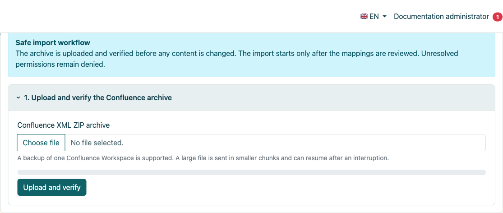
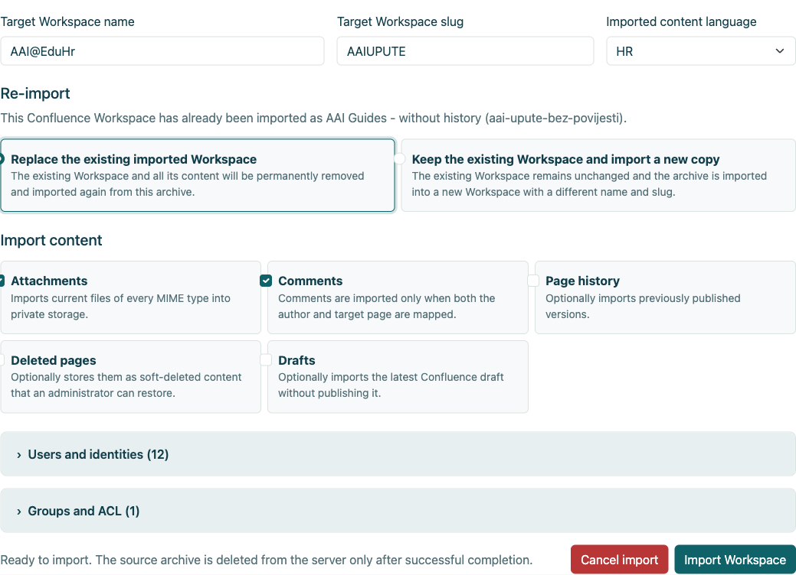
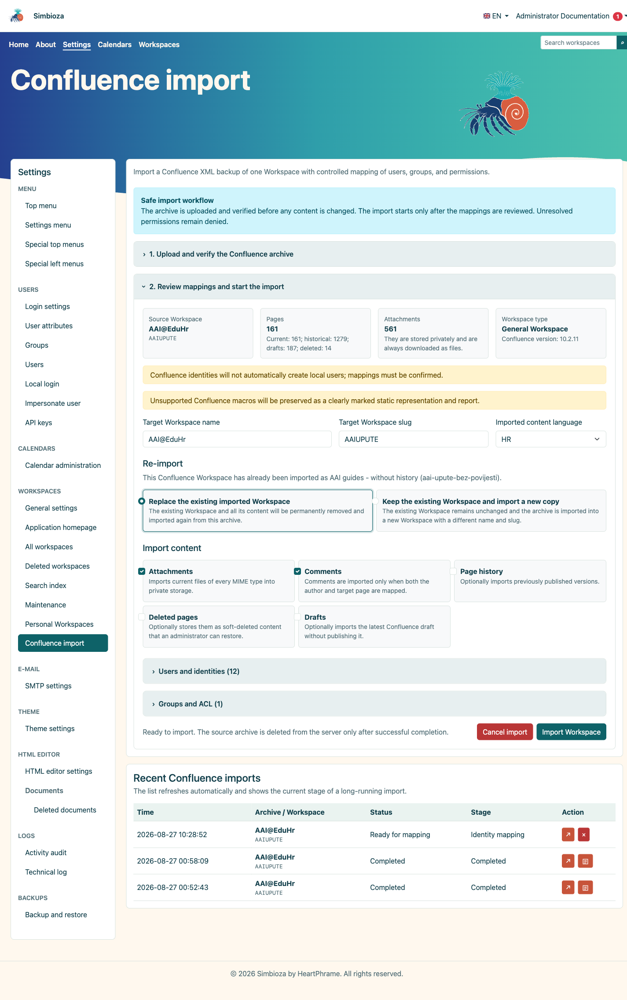
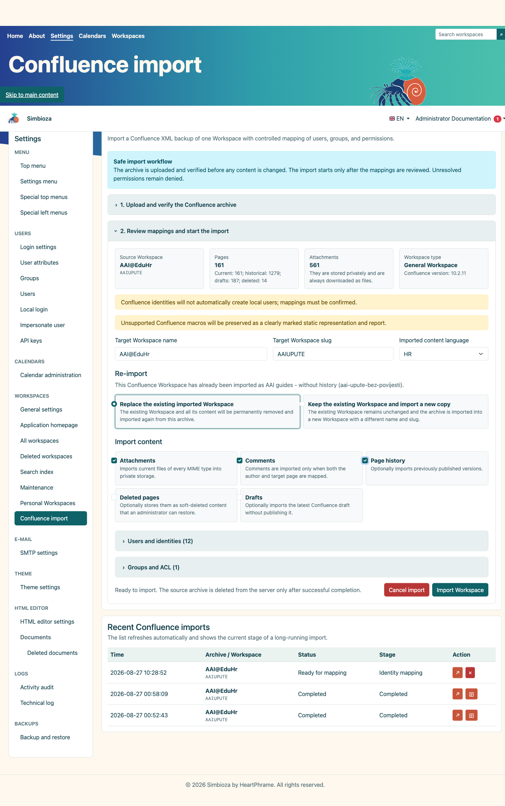
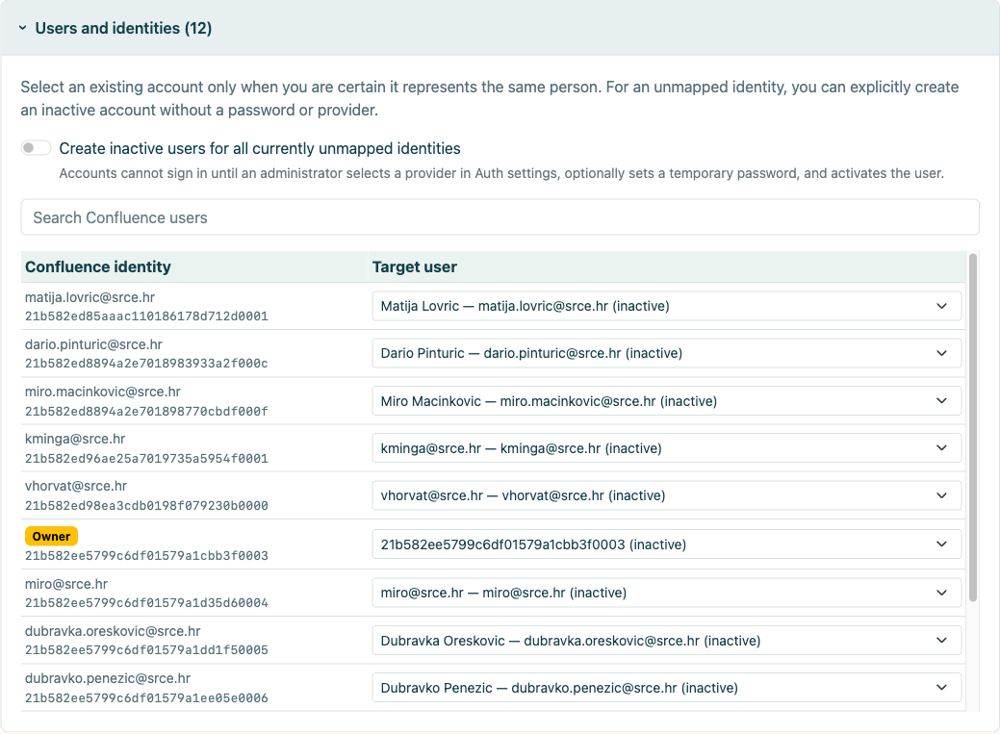
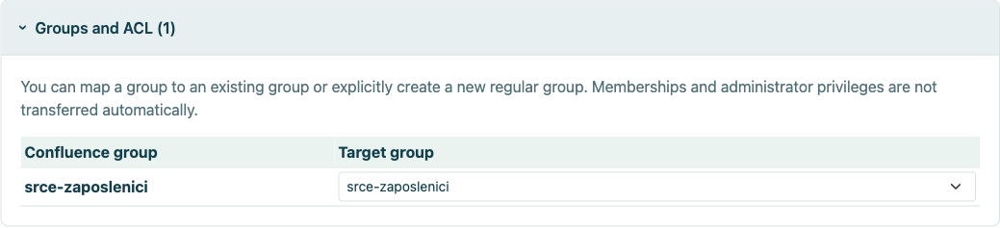
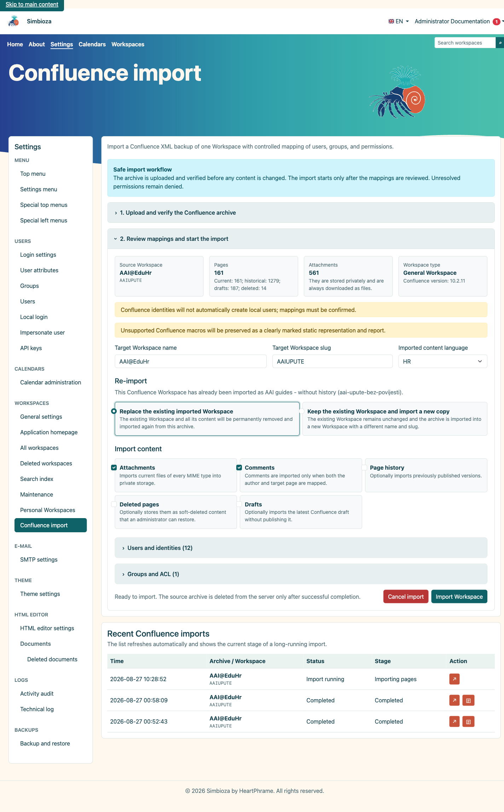
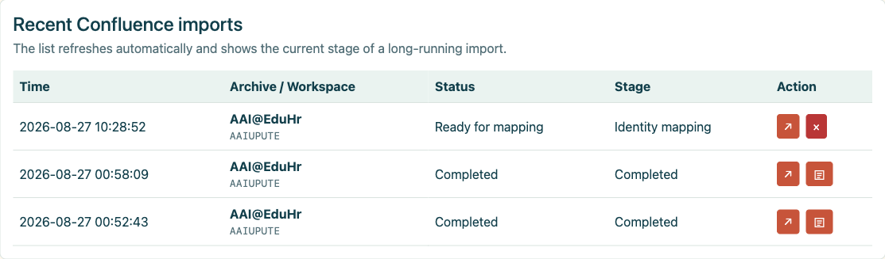
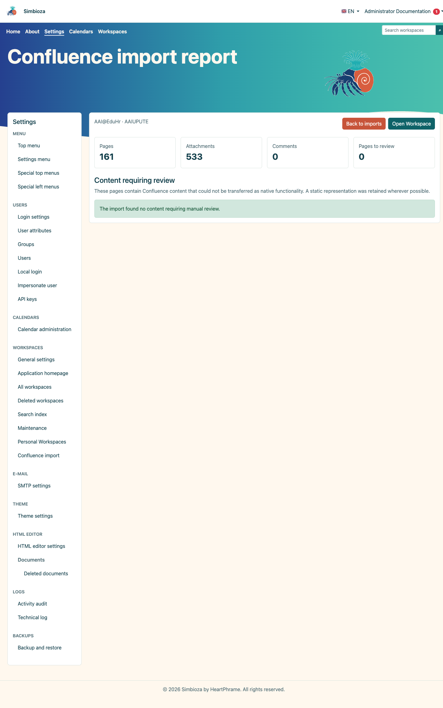
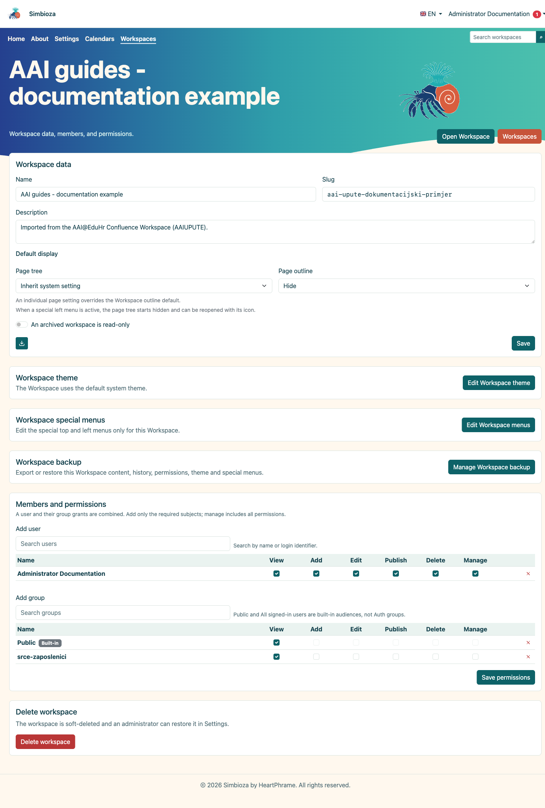

# Importazione da Confluence

> Le schermate mostrano l’interfaccia in inglese.

## Video: passaggio da Confluence a Simbioza

<video class="img-fluid rounded border w-100" controls src="images/3d2e536b-c610-44d6-a7d1-9109c83e198c.mp4" poster="images/7c772a1f-55e8-4f57-985d-ddd5dec554dc.png"></video>

Esporta uno spazio, importa il relativo archivio XML ZIP e controlla il risultato in Simbioza (3 minuti e 46 secondi). Narrazione in inglese britannico e didascalie in inglese. La struttura della pagina incorporata di Simbioza sostituisce la macro del sommario di Confluence; il video mostra come nasconderlo e visualizzarlo.

Confluence Import trasferisce uno spazio Confluence XML ZIP in un'area di lavoro Simbioza nuova o esistente. Il flusso di lavoro convalida l'archivio, seleziona il contenuto, mappa utenti e gruppi ed esegue un processo ripristinabile controllato con un report durevole.

Questa guida utilizza un'esportazione reale di AAI@EduHr Confluence su un'installazione SQLite separata. I dati di identità vengono ritagliati dagli screenshot. È stata completata un'importazione di prova solo corrente, mentre la variante abilitata alla cronologia viene mostrata come configurazione di confronto.

## Contenuto

1.  [Requisiti e preparazione all'esportazione](#requirements)
2.  [Caricamento e verifica preliminare dell'archivio](#preflight)
3.  [Pagine correnti, cronologia, bozze e pagine eliminate](#options)
4.  [Mappatura utenti e gruppi](#mapping)
5.  [Ripeti l'importazione in un'area di lavoro esistente o nuova](#repeat)
6.  [Esegui, avanzamento e risultato](#run)
7.  [Verifica post-importazione](#verify)

## 1. Requisiti e preparazione all'esportazione

- Esporta **uno spazio Confluence** come archivio XML ZIP.
- Non estrarre l'archivio prima del caricamento.
- Fornire spazio di archiviazione per ZIP, estrazione temporanea e allegati archiviati privatamente.
- Prima dell'importazione, decidi il nome di destinazione, lo slug, la lingua e la politica di mappatura delle identità.
- Esegui il backup di una destinazione esistente o utilizza un nuovo slug per un'importazione di prova.

L'amministratore apre **Impostazioni → Aree di lavoro → Importazione Confluence**.

<figure class="my-4">

<figcaption>Il flusso di lavoro controllato spiega il caricamento, il preflight, la mappatura e la conservazione dell'archivio fino al completamento.</figcaption>
</figure>

## 2. Caricamento e verifica preliminare dell'archivio

1.  Seleziona l'archivio Confluence XML ZIP.
2.  Seleziona **Carica e convalida**.
3.  Esamina il nome/chiave dello spazio di origine, la versione di Confluence, il conteggio delle pagine attuali e storiche e gli allegati.
4.  Inserisci il nome dell'area di lavoro di destinazione, lo slug e la lingua del contenuto importato.

Il preflight non importa il contenuto. Convalida la struttura, scopre parti opzionali e prepara le mappature. L'archivio temporaneo gestito viene rimosso dopo il completamento positivo o l'annullamento esplicito.

<figure class="my-4">

<figcaption>L'amministratore sceglie il nome di destinazione, lo slug e la lingua, la strategia di importazione ripetuta e se includere allegati, commenti, cronologia, pagine cancellate e bozze. Le mappature di utenti e gruppi vengono aperte dalla stessa schermata prima dell'avvio dell'importazione.</figcaption>
</figure>

## 3. Pagine correnti, cronologia, bozze e pagine cancellate

| Opzione | Utilizzare quando | Risultato |
|----|----|----|
| **Allegati** | Immagini e file fanno parte della documentazione. | I file correnti di tutti i tipi MIME vengono archiviati privatamente. |
| **Commenti** | I commenti hanno valore documentario e gli autori possono essere mappati. | Importato solo quando sono mappati sia l'autore che la pagina di destinazione. |
| **Cronologia della pagina** | Le versioni pubblicate in precedenza sono necessarie per il controllo o l'archiviazione. | Versioni multiple per pagina; sostanzialmente più lavoro e spazio di archiviazione. |
| **Pagine eliminate** | Potrebbe essere necessario che gli amministratori li recuperino. | Memorizzato come contenuto eliminato temporaneamente. |
| **Bozze** | L'ultima bozza non pubblicata è utile e va conservata. | Importato come bozza, non pubblicato automaticamente. |

### 3.1. Importazione senza cronologia

Un'importazione solo corrente trasferisce la versione pubblicata corrente di ciascuna pagina. È più veloce e più piccolo ed è appropriato quando la destinazione è la documentazione attiva mentre il controllo storico rimane nel sistema di origine o in un archivio separato.

<figure class="my-4">

<figcaption>Le pagine correnti, gli allegati e i commenti vengono selezionati senza versioni storiche.</figcaption>
</figure>

### 3.2. Importa con cronologia

Un'importazione con cronologia trasferisce anche le versioni pubblicate precedenti. In uno spazio ampio può moltiplicare i tempi di esecuzione e lo spazio di archiviazione necessario. Verifica diverse pagine con modifiche note e confronta il numero delle versioni al termine.

<figure class="my-4">

<figcaption>La cronologia delle pagine è abilitata; la stessa schermata mostra anche la decisione di ripetere l'importazione.</figcaption>
</figure>

## 4. Mappatura di utenti e gruppi

Un'identità Confluence non deve essere collegata automaticamente a un account locale semplicemente perché i nomi sembrano simili. Associa ciascuna identità a un account esistente confermato, lasciala non mappata o crea esplicitamente un account temporaneo inattivo.

<figure class="my-4">

<figcaption>La sezione espansa mostra le identità di origine, i ruoli di origine e le relative mappature di destinazione. La ricerca restringe l'elenco, mentre un controllo separato decide se le identità non mappate possono creare account inattivi senza accesso.</figcaption>
</figure>

- **Utente esistente**: seleziona solo quando hai confermato la stessa persona.
- **Non mappato**: il contenuto viene importato, ma l'identità non riceve accesso locale.
- **Utente inattivo**: crea un account non di accesso che un amministratore può successivamente collegare al fornitore corretto o attivare in base ai criteri organizzativi.

Un gruppo di origine può essere mappato a un gruppo ordinario esistente, creare un nuovo gruppo ordinario o rimanere non mappato. L'appartenenza e i diritti amministrativi non vengono mai assunti semplicemente perché un gruppo è stato riconosciuto.

<figure class="my-4">

<figcaption>La sezione espansa mostra ciascun gruppo di origine e la relativa destinazione. Un gruppo può essere mappato su un gruppo ordinario esistente, creare un nuovo gruppo ordinario o rimanere non mappato.</figcaption>
</figure>

## 5. Ripetere l'importazione in un workspace esistente o nuovo

- **Sostituisci l'area di lavoro importata esistente**: rimuove permanentemente il contenuto precedentemente importato e importa il nuovo archivio. Eseguire prima il backup e verificare che nessun contenuto aggiunto manualmente andrebbe perso.
- **Mantieni l'area di lavoro esistente e importa una nuova copia**: lascia invariata l'importazione precedente e utilizza un nome e uno slug differenti. Scegli preferibilmente questa opzione per confrontare i risultati.

## 6. Avvio, avanzamento e risultato

Seleziona **Importa area di lavoro** solo dopo aver confermato lo slug e le mappature di destinazione. Il lavoro viene eseguito in passaggi ripristinabili. Uno spazio ampio può richiedere tempo; non ricominciare la stessa azione solo perché non termina immediatamente.

<figure class="my-4">

<figcaption>La tabella delle importazioni recenti registra il processo in esecuzione e la fase corrente di importazione delle pagine.</figcaption>
</figure>

Dopo essere tornati alla pagina iniziale di Confluence Import, utilizza la tabella **Importazioni recenti di Confluence** per verificare lo stato e la fase del lavoro. Il pulsante freccia riapre il lavoro selezionato. Una riga completata mostra anche un pulsante documento separato; selezionarlo per aprire il report di importazione durevole.

<figure class="my-4">

<figcaption>Una riga completata mostra lo stato Completato e un pulsante del documento nella colonna Azione. Seleziona quel pulsante per aprire il rapporto; un lavoro ancora pronto per la mappatura non dispone ancora di un report.</figcaption>
</figure>

<figure class="my-4">

<figcaption>Dopo aver selezionato il pulsante del documento, il rapporto mostra 161 pagine correnti importate, 533 allegati e il numero di pagine che richiedono una revisione manuale.</figcaption>
</figure>

<figure class="my-4">

<figcaption>L'importazione completata appare nella normale gestione del Workspace e può essere aperta come qualsiasi altro Workspace.</figcaption>
</figure>

## 7. Verifica post-importazione

1.  Apri la home page e diversi rami profondi dell'albero.
2.  Controlla collegamenti interni/esterni, allegati, immagini, tabelle e blocchi di codice.
3.  Apri il report durevole in **Importazioni recenti di Confluence**. Le macro non supportate rimangono contenuti statici chiaramente contrassegnati che richiedono una revisione manuale.
4.  Confronta il conteggio delle pagine correnti e, se selezionato, il conteggio delle versioni storiche.
5.  Verifica ACL e gruppi mappati come utente ordinario, non soltanto come amministratore.
6.  Ricostruisci l'indice di ricerca quando il contenuto importato non è immediatamente rilevabile.
7.  Eliminare la copia di prova o pianificare la sostituzione della destinazione solo dopo l'accettazione.

L'importazione converte il contenuto, ma non può dimostrare automaticamente l'identità organizzativa, il significato di ogni macro personalizzata o l'effetto previsto delle regole ACL legacy. Tali decisioni richiedono la revisione dell'amministratore.

