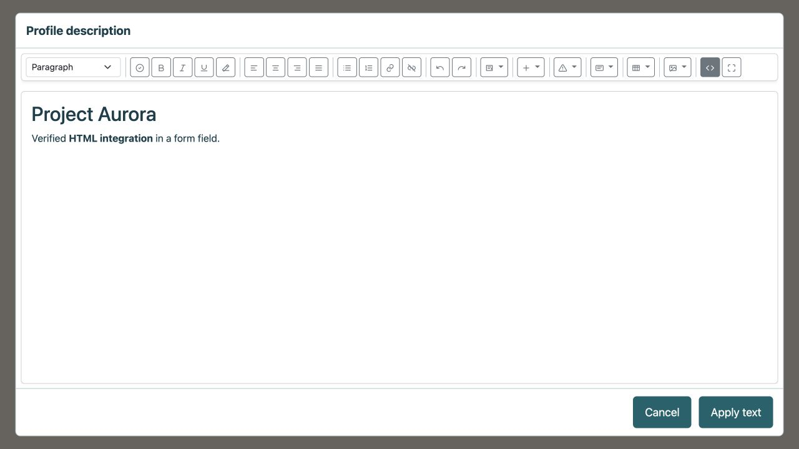
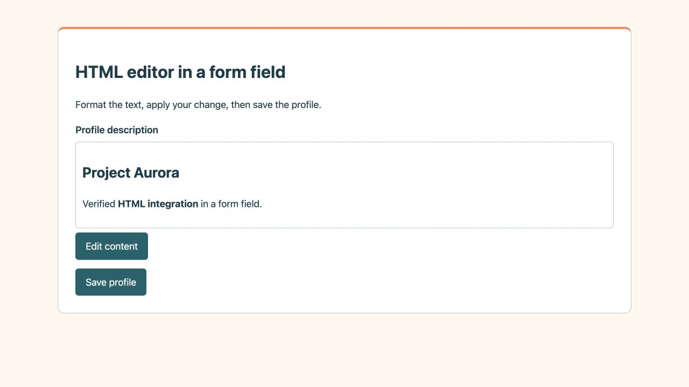

# HTML editor in a form field

This guide is for developers who want to replace an ordinary text field in their
application with formatted content editing. For example, a product summary or
user profile description can store paragraphs, headings, links and tables as HTML.

The user chooses **Edit content**, formats the text and selects **Apply text**.
This fills the form field. Only the form's **Save** action persists the HTML in
your application model. No separate Editor document or Workspace page is created.

## What to prepare

Install and enable `aaieduhr/heartphrame-module-editor-html` after ORM and Auth
in your project. Workspace, Survey, Theme and an external JavaScript editor
library are not required for this integration. Simbioza's installer selects
its dependencies; a custom host keeps its own configuration and does not modify
the Framework.

The [complete module integration guide](https://gitlab.opencode.hr/srce/aai-eduhr/heartphrame/heartphrame-module-html-editor/-/blob/main/docs/component_en.md)
covers installation and service wiring. The
[copyable example](https://gitlab.opencode.hr/srce/aai-eduhr/heartphrame/heartphrame-module-html-editor/-/tree/main/examples/form-field)
contains a controller, form view, JavaScript initializer and host storage contract.

## 1. Serve the editor from your application

These are the module's actual public APIs:

```php
use AaiEduHr\HeartPhrameModuleEditorHtml\Service\EditorHtmlRichTextField;
use AaiEduHr\HeartPhrameModuleEditorHtml\Service\EditorHtmlSanitizerInterface;

$javascript = EditorHtmlRichTextField::asset('js');
$css = EditorHtmlRichTextField::asset('css');
$shellResponse = EditorHtmlRichTextField::shell($responseFactory);
$cleanHtml = $sanitizer->sanitize($submittedHtml);
$previewHtml = EditorHtmlRichTextField::renderPreview($cleanHtml);
```

`$sanitizer` is the `EditorHtmlSanitizerInterface` service. Return JavaScript as
`application/javascript` and CSS as `text/css`. Return the `shell()` response
without wrapping it in the host's ordinary page layout. It already contains
the isolated full editor and its local resources.

The example controller exposes these **host application** routes:

| Route | Purpose |
| --- | --- |
| `GET /profile/text` | Form and existing HTML |
| `GET /profile/text/asset/js` and `/css` | Fixed component resources |
| `GET /profile/text/shell` | Isolated editor document |
| `GET /profile/text/csrf` | Current form tokens |
| `POST /profile/text/clean` | Authorization and cleaning on Apply |
| `POST /profile/text` | Revalidation and actual persistence |

These are not automatically registered HTML Editor routes. Register them in
your project and generate their URLs with its `UrlGenerator`, including any
installation subdirectory. The shell must share the form's origin. Load the
component CSS and JavaScript only once per page.

## 2. Connect the component to a named field

Keep a real `textarea name="description"` in the form. Escape stored HTML when
writing it into that textarea, for example with `htmlspecialchars()`, UTF-8 and
`ENT_QUOTES | ENT_SUBSTITUTE`. Initialize the component after loading its JavaScript:

```javascript
const input = document.querySelector('textarea[name="description"]');
const field = window.HeartPhrameHtmlEditor.createField({
  label: "Profile description",
  value: input.value,
  shellUrl: urls.shell,
  sanitize: async html => cleanHtmlOnYourServer(html),
  onChange: html => {
    input.value = html;
    input.dispatchEvent(new Event("input", { bubbles: true }));
  },
});
input.insertAdjacentElement("afterend", field);
input.hidden = true;
```

`createField()` returns an **HTMLElement**. It does not return `getValue()` or
`save()` or automatically bind a textarea: `onChange` is what writes HTML into
the named form value. A hidden textarea is still submitted. Hide it only after
successful initialization; without JavaScript it can remain an HTML source field.

`urls.shell` is generated by your host application. `cleanHtmlOnYourServer()` is
also your own callback, not a module function: it sends HTML to the authorized
cleaning endpoint and returns the cleaned **string**. The complete example
implements the request, CSRF refresh and error handling. For multiple fields,
create separate components with unique IDs and names; each `onChange` must
update its own textarea.

## 3. Distinguish Apply from Save



**Apply text** calls server cleaning first, then returns the HTML to the field
on success. It does not save the profile yet. **Cancel** or Escape preserves the
previous value; a cleaning error keeps the dialog open.

The user then selects **Save profile**. The form handler checks authorization
and HTML again and persists it through your repository. Reopening the form
shows the saved formatting:



`ProfileTextStore` in the example is a **host application** contract, not an
HTML Editor service. Connect its `read()` and `write()` methods to your existing
model and transactions. Use parameterized queries and a large enough text
column, for example the ORM's `longText()` type. Do not use `EditorService::save()`
or `/editor-html/save` for an ordinary field; those operations save Editor documents.

## 4. Security and displaying saved HTML

Applying, saving and reopening must preserve every supported element: cards, columns, tables and their settings, tabs, accordions, images, video, charts and timelines. Use the same shared sanitizer at every step; a second `strip_tags()` or narrower allowlist would remove the structure. Store canonical HTML rather than the preview DOM. Keep integration-block references even when the form has no adapter; the application resolves their data with permission checks.

- Check identity and access to the specific record on read, clean and save.
  Hiding a button does not protect custom routes.
- Call `EditorHtmlSanitizerInterface::sanitize()` on Apply **and again on final
  Save**. Direct POST requests can bypass JavaScript.
- Validate string types, byte length and business rules. The example has a
  65,536-byte limit; adapt it to your database and use case.
- Keep CSRF protection. HeartPhrame's middleware rotates its token after a
  successful POST, so refresh it before another Apply and before final Save.
  The complete example serializes requests and retains a field-scoped token.
- For canonical chart and roadmap previews, use `renderPreview($cleanHtml)` but
  persist the original cleaned HTML, not its rendered preview. `renderPreview()`
  only prepares presentation; it does not sanitize HTML.
- On a read-only page, render only the cleaned fragment as HTML. Continue to
  escape ordinary text, titles and attributes. Load the component JavaScript
  when native tabs or tables should be interactive.

Translate outer field labels and messages with `labels`; the toolbar uses the
host translation context. The full guide lists supported keys, iframe restrictions
and optional adapters for authorized image/video uploads. The field does not
inherit document history, drafts or publication; your own model owns those features.
