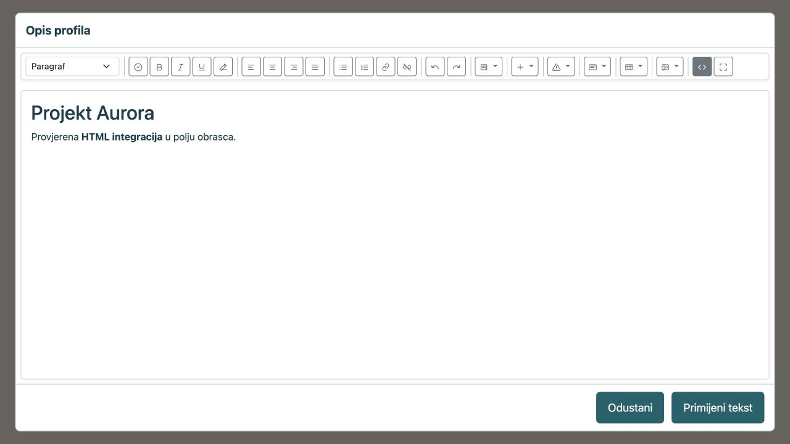
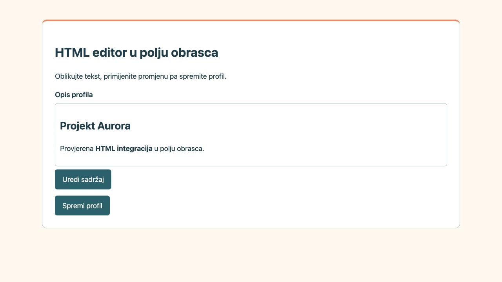

# HTML editor u polju obrasca

Ovaj vodič namijenjen je razvojnim programerima koji žele u svojoj aplikaciji
zamijeniti obično tekstualno polje uređivanjem oblikovanog sadržaja. Primjerice,
polje opisa proizvoda ili korisničkog profila može spremati odlomke, naslove,
poveznice i tablice kao HTML.

Korisnik odabere **Uredi sadržaj**, oblikuje tekst i klikne **Primijeni tekst**.
Time se popunjava polje obrasca. Tek **Spremi** na obrascu trajno zapisuje HTML
u model vaše aplikacije. Ne nastaje zaseban dokument Editora ni stranica područja.

## Što treba pripremiti

U vlastiti projekt instalirajte i uključite
`aaieduhr/heartphrame-module-editor-html` nakon ORM-a i Autha. Za ovu namjenu
nisu potrebni Workspace, Survey, Theme ni vanjska JavaScript biblioteka.
Simbiozin installer bira potrebne ovisnosti; vlastita aplikacija zadržava svoju
konfiguraciju i ne mijenja Framework.

[Puni razvojni vodič modula](https://gitlab.opencode.hr/srce/aai-eduhr/heartphrame/heartphrame-module-html-editor/-/blob/main/docs/component_hr.md)
sadrži instalaciju i povezivanje servisa. U
[primjeru za kopiranje](https://gitlab.opencode.hr/srce/aai-eduhr/heartphrame/heartphrame-module-html-editor/-/tree/main/examples/form-field)
nalaze se kontroler, prikaz obrasca, JavaScript i ugovor pohrane aplikacije.

## 1. Poslužite editor iz svoje aplikacije

Koriste se stvarni javni API-ji modula:

```php
use AaiEduHr\HeartPhrameModuleEditorHtml\Service\EditorHtmlRichTextField;
use AaiEduHr\HeartPhrameModuleEditorHtml\Service\EditorHtmlSanitizerInterface;

$javascript = EditorHtmlRichTextField::asset('js');
$css = EditorHtmlRichTextField::asset('css');
$shellResponse = EditorHtmlRichTextField::shell($responseFactory);
$cleanHtml = $sanitizer->sanitize($submittedHtml);
$previewHtml = EditorHtmlRichTextField::renderPreview($cleanHtml);
```

`$sanitizer` je servis `EditorHtmlSanitizerInterface`. JavaScript odgovor mora
imati tip `application/javascript`, a CSS `text/css`. Vratite odgovor metode
`shell()` bez umetanja u obični izgled stranice. On već sadrži izdvojeni puni
editor i njegove lokalne resurse.

Kontroler primjera izlaže ove rute **aplikacije**:

| Ruta | Svrha |
| --- | --- |
| `GET /profile/text` | Prikaz obrasca i postojećeg HTML-a |
| `GET /profile/text/asset/js` i `/css` | Fiksne datoteke komponente |
| `GET /profile/text/shell` | Izdvojeni prozor editora |
| `GET /profile/text/csrf` | Aktualni tokeni obrasca |
| `POST /profile/text/clean` | Provjera ovlasti i čišćenje pri Primijeni |
| `POST /profile/text` | Ponovna provjera i stvarno spremanje |

To nisu unaprijed registrirane rute HTML Editora. Registrirajte ih u svojem
projektu i generirajte URL-ove njegovim `UrlGenerator` servisom, uključujući
poddirektorij instalacije. Okvir mora biti s istog podrijetla kao obrazac.
CSS i JavaScript komponente učitajte samo jednom na stranici.

## 2. Povežite komponentu s imenovanim poljem

Zadržite stvarni `textarea name="description"` u obrascu. Postojeći HTML u njega
ispišite kodirano, primjerice pomoću `htmlspecialchars()` s UTF-8 i
`ENT_QUOTES | ENT_SUBSTITUTE`. Komponentu pokrenite nakon učitavanja njezina
JavaScripta:

```javascript
const input = document.querySelector('textarea[name="description"]');
const field = window.HeartPhrameHtmlEditor.createField({
  label: "Opis profila",
  value: input.value,
  shellUrl: urls.shell,
  sanitize: async html => cleanHtmlOnYourServer(html),
  onChange: html => {
    input.value = html;
    input.dispatchEvent(new Event("input", { bubbles: true }));
  },
});
input.insertAdjacentElement("afterend", field);
input.hidden = true;
```

`createField()` vraća **HTMLElement**. Ne vraća `getValue()` ili `save()` i ne
povezuje textarea automatski: upravo `onChange` sprema HTML u imenovano polje.
Skrivena textarea i dalje se šalje obrascem. Prikrijte je tek nakon uspješnog
pokretanja; bez JavaScripta može ostati polje izvornog HTML-a.

`urls.shell` je URL koji je generirala vaša aplikacija.
`cleanHtmlOnYourServer()` također je funkcija vaše aplikacije, a ne funkcija
modula: ovlaštenim POST-om šalje HTML ruti čišćenja i vraća očišćeni **string**.
Potpun primjer sadrži implementaciju zahtjeva, obnove CSRF-a i poruka pogreške.
Za više polja stvorite odvojene komponente s jedinstvenim ID-jevima i imenima;
svaki `onChange` mora mijenjati vlastitu textarea kontrolu.

## 3. Razlikujte Primijeni i Spremi



**Primijeni tekst** prvo zove poslužiteljsko čišćenje pa, nakon uspjeha, vraća
HTML u polje. Još ne sprema profil. **Odustani** ili Escape zadržava prethodnu
vrijednost; pogreška čišćenja ostavlja prozor otvorenim.

Zatim korisnik odabire **Spremi profil**. Handler obrasca ponovno provjerava
ovlasti i HTML te zapisuje sadržaj vlastitim repozitorijem. Nakon ponovnog
učitavanja prikazuje se spremljeno oblikovanje:



`ProfileTextStore` u primjeru je ugovor **vaše aplikacije**, ne servis HTML
Editora. Povežite njegove metode `read()` i `write()` s postojećim modelom i
transakcijama. Koristite parametrizirane upite i dovoljno velik tekstualni
stupac, primjerice ORM tip `longText()`. Za obično polje nemojte koristiti
`EditorService::save()` ni `/editor-html/save`, jer oni spremaju dokumente Editora.

## 4. Sigurnost i prikaz spremljenog HTML-a

Pri primjeni, spremanju i ponovnom otvaranju moraju ostati svi podržani elementi: kartice, stupci, tablice i njihove postavke, tabovi, harmonike, slike, video, grafikoni i vremenski planovi. Koristite isti zajednički sanitizer u svim koracima; dodatni `strip_tags()` ili uži popis oznaka uklonio bi strukturu. Spremajte kanonski HTML, a ne prikazni DOM. Reference integracijskih blokova čuvajte i kada u obrascu nema adaptera; dohvat njihovih podataka vodi aplikacija uz provjeru ovlasti.

- Provjerite identitet i pravo na konkretan zapis pri čitanju, čišćenju i spremanju.
  Skriveni gumb nije zaštita vlastitih ruta.
- HTML čistite `EditorHtmlSanitizerInterface::sanitize()` pri Primijeni **i ponovno
  pri završnom spremanju**. Izravni POST može zaobići JavaScript.
- Provjerite tip, broj bajtova i poslovna pravila polja. Primjer ima ograničenje
  od 65.536 bajtova; prilagodite ga svojoj bazi i namjeni.
- Zadržite CSRF provjere. HeartPhrameov middleware nakon uspješnog POST-a mijenja
  token, pa ga treba osvježiti prije sljedećeg Primijeni i prije završnog Spremi.
  Potpun primjer usklađuje zahtjeve i čuva poseban token obrasca.
- Za pregled kanonskih grafikona i vremenskih planova koristite
  `renderPreview($cleanHtml)`, ali pohranite izvorni očišćeni HTML, ne njegov
  renderirani pregled. `renderPreview()` samo priprema prikaz; ne čisti HTML.
- Na stranici za čitanje ispišite samo očišćeni fragment kao HTML. Običan tekst,
  naslove i atribute i dalje kodirajte. Za nativne tabove ili tablice učitajte
  pripadajući JavaScript komponente.

Vanjske oznake i poruke polja prevodite parametrom `labels`; alatna traka koristi
prijevode aplikacije. Puna uputa opisuje dostupne ključeve, ograničenje iframeova
te neobavezne adaptere za ovlašteno učitavanje slika i videa. Polje ne nasljeđuje
povijest, nacrte ni objavu dokumenata; te mogućnosti, ako ih želite, vodi vaš model.
