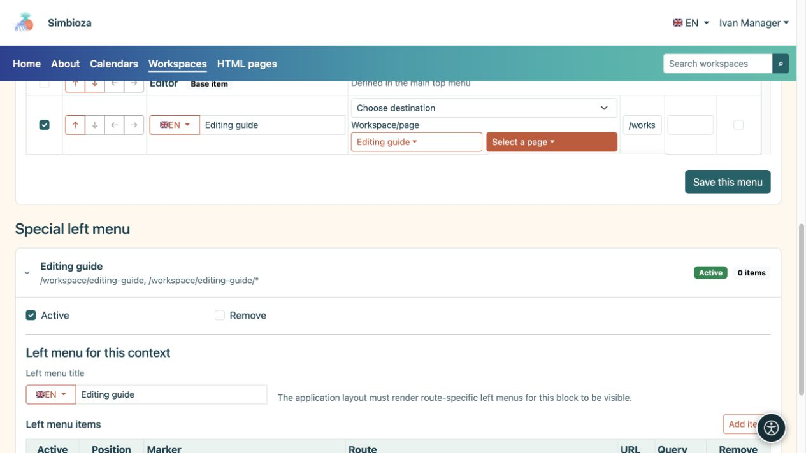
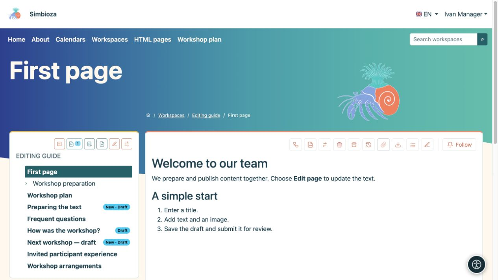
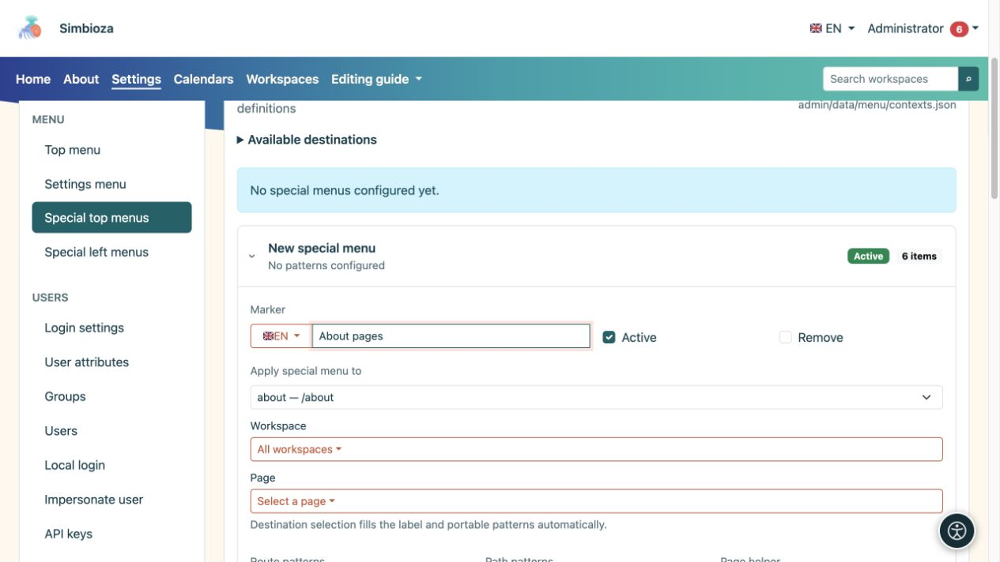
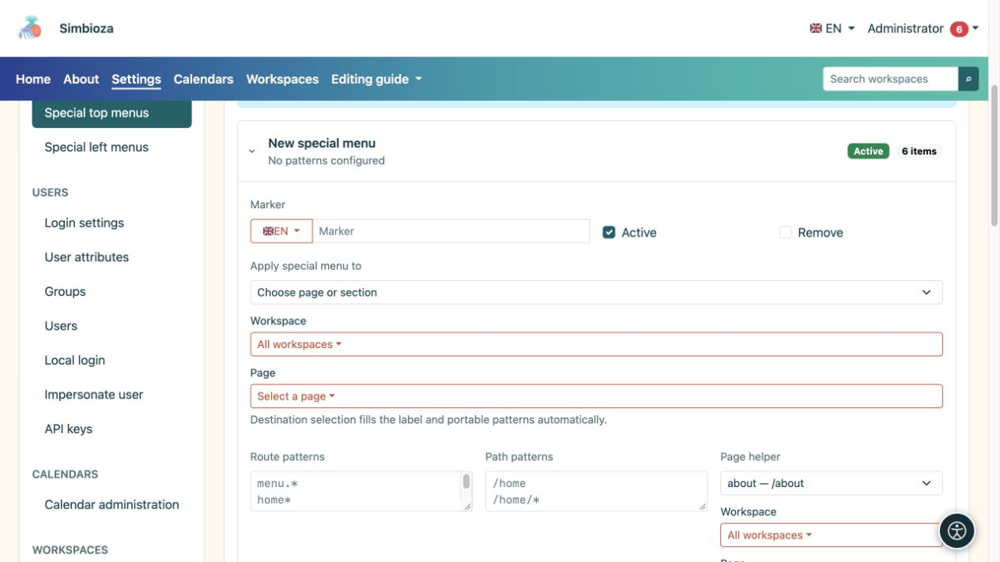
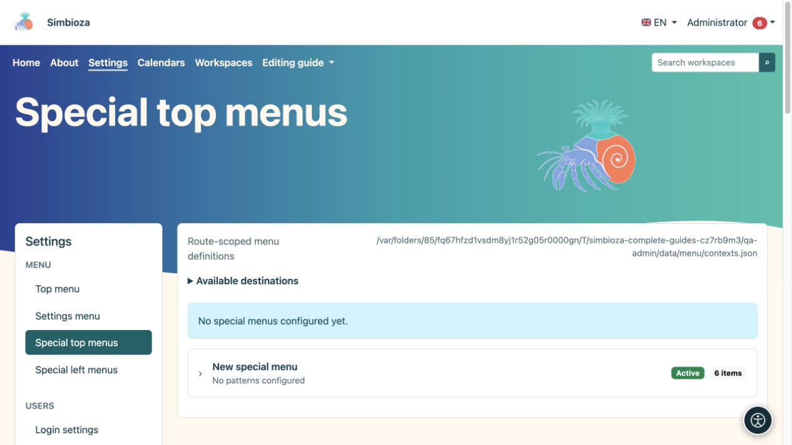
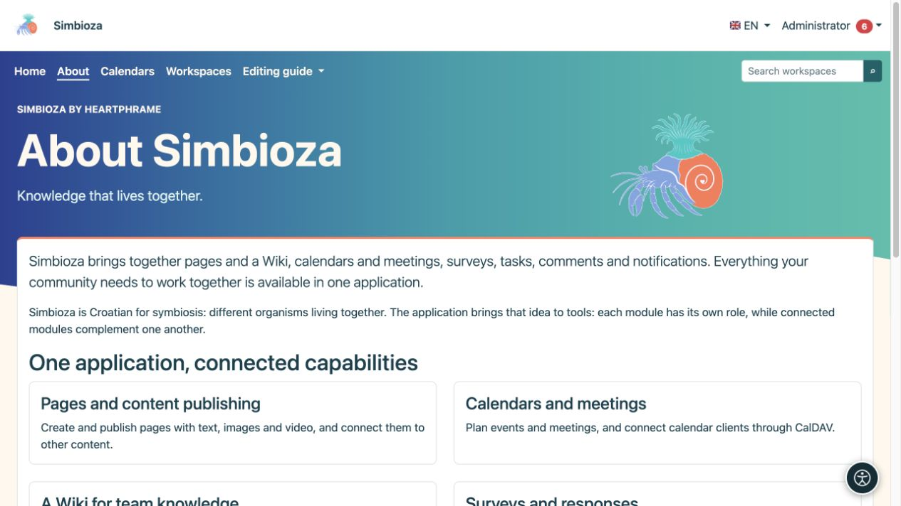

# Besondere Menüs für einen Arbeitsbereich oder eine Ansicht

> Die Bildschirmaufnahmen zeigen die englische Benutzeroberfläche.

[Menüs](izbornici_de.md)

Ein spezielles Menü passt die Navigation an den Arbeitsort an. Beispielsweise kann der Arbeitsbereich einer Schule direkt mit Stundenplänen, Materialien und Kontakten verknüpft werden. Dadurch werden weder Inhalte verschoben noch Berechtigungen geändert.

## Bearbeiten Sie Ihr Arbeitsbereichsmenü

*Ein Arbeitsbereichsmanager kann ein Ziel auswählen und dieses Menü speichern, ohne auf globale Einstellungen zugreifen zu müssen.*

**Zielgruppe:** der Administrator oder ein Manager mit der Berechtigung **Verwalten** für diesen Arbeitsbereich.

1. Öffnen Sie Ihre Arbeitsbereichseinstellungen und **Spezialmenüs**.
2. Wählen Sie den oberen oder linken Bereich. Jeder wird separat gespeichert.
3. Fügen Sie klar benannte Elemente und Ziele hinzu und [ordnen Sie sie dann mit den Pfeilen an](izbornici-stavke_de.md).
4. Geben Sie für ein linkes Menü auch den **Titel des linken Menüs** in den erforderlichen Sprachen ein.
5. Wählen Sie **Dieses Menü speichern** für den Abschnitt, den Sie bearbeiten.
6. Öffnen Sie eine Seite in diesem Arbeitsbereich in der Leseansicht und überprüfen Sie sie mit einem anderen Konto.

**Ergebnis:** Das Spezialmenü gilt für den ausgewählten Arbeitsbereich und seine Seiten. Bei diesem Formular ist es seinem Manager nicht möglich, den Bereich auf einen anderen Arbeitsbereich oder die gesamte Anwendung zu ändern. Gewöhnliche Berechtigungen zum Lesen oder Bearbeiten von Seiten reichen nicht aus.

*Nach dem Speichern erscheint der Workshop-Plan im oberen Menü des ausgewählten Arbeitsbereichs.*

Das spezielle Hauptmenü kombiniert Basiselemente aus dem Hauptmenü mit zusätzlichen Elementen. Basisartikel sind mit **Basisartikel** gekennzeichnet: Sie können sie für dieses spezielle Menü neu anordnen oder aktivieren/deaktivieren, aber ihre Beschriftungen und Ziele sind hier geschützt. Der Administrator ändert seine freigegebenen Labels im Hauptmenü.

Ein spezielles linkes Menü ist ein zusätzlicher Linkblock. Die Seitenhierarchie des Arbeitsbereichs wird weder ersetzt noch erstellt. Der Seitenbaum und seine Berechtigungen bleiben Teil von Arbeitsbereiche.

## Das spezielle Menü eines Administrators für einen Bildschirm

*In diesem Beispiel zielt das Spezialmenü auf die About-Route und den /about-Pfad ab; der Helfer erleichtert die Eingabe dieser Regeln.*

*Der erweiterte Eintrag zeigt seine Bezeichnung, den aktiven Status, die Zielauswahl und die Regeln, die dieses spezielle Menü anwenden.*

*Spezielle Top-Menüs haben separate Einträge; Erweitern Sie den richtigen Eintrag oder ein neues Menü, bevor Sie dessen Umfang bearbeiten.*

Unter **Einstellungen → Menü → Spezielle obere Menüs** oder **Spezielle linke Menüs** kann der Administrator einen separaten Datensatz erstellen.

1. Öffnen Sie **Neues Spezialmenü**.
2. Wählen Sie unter **Spezielles Menü anwenden auf** den entsprechenden Bildschirm, Arbeitsbereich oder die entsprechende Seite aus.
3. Überprüfen Sie den automatisch gefüllten Bereich. Die Verwendung des Pickers ist sicherer als das manuelle Erraten von Mustern.
4. Bearbeiten Sie seine Elemente und, bei einem linken Menü, seinen Titel.
5. Aktivieren Sie **Aktiv** und wählen Sie **Dieses Menü speichern**.

Der erweiterte Abschnitt **Routen-/Pfadmuster** bestimmt, wo der Datensatz gilt. `*` stimmt mit mehreren Suffixen überein, sodass ein breites Muster mehr Bildschirme als beabsichtigt beeinflussen kann. Verwenden Sie es nur, wenn Sie die jeweiligen Anwendungswege verstehen. Kopieren Sie nicht die vollständige Adresse einer anderen Site in ein installationsunabhängiges Muster.

## Zurück zur geteilten Navigation

*In diesem Beispiel verfügt About über ein spezielles Hauptmenü ohne Einstellungen, während der Seiteninhalt gleich bleibt.*

Ohne ein aktives passendes spezielles Top-Menü wird das gemeinsame Top-Menü verwendet. Um dorthin zurückzukehren, deaktivieren Sie den gesamten speziellen Datensatz und speichern Sie ihn oder wählen Sie die Option **Entfernen** und speichern Sie ihn. Dadurch werden die Ziele nicht gelöscht. Der zusätzliche linke Block verschwindet, wenn kein aktives linkes Menü übereinstimmt.

Spezielle Menüs oben und links können aus separaten Datensätzen stammen. Es gibt keinen universellen „Ersetzen/Erben“-Schalter für jede Art: Bearbeiten Sie den Teil, den Sie tatsächlich ändern möchten, und überprüfen Sie ihn auf der Zielseite. Wenn sich mehrere spezielle Datensätze überschneiden, sollte der Administrator deren Umfang überprüfen, bevor er einen weiteren hinzufügt.
