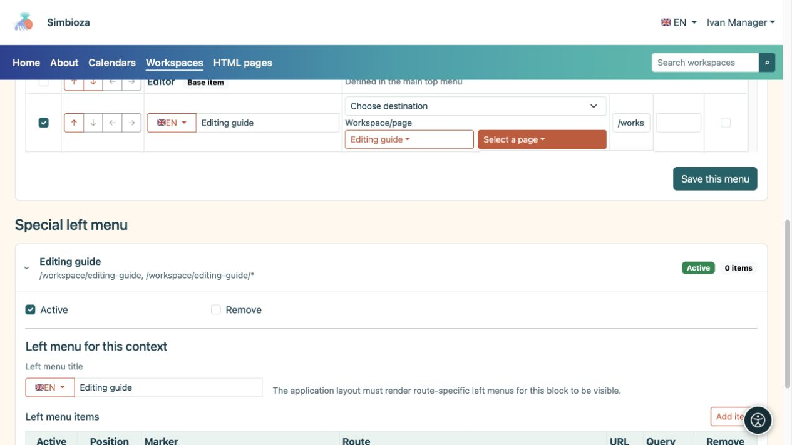
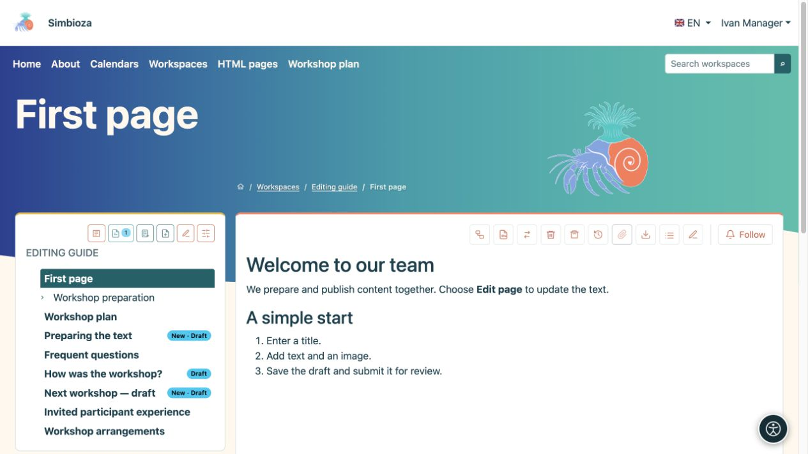
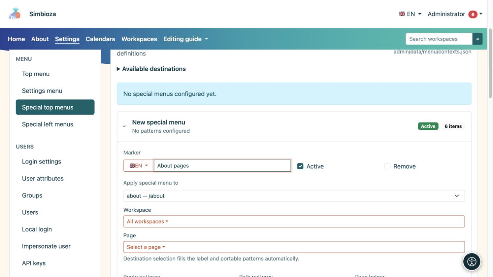
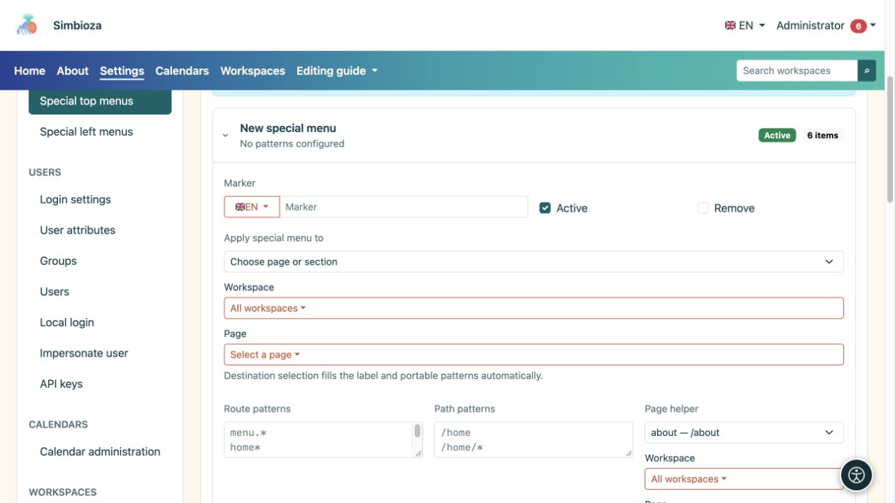
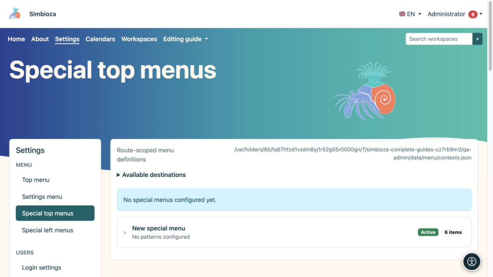
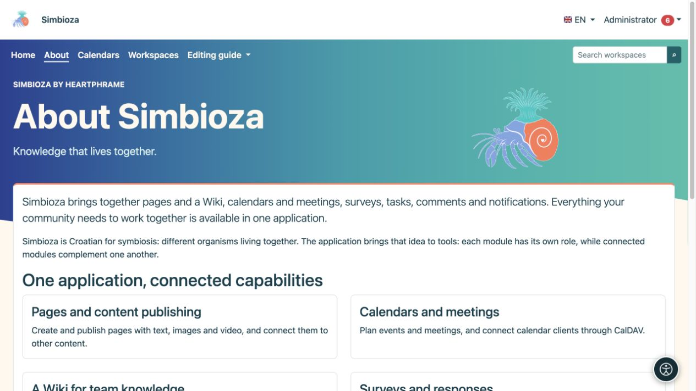

# Special menus for a workspace or screen

[Menus](izbornici_en.md)

A special menu adapts navigation to where people are working. For example, a school's workspace can link directly to schedules, materials, and contacts. This does not move content or change permissions.

## Edit your workspace menu

*A workspace manager can choose a destination and save that menu without access to global Settings.*

**Audience:** the administrator or a manager with **Manage** permission for that workspace.

1. Open your workspace settings and **Special menus**.
2. Choose the top or left section. Each is saved separately.
3. Add clearly named items and destinations, then [arrange them with the arrows](izbornici-stavke_en.md).
4. For a left menu, also enter its **Left menu title** in the required languages.
5. Choose **Save this menu** for the section you are editing.
6. Open a page in that workspace in its reading view and check it with another account.

**Result:** the special menu applies to the selected workspace and its pages. This form does not let its manager change the scope to another workspace or the whole application. Ordinary page reading or editing permissions are insufficient.

*After saving, Workshop plan appears in the top menu of the selected workspace.*

The special top menu combines base items from the main menu with additional items. Base items are marked **Base item**: you can reorder or enable/disable them for this special menu, but their labels and destinations are protected here. The administrator changes their shared labels in the main top menu.

A special left menu is an additional block of links. It neither replaces nor creates the workspace page hierarchy. The page tree and its permissions remain part of Workspaces.

## An administrator's special menu for a screen

*In this example, the special menu targets the about route and /about path; the helper makes these rules easier to enter.*

*The expanded entry shows its label, active state, target selection, and the rules applying that special menu.*

*Special top menus have separate entries; expand the correct entry or a new menu before editing its scope.*

Under **Settings → Menu → Special top menus** or **Special left menus**, the administrator can create a separate record.

1. Open **New special menu**.
2. Under **Apply special menu to**, select the appropriate screen, workspace, or page.
3. Check the automatically filled scope. Using the picker is safer than guessing patterns manually.
4. Edit its items and, for a left menu, its title.
5. Check **Active** and choose **Save this menu**.

The advanced **Route/path patterns** section determines where the record applies. `*` matches multiple suffixes, so a broad pattern can affect more screens than intended. Use it only when you understand the particular application routes. Do not copy another site's full address into an installation-independent pattern.

## Return to shared navigation

*In this example, About has a special top menu without Settings, while the page content stays the same.*

Without an active matching special top menu, the shared top menu is used. To return to it, disable the whole special record and save, or select its **Remove** option and save. This does not delete its destinations. The additional left block disappears when no active left menu matches.

Special top and left menus can come from separate records. There is no universal “replace/inherit” switch for every kind: edit the part you actually want to change and check it on the target page. If several special records overlap, the administrator should review their scope before adding another.
