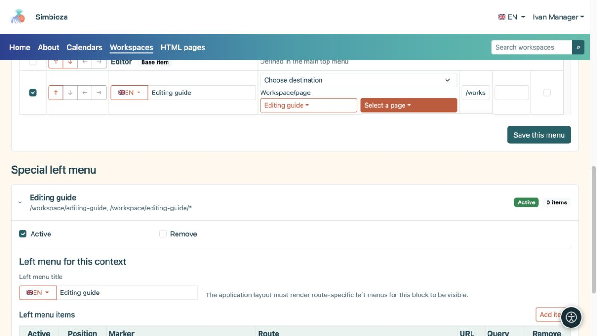
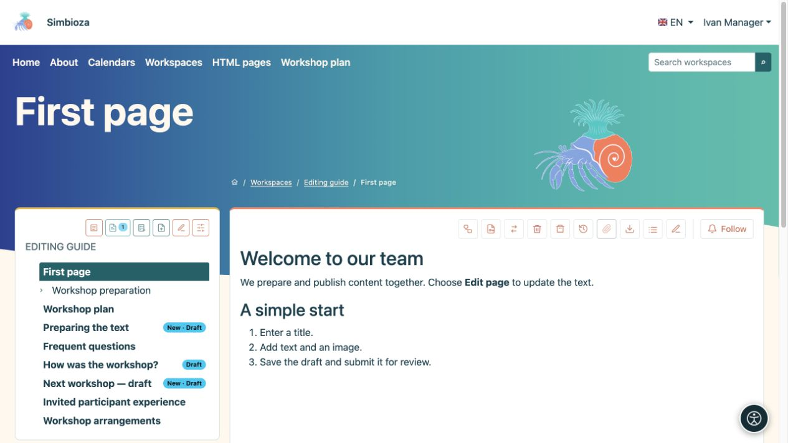
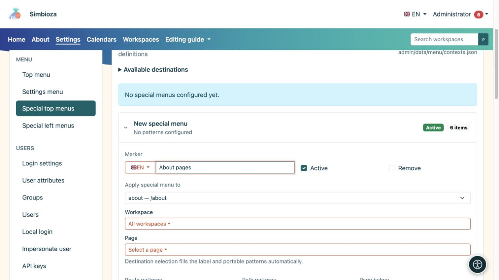
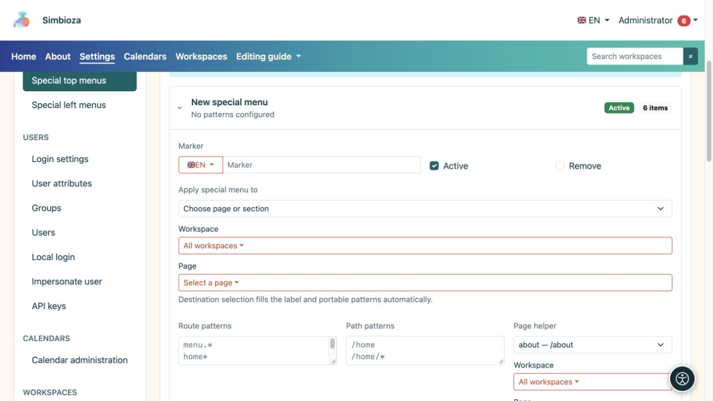
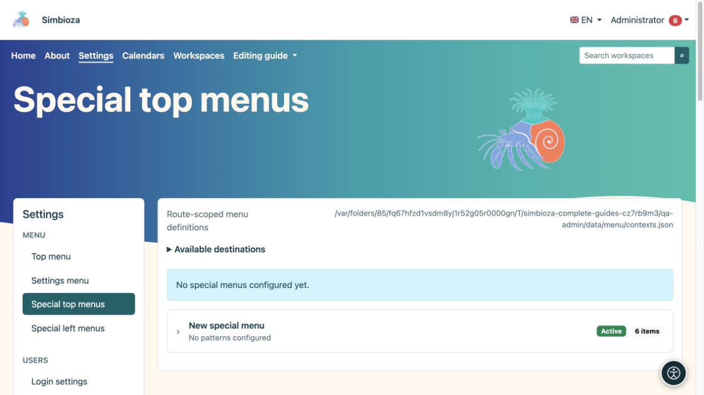
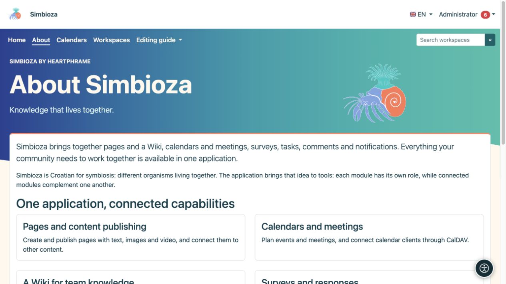

# Menús especiales para un espacio de trabajo o una pantalla

> Las capturas de pantalla muestran la interfaz en inglés.

[Menús](izbornici_es.md)

Un menú especial adapta la navegación al lugar donde trabajan las personas. Por ejemplo, el espacio de trabajo de una escuela puede vincularse directamente a horarios, materiales y contactos. Esto no mueve contenido ni cambia permisos.

## Edita el menú de su espacio de trabajo

*Un gestor del espacio de trabajo puede elegir un destino y guardar ese menú sin acceso a la configuración global.*

**Audiencia:** el administrador o un gestor con permiso **Administrar** para ese espacio de trabajo.

1. Abra la configuración de su espacio de trabajo y **Menús especiales**.
2. Elija la sección superior o izquierda. Cada uno se guarda por separado.
3. Agregue elementos y destinos con nombres claros y luego [organícelos con las flechas](izbornici-stavke_es.md).
4. Para un menú de la izquierda, ingrese también su **Título del menú de la izquierda** en los idiomas requeridos.
5. Elija **Guardar este menú** para la sección que está editando.
6. Abra una página en ese espacio de trabajo en su vista de lectura y verifíquela con otra cuenta.

**Resultado:** el menú especial se aplica al espacio de trabajo seleccionado y sus páginas. Este formulario no permite que su gestor cambie el alcance a otro espacio de trabajo o a toda la aplicación. Los permisos normales de lectura o edición de páginas son insuficientes.

*Después de guardar, el plan del taller aparece en el menú superior del espacio de trabajo seleccionado.*

El menú superior especial combina elementos básicos del menú principal con elementos adicionales. Los elementos base están marcados como **Elemento base**: puede reordenarlos o habilitarlos/deshabilitarlos para este menú especial, pero sus etiquetas y destinos están protegidos aquí. El administrador cambia sus etiquetas compartidas en el menú superior principal.

Un menú especial de la izquierda es un bloque adicional de enlaces. No reemplaza ni crea la jerarquía de páginas del espacio de trabajo. El árbol de páginas y sus permisos siguen siendo parte de Workspaces.

## Menú especial de administrador para una pantalla.

*En este ejemplo, el menú especial apunta a la ruta acerca de y /acerca de la ruta; el asistente hace que estas reglas sean más fáciles de ingresar.*

*La entrada ampliada muestra su etiqueta, estado activo, selección de objetivos y las reglas que aplican ese menú especial.*

*Los menús superiores especiales tienen entradas separadas; expanda la entrada correcta o un nuevo menú antes de editar su alcance.*

En **Configuración → Menú → Menús superiores especiales** o **Menús izquierdos especiales**, el administrador puede crear un registro separado.

1. Abra **Nuevo menú especial**.
2. En **Aplicar menú especial a**, seleccione la pantalla, el espacio de trabajo o la página adecuada.
3. Verifique el alcance completado automáticamente. Usar el selector es más seguro que adivinar patrones manualmente.
4. Edite sus elementos y, para un menú de la izquierda, su título.
5. Marque **Activo** y elija **Guardar este menú**.

La sección avanzada **Patrones de ruta/ruta** determina dónde se aplica el registro. `*` coincide con varios sufijos, por lo que un patrón amplio puede afectar a más pantallas de las previstas. Úselo sólo cuando comprenda las rutas de aplicación particulares. No copie la dirección completa de otro sitio en un patrón independiente de la instalación.

## Volver a la navegación compartida

*En este ejemplo, Acerca de tiene un menú superior especial sin Configuración, mientras que el contenido de la página sigue siendo el mismo.*

Sin un menú superior especial coincidente activo, se utiliza el menú superior compartido. Para volver a él, deshabilite todo el registro especial y guárdelo, o seleccione su opción **Eliminar** y guárdelo. Esto no elimina sus destinos. El bloque izquierdo adicional desaparece cuando ningún menú izquierdo activo coincide.

Los menús especiales superior e izquierdo pueden provenir de registros separados. No existe un interruptor universal de “reemplazar/heredar” para cada tipo: edite la parte que realmente desea cambiar y verifíquela en la página de destino. Si varios registros especiales se superponen, el administrador debe revisar su alcance antes de agregar otro.
