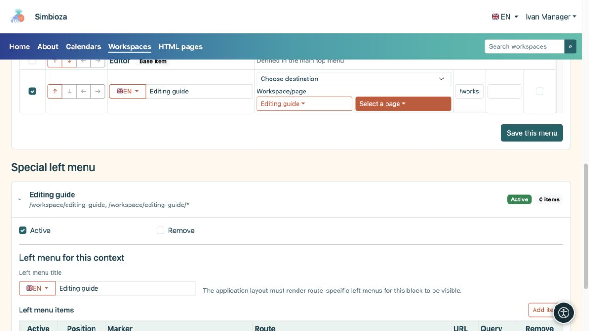
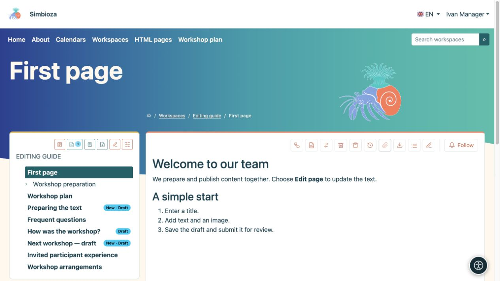
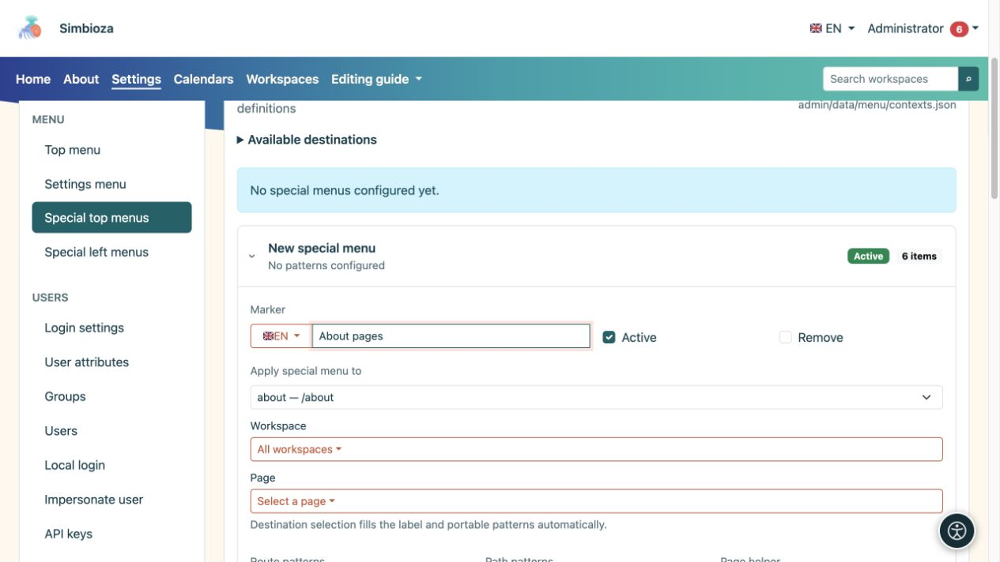
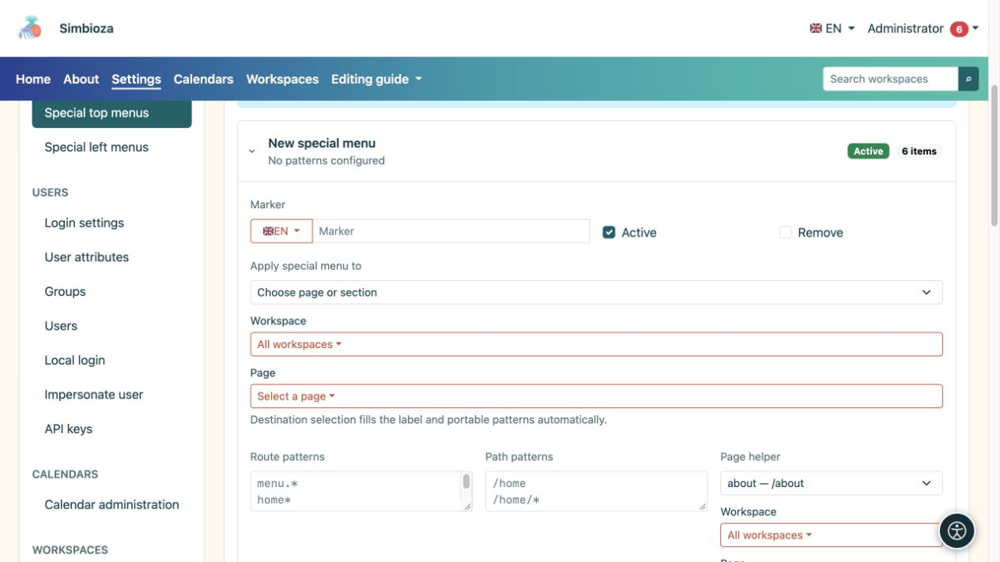
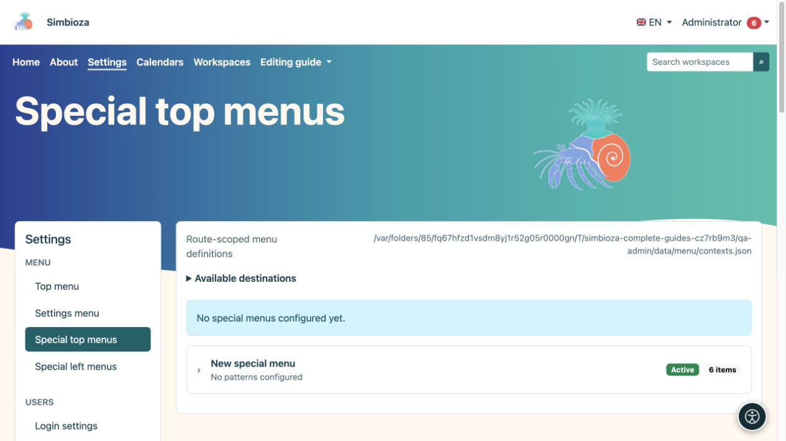
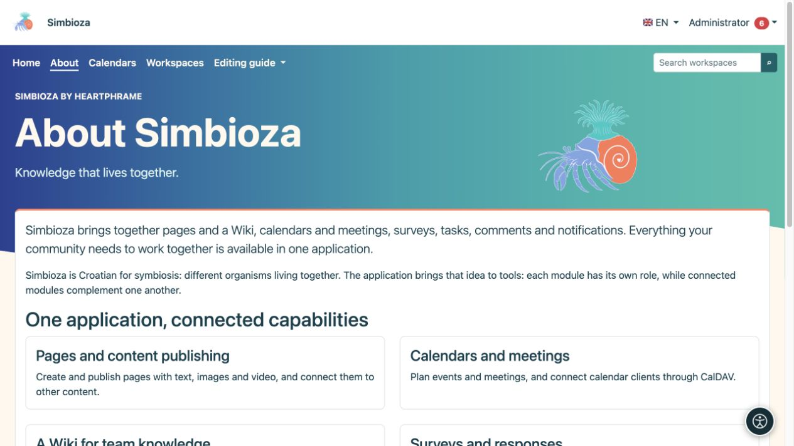

# Menus spécifiques à un espace de travail ou à un écran

> Les captures d’écran présentent l’interface en anglais.

[Menus](izbornici_fr.md)

Un menu spécial adapte la navigation à l'endroit où les gens travaillent. Par exemple, l'espace de travail d'une école peut être directement lié aux horaires, au matériel et aux contacts. Cela ne déplace pas le contenu ni ne modifie les autorisations.

## Modifier le menu de votre espace de travail

*Un gestionnaire d'espace de travail peut choisir une destination et enregistrer ce menu sans accéder aux paramètres globaux.*

**Audience :** l'administrateur ou un responsable disposant de l'autorisation **Gérer** pour cet espace de travail.

1. Ouvrez les paramètres de votre espace de travail et les **menus spéciaux**.
2. Choisissez la section supérieure ou gauche. Chacun est enregistré séparément.
3. Ajoutez des éléments et des destinations clairement nommés, puis [disposez-les avec les flèches](izbornici-stavke_fr.md).
4. Pour un menu de gauche, saisissez également son **Titre du menu de gauche** dans les langues requises.
5. Choisissez **Enregistrer ce menu** pour la section que vous modifiez.
6. Ouvrez une page de cet espace de travail dans sa vue lecture et vérifiez-la avec un autre compte.

**Résultat :** le menu spécial s'applique à l'espace de travail sélectionné et à ses pages. Ce formulaire ne permet pas à son gestionnaire de modifier la portée vers un autre espace de travail ou l'ensemble de l'application. Les autorisations ordinaires de lecture ou de modification de pages sont insuffisantes.

*Après l'enregistrement, le plan d'atelier apparaît dans le menu supérieur de l'espace de travail sélectionné.*

Le menu supérieur spécial combine les éléments de base du menu principal avec des éléments supplémentaires. Les éléments de base sont marqués **Élément de base** : vous pouvez les réorganiser ou les activer/désactiver pour ce menu spécial, mais leurs étiquettes et destinations sont protégées ici. L'administrateur modifie ses étiquettes partagées dans le menu principal supérieur.

Un menu spécial de gauche est un bloc de liens supplémentaire. Il ne remplace ni ne crée la hiérarchie des pages de l'espace de travail. L'arborescence des pages et ses autorisations restent partie intégrante des espaces de travail.

## Un menu spécial administrateur pour un écran

*Dans cet exemple, le menu spécial cible la route about et le chemin /about ; l'assistant facilite la saisie de ces règles.*

*L'entrée développée affiche son étiquette, son état actif, sa sélection de cible et les règles appliquant ce menu spécial.*

*Les menus supérieurs spéciaux ont des entrées séparées ; développez l'entrée correcte ou un nouveau menu avant de modifier sa portée.*

Sous **Paramètres → Menu → Menus supérieurs spéciaux** ou **Menus spéciaux de gauche**, l'administrateur peut créer un enregistrement distinct.

1. Ouvrez **Nouveau menu spécial**.
2. Sous **Appliquer le menu spécial à**, sélectionnez l'écran, l'espace de travail ou la page approprié.
3. Vérifiez la portée automatiquement remplie. Utiliser le sélecteur est plus sûr que deviner des modèles manuellement.
4. Modifiez ses éléments et, pour un menu de gauche, son titre.
5. Cochez **Actif** et choisissez **Enregistrer ce menu**.

La section avancée **Modèles d'route/chemin** détermine où l'enregistrement s'applique. `*` correspond à plusieurs suffixes, donc un modèle large peut affecter plus d'écrans que prévu. Utilisez-le uniquement lorsque vous comprenez les routes d'application particuliers. Ne copiez pas l'adresse complète d'un autre site dans un modèle indépendant de l'installation.

## Revenir à la navigation partagée

*Dans cet exemple, À propos de possède un menu supérieur spécial sans paramètres, tandis que le contenu de la page reste le même.*

Sans menu supérieur spécial correspondant actif, le menu supérieur partagé est utilisé. Pour y revenir, désactivez l'intégralité de l'enregistrement spécial et enregistrez, ou sélectionnez son option **Supprimer** et enregistrez. Cela ne supprime pas ses destinations. Le bloc de gauche supplémentaire disparaît lorsqu'aucun menu de gauche actif ne correspond.

Les menus spéciaux en haut et à gauche peuvent provenir d'enregistrements distincts. Il n'existe pas de commutateur universel « remplacer/hériter » pour chaque type : modifiez la partie que vous souhaitez réellement modifier et vérifiez-la sur la page cible. Si plusieurs enregistrements spéciaux se chevauchent, l'administrateur doit revoir leur portée avant d'en ajouter un autre.
