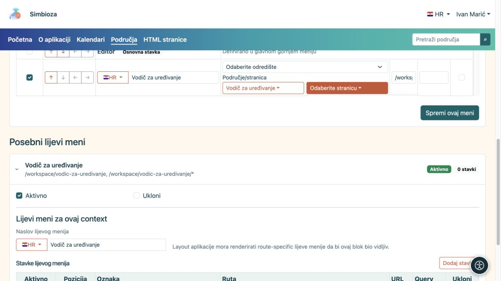
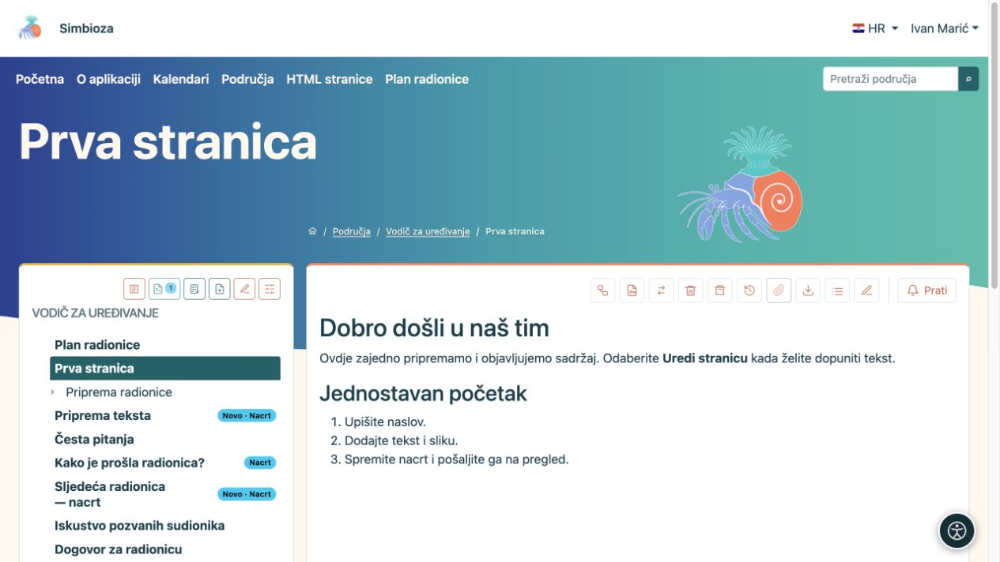
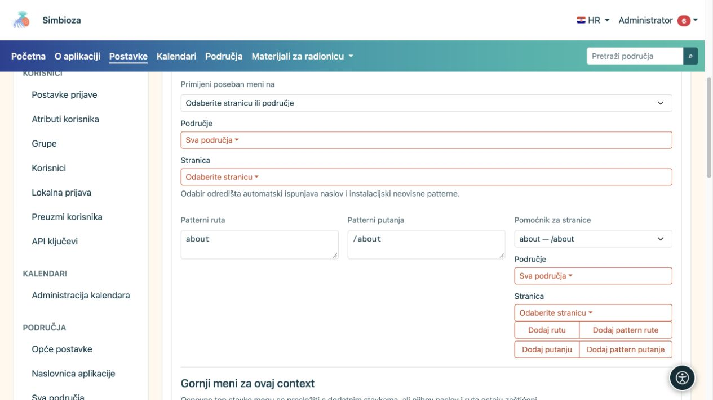
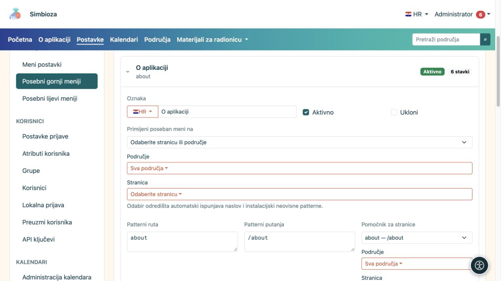
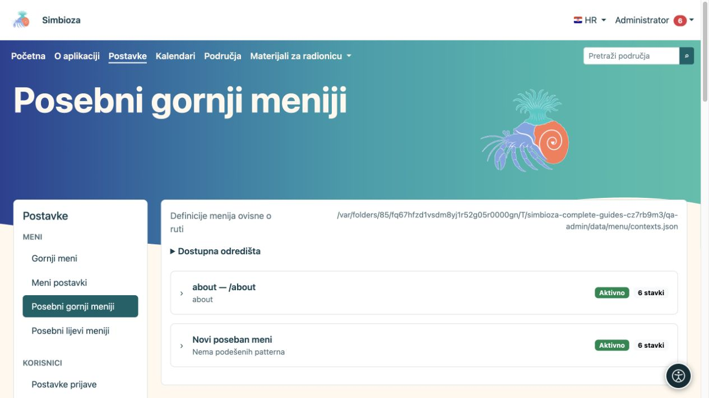
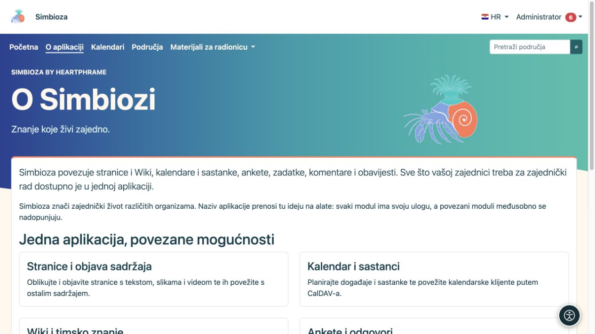

# Posebni izbornici za područje ili ekran

[Izbornici](izbornici_hr.md)

Poseban meni prilagođava navigaciju mjestu na kojem korisnik radi. Primjerice, područje škole može imati izravne poveznice na raspored, materijale i kontakte. Sadržaj i prava time se ne premještaju.

## Uredite meni svojeg područja

*Upravitelj područja može birati odredište i spremiti svoj meni; nema pristup globalnim Postavkama.*

**Za koga:** administrator ili upravitelj s pravom **Upravljanje** na odabranom području.

1. Otvorite postavke svojeg područja i **Posebni meniji**.
2. Odaberite gornji ili lijevi dio obrasca. Oba se spremaju odvojeno.
3. Dodajte razumljivo imenovane stavke i odredišta te ih [rasporedite strelicama](izbornici-stavke_hr.md).
4. Za lijevi meni unesite i njegov **Naslov lijevog menija** na potrebnim jezicima.
5. Odaberite **Spremi ovaj meni** za upravo uređeni dio.
6. Otvorite čitalački prikaz stranice tog područja i provjerite prikaz drugim računom.

**Rezultat:** poseban meni vrijedi za odabrano područje i njegove stranice. Ovaj obrazac ne dopušta upravitelju mijenjanje opsega na drugo područje ili cijelu aplikaciju. Za to nisu dovoljna obična prava čitanja ili uređivanja stranice.

*Nakon spremanja poveznica Plan radionice pojavljuje se u gornjem meniju odabranog područja.*

Gornji poseban meni prikazuje osnovne stavke glavnog menija zajedno s dodatnima. Osnovne su označene kao **Osnovna stavka**: možete ih rasporediti ili uključiti/isključiti za taj poseban meni, ali njihov naziv i odredište ovdje su zaštićeni. Njihov zajednički naziv administrator mijenja u glavnom gornjem meniju.

Lijevi poseban meni dodatni je blok poveznica. Ne zamjenjuje niti sam izrađuje hijerarhiju stranica područja. Stablo i njegove ovlasti ostaju dio Područja.

## Administratorski poseban meni za ekran

*U primjeru je poseban meni vezan uz rutu about i putanju /about; pomoćnik olakšava unos tih pravila.*

*Otvoreni zapis prikazuje naziv, aktivnost, odabir cilja i pravila primjene posebnog izbornika.*

*Posebni gornji meniji imaju vlastite zapise; otvorite odgovarajući zapis ili novi meni prije uređivanja njegova opsega.*

Administrator u **Postavke → Meni → Posebni gornji meniji** ili **Posebni lijevi meniji** može izraditi zaseban zapis.

1. Otvorite **Novi poseban meni**.
2. U **Primijeni poseban meni na** odaberite odgovarajući ekran, područje ili stranicu.
3. Provjerite automatski popunjene podatke o opsegu. Ponuđeni birač sigurniji je od ručnog pogađanja patterna.
4. Uredite stavke i, za lijevi meni, naslov.
5. Provjerite **Aktivno** i odaberite **Spremi ovaj meni**.

Napredni dio **Patterni ruta/putanja** određuje gdje se zapis primjenjuje. `*` znači više odgovarajućih nastavaka, pa preširok pattern može zahvatiti više ekrana nego što želite. Koristite ga samo ako razumijete konkretne ponuđene rute. Nemojte kopirati punu adresu drugog sitea u instalacijski neovisni pattern.

## Vratite zajedničku navigaciju

*U ovom primjeru stranica O aplikaciji ima poseban gornji meni bez stavke Postavke, dok se ostatak sadržaja stranice ne mijenja.*

Bez aktivnog odgovarajućeg posebnog gornjeg menija koristi se zajednički gornji meni. Za povrat isključite cijeli poseban zapis i spremite ili označite njegovo **Ukloni** pa spremite. To ne briše povezana odredišta. Dodatni lijevi blok nestaje kada više nema odgovarajućeg aktivnog lijevog menija.

Gornji i lijevi posebni meni mogu dolaziti iz zasebnih zapisa. Ne postoji jedan univerzalan prekidač „zamijeni/naslijedi” za sve vrste: uredite upravo onaj dio koji želite promijeniti i provjerite rezultat na ciljnoj stranici. Ako imate više preklopljenih posebnih zapisa, administrator treba provjeriti njihov opseg prije dodavanja još jednog.
