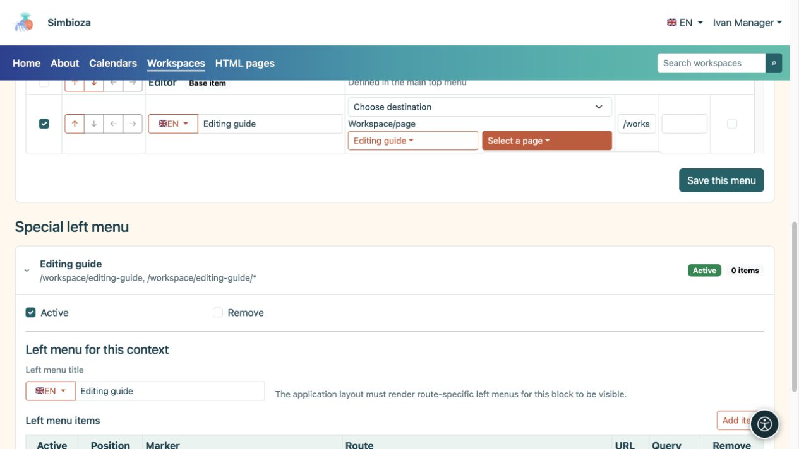
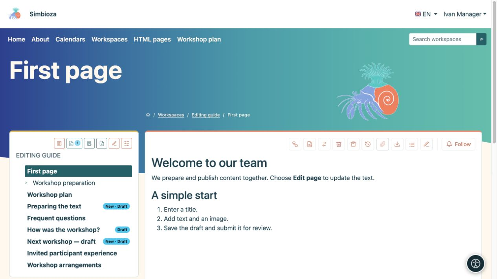
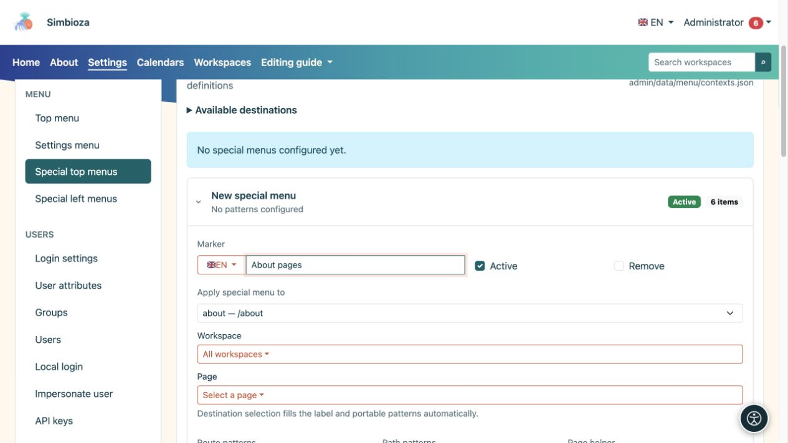
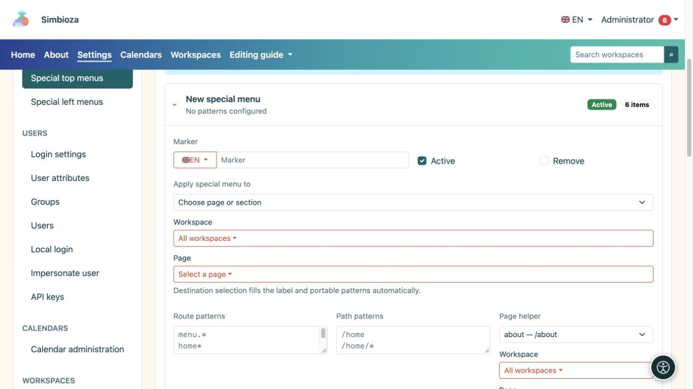
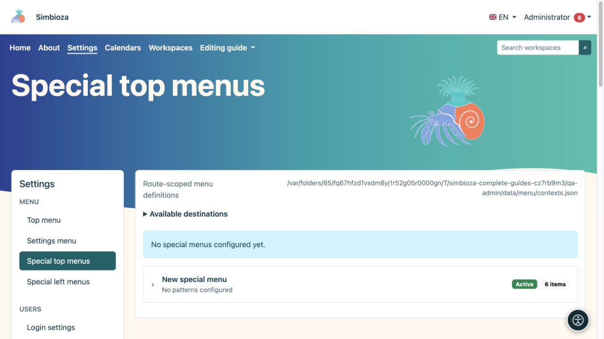
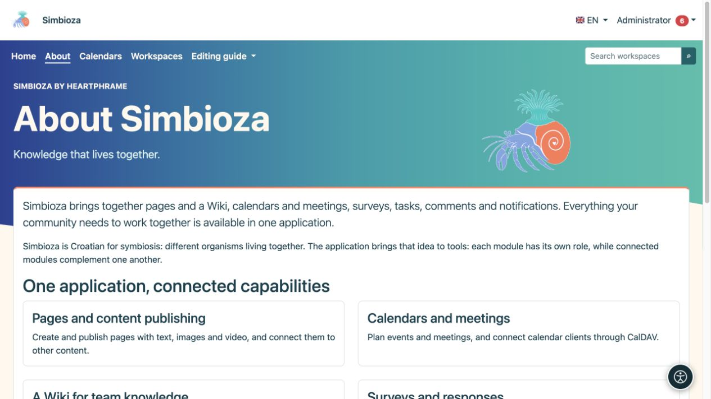

# Menu speciali per un'area di lavoro o una schermata

> Le schermate mostrano l’interfaccia in inglese.

[Menu](izbornici_it.md)

Un menu speciale adatta la navigazione al luogo in cui le persone lavorano. Ad esempio, l'area di lavoro di una scuola può collegarsi direttamente a orari, materiali e contatti. Ciò non sposta il contenuto né modifica le autorizzazioni.

## Modifica il menu dell'area di lavoro

*Un gestore dell'area di lavoro può scegliere una destinazione e salvare il menu senza accedere alle Impostazioni globali.*

**Pubblico:** l'amministratore o un manager con l'autorizzazione **Gestisci** per quell'area di lavoro.

1. Apri le impostazioni dell'area di lavoro e i **Menu speciali**.
2. Scegli la sezione in alto o a sinistra. Ciascuno viene salvato separatamente.
3. Aggiungi elementi e destinazioni con nomi chiari, quindi [disponili con le frecce](izbornici-stavke_it.md).
4. Per un menu a sinistra, inserisci anche il **Titolo del menu a sinistra** nelle lingue richieste.
5. Scegli **Salva questo menu** per la sezione che stai modificando.
6. Apri una pagina in quell'area di lavoro nella sua vista di lettura e controllala con un altro account.

**Risultato:** il menu speciale si applica all'area di lavoro selezionata e alle sue pagine. Questo modulo non permette al responsabile di estenderne l'ambito a un'altra area di lavoro o all'intera applicazione. Le normali autorizzazioni di lettura o modifica delle pagine non bastano.

*Dopo il salvataggio, il piano del workshop viene visualizzato nel menu superiore dell'area di lavoro selezionata.*

Il menu superiore speciale combina gli elementi di base del menu principale con elementi aggiuntivi. Gli elementi di base sono contrassegnati come **Elemento di base**: puoi riordinarli o abilitarli/disabilitarli per questo menu speciale, ma qui le loro etichette e destinazioni sono protette. L'amministratore modifica le etichette condivise nel menu superiore principale.

Un menu speciale a sinistra è un blocco aggiuntivo di collegamenti. Non sostituisce né crea la gerarchia delle pagine dell'area di lavoro. L'albero delle pagine e le relative autorizzazioni restano parte delle aree di lavoro.

## Menu speciale dell'amministratore per una schermata

*In questo esempio, il menu speciale si applica alla route about e al percorso /about; lo strumento di supporto facilita l'inserimento delle regole.*

*La voce espansa mostra la sua etichetta, lo stato attivo, la selezione del target e le regole che applicano quel menu speciale.*

*I menu superiori speciali hanno voci separate; espandere la voce corretta o un nuovo menu prima di modificarne l'ambito.*

In **Impostazioni → Menu → Menu speciali in alto** o **Menu speciali a sinistra**, l'amministratore può creare un record separato.

1. Apri **Nuovo menu speciale**.
2. In **Applica menu speciale a**, seleziona la schermata, l'area di lavoro o la pagina appropriata.
3. Controlla l'ambito compilato automaticamente. Usare il selettore è più sicuro che indovinare manualmente i modelli.
4. Modifica i suoi elementi e, per un menu a sinistra, il suo titolo.
5. Seleziona **Attivo** e scegli **Salva questo menu**.

La sezione avanzata **Modelli di route/percorso** determina dove si applica la voce. `*` corrisponde a più suffissi, quindi un modello ampio può influire su più schermate del previsto. Usalo soltanto se conosci le specifiche route dell'applicazione. Non copiare l'indirizzo completo di un altro sito in un modello indipendente dall'installazione.

## Torna alla navigazione condivisa

*In questo esempio, Informazioni ha un menu superiore speciale senza Impostazioni, mentre il contenuto della pagina rimane lo stesso.*

Senza un menu superiore speciale corrispondente attivo, viene utilizzato il menu superiore condiviso. Per ritornarvi, disabilita l'intero record speciale e salva, oppure seleziona la sua opzione **Rimuovi** e salva. Ciò non elimina le sue destinazioni. Il blocco sinistro aggiuntivo scompare quando non corrisponde alcun menu sinistro attivo.

I menu speciali in alto e a sinistra possono provenire da record separati. Non esiste un interruttore universale "sostituisci/eredita" per ogni tipo: modifica la parte che desideri effettivamente modificare e controllala sulla pagina di destinazione. Se diversi record speciali si sovrappongono, l'amministratore dovrebbe esaminarne l'ambito prima di aggiungerne un altro.
