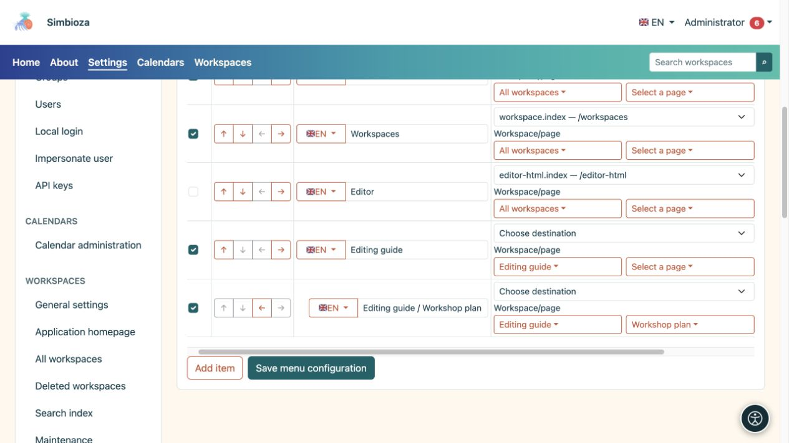
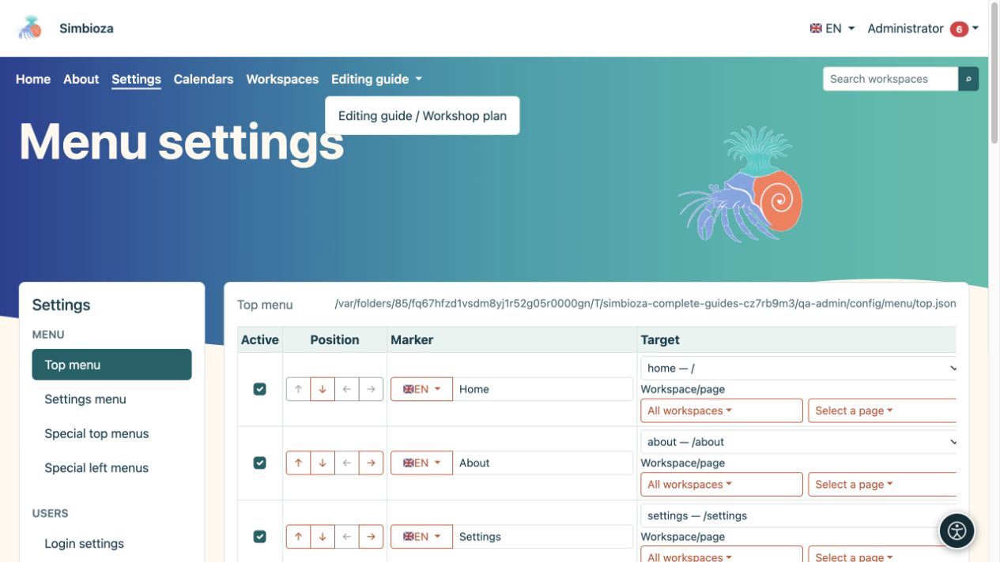

# Menüeinträge hinzufügen und anordnen

> Die Bildschirmaufnahmen zeigen die englische Benutzeroberfläche.

[Menüs](izbornici_de.md)

**Zielgruppe:** der Administrator unter **Einstellungen → Menü → Hauptmenü** oder **Einstellungsmenü**. Ein Arbeitsbereichsmanager verwendet dieselben grundlegenden Aktionen im Spezialmenü seines Arbeitsbereichs.

## Fügen Sie einen Link hinzu

*Ein Arbeitsbereich und seine Seite werden separat ausgewählt; Jede Zeile hat ihre eigene Beschriftung und ihr eigenes Ziel.*

1. Wählen Sie **Eintrag hinzufügen**.
2. Geben Sie unter **Label** einen kurzen Zielnamen ein, z. B. „Workshop-Materialien“.
3. Verwenden Sie die Flaggenauswahl, um eine andere installierte Sprache auszuwählen und deren Übersetzung einzugeben. Kehren Sie zur ersten Sprache zurück, um zu überprüfen, ob deren Bezeichnung noch im Formular vorhanden ist.
4. Wählen Sie unter **Ziel** ein verfügbares Anwendungsziel aus. Verwenden Sie die entsprechende Auswahl und suchen Sie nach einem Arbeitsbereich oder einer Seite. Längere Listen werden auf begrenzten Seiten geladen.
5. Geben Sie für ein externes Ziel dessen vollständige **URL** ein, z. B. `https://example.org/schedule`. Konfigurieren Sie nicht gleichzeitig ein Anwendungsziel und eine manuelle URL.
6. Aktivieren Sie **Aktiv** und wählen Sie **Menükonfiguration speichern**.
7. Öffnen Sie den gerenderten Link und überprüfen Sie sein Ziel.

**Ergebnis:** Der Link verfügt über Beschriftungen in den verfügbaren Sprachen. Die Label-Eingabe bearbeitet die durch ihr Flag ausgewählte Sprache; Fügen Sie nicht jede Übersetzung in die gleiche Texteingabe ein.

Bevorzugen Sie die Zielauswahl für interne Inhalte, damit das System die Adresse für die aktuelle Installation erstellen kann. Verwenden Sie für eine manuelle interne URL einen Anwendungspfad wie `/calendars`, ohne die Adresse einer anderen Testinstallation.

**Abfrage** enthält zusätzliche Parameter für eine ausgewählte Anwendungsroute, zum Beispiel `section=users`. Es ist kein Feld für HTML oder JavaScript. Lassen Sie es leer, wenn das Ziel keine Parameter benötigt. Fügen Sie bei einer manuellen URL Parameter in diese URL selbst ein.

## Ordnen Sie Elemente neu an und erstellen Sie untergeordnete Elemente

*Ein gespeichertes untergeordnetes Element wird in seinem übergeordneten Dropdown-Menü geöffnet. Überprüfen Sie das Ergebnis in der oberen Navigation.*

Verwenden Sie die Pfeile unter **Position**:

| Aktion | Ergebnis |
|---|---|
| Nach oben/unten bewegen | Ändert die Position des Elements im Menü. |
| Eine Ebene einrücken | Platziert es unter dem vorhergehenden passenden Eintrag. |
| Eine Ebene nach hinten verschieben | Verschiebt einen untergeordneten Eintrag in die oberste Ebene. |

Fügen Sie zuerst das übergeordnete Element hinzu, fügen Sie verwandte Elemente darunter ein und rücken Sie sie dann ein. Ein übergeordnetes Label kann untergeordnete Elemente ohne eigenen Link gruppieren. Überprüfen Sie das resultierende Dropdown-Menü auf dem Desktop und auf Mobilgeräten und speichern Sie es dann. Die Pfeile speichern die Konfiguration nicht automatisch.

## Vorübergehend ausblenden oder entfernen

- Deaktivieren Sie **Aktiv** und speichern Sie, um ein Element vorübergehend auszublenden.
- Wählen Sie **Entfernen** und speichern Sie es, um es aus der Konfiguration zu entfernen. Bevor Sie ein übergeordnetes Element entfernen, verschieben Sie alle benötigten untergeordneten Elemente und überprüfen Sie die gesamte Gruppe.

Dadurch werden die Zielseite, der Zielkalender oder die Zielumfrage nicht gelöscht. Ändern Sie die Zielgruppe in den [eigenen Berechtigungen des Inhalts](izbornici-vidljivost_de.md).

## Symbole neben Elementen

Dieses Formular verfügt nicht über eine separate Symbolauswahl für jedes Element. Das Design kann Symbole anzeigen, die bereits von der Elementkonfiguration oder ihrem Modul bereitgestellt werden. Platzieren Sie `` oder andere HTML nicht in einer Beschriftung, wenn Sie ein Symbol erwarten: Beschriftungen bestehen aus reinem Text. Behalten Sie immer eine verständliche Textbeschriftung bei.
