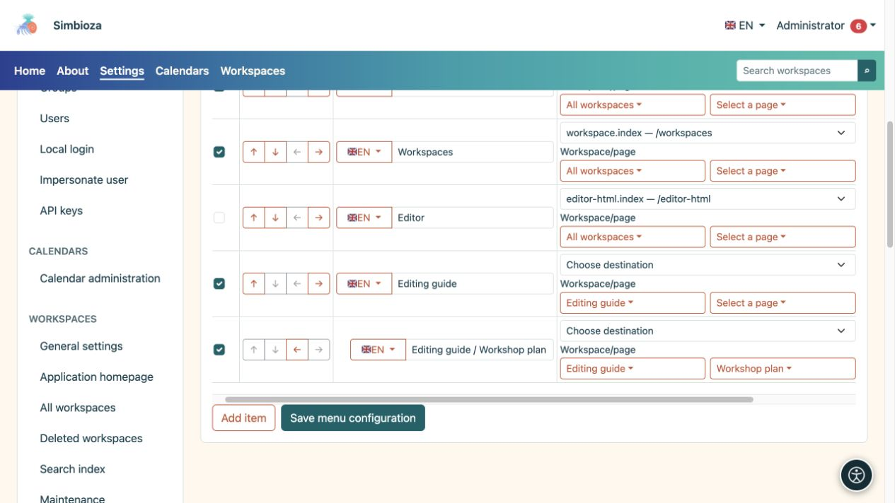
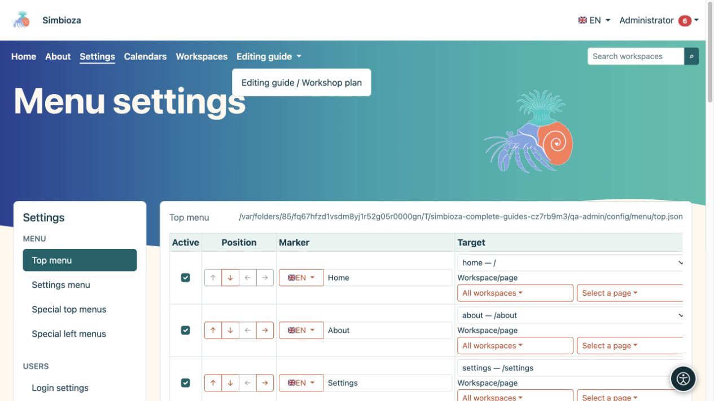

# Add and arrange menu items

[Menus](izbornici_en.md)

**Audience:** the administrator under **Settings → Menu → Top menu** or **Settings menu**. A workspace manager uses the same basic actions within their workspace's special menu.

## Add a link

*A workspace and its page are selected separately; each row has its own label and destination.*

1. Choose **Add item**.
2. Enter a short destination name in **Label**, such as “Workshop materials”.
3. Use the flag selector to choose another installed language and enter its translation. Return to the first language to check its label is still present in the form.
4. Select an available application destination under **Destination**. Use the relevant picker and search for a workspace or page; longer lists load in bounded pages.
5. For an external destination, enter its full **URL**, such as `https://example.org/schedule`. Do not configure both an application destination and a manual URL.
6. Check **Active** and choose **Save menu configuration**.
7. Open the rendered link and verify its destination.

**Result:** the link has labels in the available languages. The label input edits the language selected by its flag; do not put every translation in the same text input.

Prefer the destination picker for internal content so the system can build the address for the current installation. For a manual internal URL, use an application path such as `/calendars`, without another test installation's address.

**Query** holds extra parameters for a selected application route, for example `section=users`. It is not a field for HTML or JavaScript. Leave it empty when the destination needs no parameters. For a manual URL, include parameters in that URL itself.

## Reorder items and create children

*A saved child item opens in its parent dropdown; check the result in the top navigation.*

Use the arrows under **Position**:

| Action | Result |
|---|---|
| Move up / down | Changes the item's position in the menu. |
| Indent one level | Places it under the preceding suitable item. |
| Outdent one level | Moves a child towards the top level. |

Add the parent first, put related items below it, then indent them. A parent label can group children without a link of its own. Check the resulting dropdown on desktop and mobile, then save. The arrows do not save configuration automatically.

## Hide temporarily or remove

- Clear **Active** and save to hide an item temporarily.
- Select **Remove** and save to remove it from configuration. Before removing a parent, move any children you need and check the whole group.

This does not delete the destination page, calendar, or survey. Change its audience in the [content's own permissions](izbornici-vidljivost_en.md).

## Icons beside items

This form has no separate icon picker for each item. The theme can display icons already supplied by item configuration or its module. Do not place `` or other HTML in a label expecting an icon: labels are plain text. Always retain an understandable text label.
