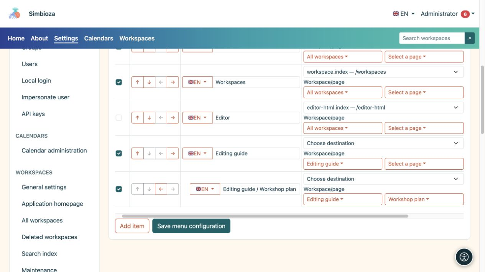
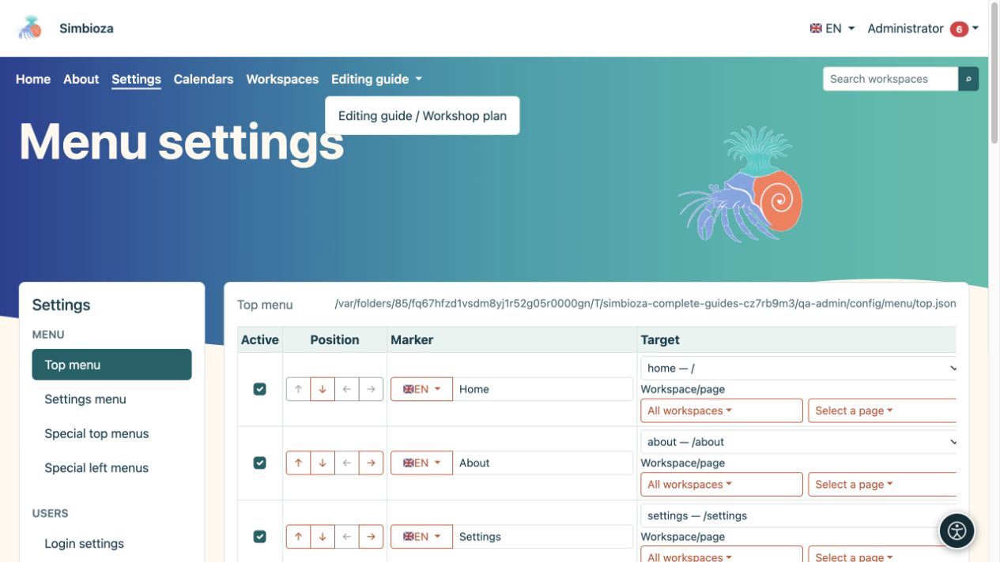

# Añadir y ordenar elementos del menú

> Las capturas de pantalla muestran la interfaz en inglés.

[Menús](izbornici_es.md)

**Audiencia:** el administrador en **Configuración → Menú → Menú superior** o **Menú de configuración**. Un administrador de espacio de trabajo utiliza las mismas acciones básicas dentro del menú especial de su espacio de trabajo.

## Agregar un enlace

*Un espacio de trabajo y su página se seleccionan por separado; cada fila tiene su propia etiqueta y destino.*

1. Elija **Agregar elemento**.
2. Ingrese un nombre de destino corto en **Etiqueta**, como "Materiales del taller".
3. Utilice el selector de banderas para elegir otro idioma instalado e ingrese su traducción. Regrese al primer idioma para verificar que su etiqueta aún esté presente en el formulario.
4. Seleccione un destino de aplicación disponible en **Destino**. Utilice el selector correspondiente y busque un espacio de trabajo o una página; Las listas más largas se cargan en páginas delimitadas.
5. Para un destino externo, ingrese su **URL** completa, como `https://example.org/schedule`. No configure al mismo tiempo un destino de aplicación y una URL manual.
6. Marque **Activo** y elija **Guardar configuración del menú**.
7. Abra el enlace renderizado y verifique su destino.

**Resultado:** el enlace tiene etiquetas en los idiomas disponibles. La entrada de etiqueta edita el idioma seleccionado por su bandera; no coloque todas las traducciones en la misma entrada de texto.

Prefiera el selector de destino para el contenido interno para que el sistema pueda crear la dirección para la instalación actual. Para una URL interna manual, utilice una ruta de aplicación como `/calendars`, sin otra dirección de instalación de prueba.

**Consulta** contiene parámetros adicionales para una ruta de aplicación seleccionada, por ejemplo `section=users`. No es un campo para HTML o JavaScript. Déjelo vacío cuando el destino no necesite parámetros. Para una URL manual, incluya parámetros en esa URL.

## Reordenar elementos y crear hijos.

*Un elemento secundario guardado se abre en su menú desplegable principal; verifique el resultado en la navegación superior.*

Utilice las flechas debajo de **Posición**:

| Acción | Resultado |
|---|---|
| Mover arriba/abajo | Cambia la posición del elemento en el menú. |
| Sangrar un nivel | Lo coloca debajo del elemento adecuado anterior. |
| Salir un nivel | Acerca un elemento secundario al nivel superior. |

Añada primero el elemento superior, coloque debajo los elementos relacionados y aplíqueles sangría. Un elemento superior puede agrupar elementos secundarios sin tener un enlace propio. Compruebe el menú desplegable resultante en un ordenador y en un móvil, y guarde los cambios. Las flechas no guardan la configuración automáticamente.

## Ocultar temporalmente o eliminar

- Borre **Activo** y guárdelo para ocultar un elemento temporalmente.
- Seleccione **Eliminar** y guarde para quitar el elemento de la configuración. Antes de eliminar un elemento superior, mueva los elementos secundarios que desee conservar y revise todo el grupo.

Esto no elimina la página de destino, el calendario o la encuesta. Cambie su audiencia en los [permisos propios del contenido](izbornici-vidljivost_es.md).

## Iconos al lado de los elementos

Este formulario no tiene un selector de íconos separado para cada elemento. El tema puede mostrar iconos ya proporcionados por la configuración del elemento o su módulo. No coloque `` u otro HTML en una etiqueta esperando un ícono: las etiquetas son texto sin formato. Conserve siempre una etiqueta de texto comprensible.
