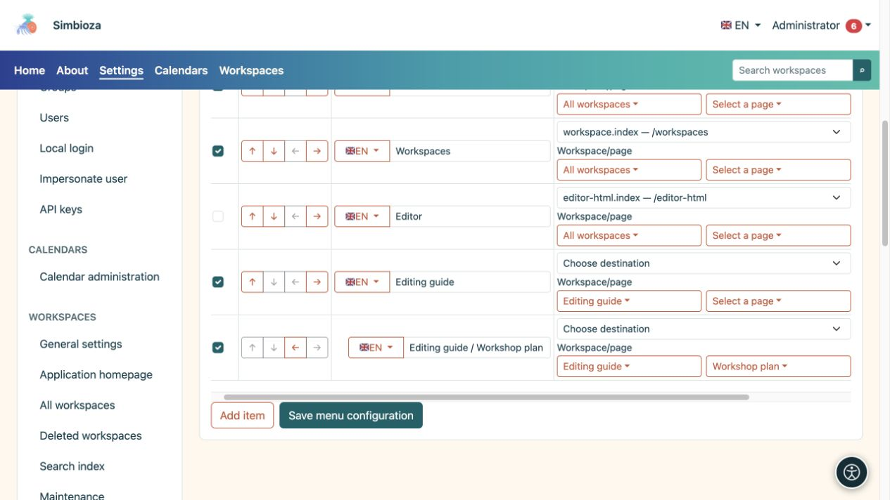
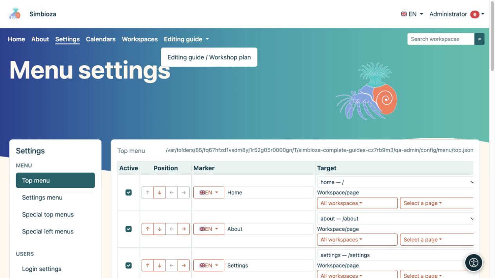

# Ajouter et organiser les éléments de menu

> Les captures d’écran présentent l’interface en anglais.

[Menus](izbornici_fr.md)

**Audience :** l'administrateur sous **Paramètres → Menu → Menu principal** ou **Menu Paramètres**. Un gestionnaire d'espace de travail utilise les mêmes actions de base dans le menu spécial de son espace de travail.

## Ajouter un lien

*Un espace de travail et sa page sont sélectionnés séparément ; chaque ligne a sa propre étiquette et sa propre destination.*

1. Choisissez **Ajouter un élément**.
2. Saisissez un nom de destination court dans **Étiquette**, tel que « Matériel d'atelier ».
3. Utilisez le sélecteur de drapeau pour choisir une autre langue installée et saisir sa traduction. Revenez à la première langue pour vérifier que son label est toujours présent dans le formulaire.
4. Sélectionnez une destination d'application disponible sous **Destination**. Utilisez le sélecteur approprié et recherchez un espace de travail ou une page ; les listes plus longues se chargent dans des pages délimitées.
5. Pour une destination externe, saisissez son **URL** complète, par exemple `https://example.org/schedule`. Ne configurez pas à la fois une destination d’application et une URL manuelle.
6. Cochez **Actif** et choisissez **Enregistrer la configuration du menu**.
7. Ouvrez le lien rendu et vérifiez sa destination.

**Résultat :** le lien comporte des étiquettes dans les langues disponibles. L'entrée label édite la langue sélectionnée par son drapeau ; ne mettez pas toutes les traductions dans la même entrée de texte.

Préférez le sélecteur de destination pour le contenu interne afin que le système puisse créer l'adresse de l'installation actuelle. Pour une URL interne manuelle, utilisez un chemin d’application tel que `/calendars`, sans l’adresse d’une autre installation de test.

**Query** contient des paramètres supplémentaires pour une route d'application sélectionnée, par exemple `section=users`. Ce n'est pas un champ pour HTML ou JavaScript. Laissez-le vide lorsque la destination n'a besoin d'aucun paramètre. Pour une URL manuelle, incluez des paramètres dans cette URL elle-même.

## Réorganiser les articles et créer des enfants

*Un élément enfant enregistré s'ouvre dans la liste déroulante parent ; vérifiez le résultat dans la navigation supérieure.*

Utilisez les flèches sous **Position** :

| Action | Résultat |
|---|---|
| Déplacer vers le haut/bas | Modifie la position de l'élément dans le menu. |
| Indenter d'un niveau | Le place sous l’élément approprié précédent. |
| Dépasser d'un niveau | Déplace un enfant vers le niveau supérieur. |

Ajoutez d'abord le parent, placez les éléments associés en dessous, puis mettez-les en retrait. Une étiquette parent peut regrouper des enfants sans lien propre. Vérifiez la liste déroulante résultante sur ordinateur et mobile, puis enregistrez. Les flèches n'enregistrent pas automatiquement la configuration.

## Masquer temporairement ou supprimer

- Désactivez **Actif** et enregistrez pour masquer temporairement un élément.
- Sélectionnez **Supprimer** et enregistrez pour le supprimer de la configuration. Avant de supprimer un parent, déplacez tous les enfants dont vous avez besoin et vérifiez l'ensemble du groupe.

Cela ne supprime pas la page de destination, le calendrier ou le sondage. Modifiez son audience dans les [autorisations propres au contenu](izbornici-vidljivost_fr.md).

## Icônes à côté des éléments

Ce formulaire n'a pas de sélecteur d'icônes distinct pour chaque élément. Le thème peut afficher des icônes déjà fournies par la configuration de l'élément ou son module. Ne placez pas `` ou autre HTML dans une étiquette en attendant une icône : les étiquettes sont du texte brut. Conservez toujours une étiquette de texte compréhensible.
