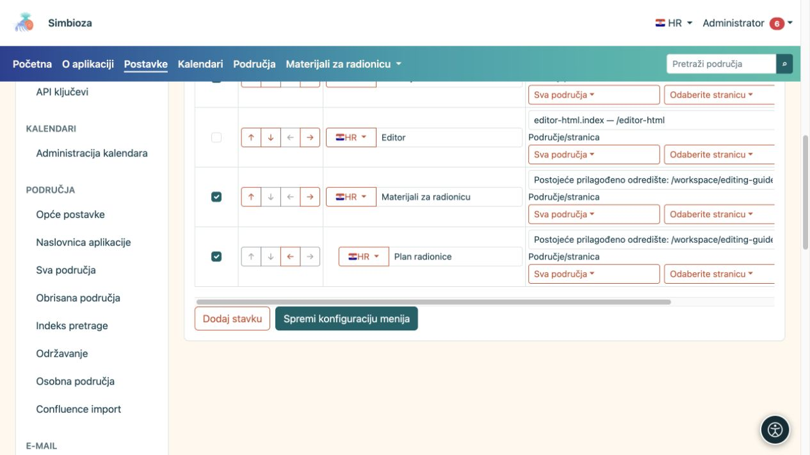
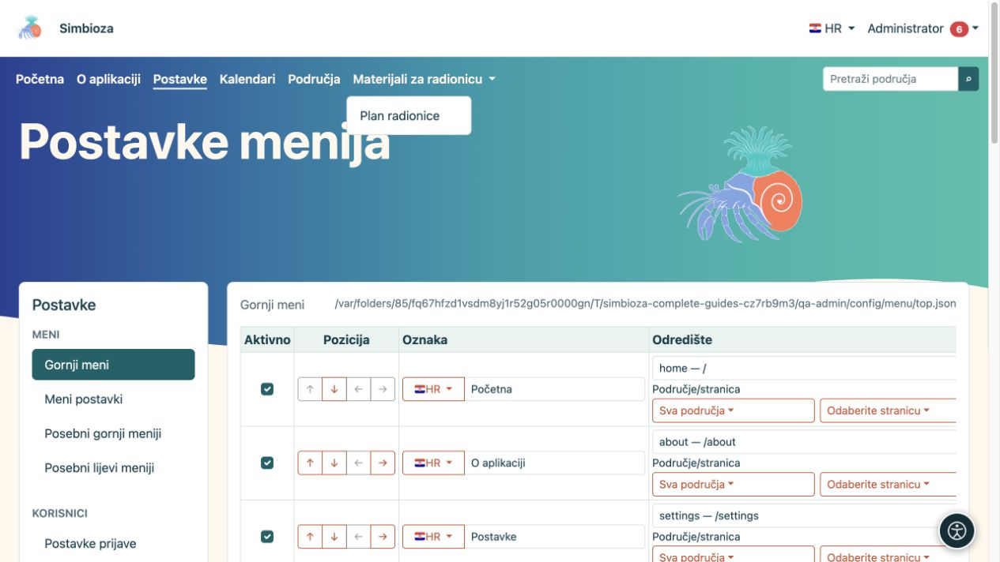

# Dodajte i rasporedite stavke izbornika

[Izbornici](izbornici_hr.md)

**Za koga:** administrator u **Postavke → Meni → Gornji meni** ili **Meni postavki**. U posebnom meniju područja iste osnovne radnje koristi njegov upravitelj.

## Dodajte poveznicu

*Stavka područja i njezina stranica biraju se zasebno; svaki redak ima vlastiti naziv i odredište.*

1. Odaberite **Dodaj stavku**.
2. U **Oznaka** unesite kratak naziv koji opisuje odredište, primjerice „Materijali radionice”.
3. U izborniku sa zastavicom odaberite drugi instalirani jezik i unesite njegov prijevod. Vratite se na prvi jezik i provjerite da je naziv ostao spremljen u obrascu.
4. U **Odredište** odaberite ponuđeni dio aplikacije. Za područje ili stranicu koristite pripadajući birač i pretragu; veći popisi učitavaju se u dijelovima.
5. Za vanjsko odredište upišite puni **URL**, primjerice `https://example.org/raspored`. Nemojte istodobno zadavati i aplikacijsko odredište i vlastiti URL.
6. Provjerite **Aktivno** i odaberite **Spremi konfiguraciju menija**.
7. Otvorite poveznicu u prikazu i provjerite odredište.

**Rezultat:** dodana je poveznica s nazivom na raspoloživim jezicima. Polje naziva uređuje jezik odabran zastavicom; ne upisujte sve prijevode u isto tekstualno polje.

Za unutarnji sadržaj prednost dajte ponuđenom odredištu. Sustav tada može oblikovati adresu za trenutačnu instalaciju. Ako ručno koristite unutarnji URL, koristite putanju aplikacije poput `/calendars`, bez adrese tuđe testne instalacije.

**Query** je dodatni parametar ponuđene aplikacijske rute, primjerice `section=users`. To nije polje za cijeli HTML ili JavaScript. Ostavite ga praznim kada odredište ne traži dodatne parametre. Uz ručni URL parametre upišite u sam URL.

## Promijenite redoslijed i napravite podstavke

*Spremljena podstavka otvara se u padajućem meniju roditelja; rezultat provjerite u navigaciji na vrhu.*

Strelice u stupcu **Pozicija** mijenjaju raspored:

| Radnja | Rezultat |
|---|---|
| Pomakni gore / dolje | Pomiče stavku u redoslijedu izbornika. |
| Uvuci jednu razinu | Smješta stavku pod prethodnu prikladnu stavku. |
| Izvuci jednu razinu | Vraća podstavku prema glavnoj razini. |

Najprije dodajte nadređenu stavku, zatim povezane stavke ispod nje i uvucite ih. Nadređeni naslov može grupirati podstavke bez vlastite poveznice. Provjerite dobiveni padajući meni na računalu i mobitelu, pa spremite raspored. Strelice same ne spremaju konfiguraciju.

## Privremeno sakrijte ili uklonite stavku

- Uklonite kvačicu **Aktivno** i spremite za privremeno skrivanje.
- Označite **Ukloni** i spremite za uklanjanje stavke iz konfiguracije. Ako uklanjate nadređenu stavku, prvo premjestite potrebne podstavke i provjerite cijelu skupinu.

To ne briše stranicu, kalendar ni anketu na odredištu. Za promjenu publike otvorite [prava samog sadržaja](izbornici-vidljivost_hr.md).

## Ikone uz stavke

Ovaj obrazac nema zasebni birač ikone za svaku stavku. Tema može prikazivati ikone koje stavka već ima u konfiguraciji ili ih postavlja modul. Ne unosite `` ili drugi HTML u naziv očekujući novu ikonu: naziv je običan tekst. Za smisao stavke uvijek ostavite čitljiv naziv.
