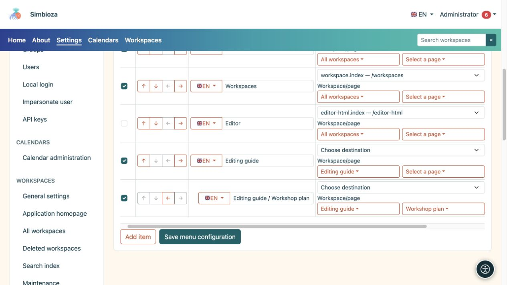
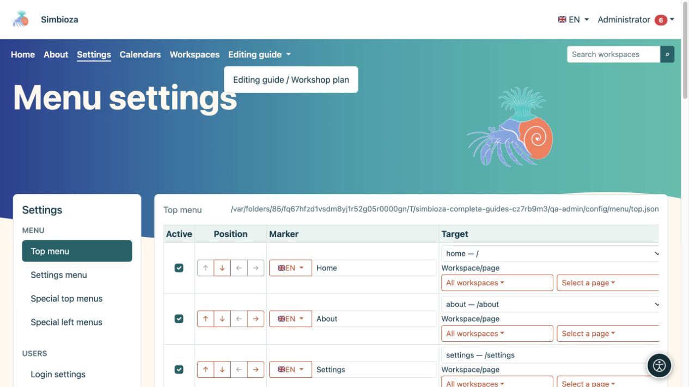

# Aggiungi e organizza le voci di menu

> Le schermate mostrano l’interfaccia in inglese.

[Menu](izbornici_it.md)

**Destinatari:** l'amministratore in **Impostazioni → Menu → Menu superiore** o **Menu Impostazioni**. Un responsabile di un'area di lavoro usa le stesse azioni di base nel menu speciale della propria area.

## Aggiungi un collegamento

*Un'area di lavoro e la relativa pagina vengono selezionati separatamente; ogni riga ha la propria etichetta e destinazione.*

1. Scegli **Aggiungi elemento**.
2. Inserisci un breve nome di destinazione in **Etichetta**, ad esempio "Materiali del workshop".
3. Usa il selettore con la bandiera per scegliere un'altra lingua installata e inserisci la traduzione. Torna alla prima lingua per verificare che la sua etichetta sia ancora presente nel modulo.
4. Seleziona una destinazione per l'applicazione disponibile in **Destinazione**. Utilizza il selettore pertinente e cerca un'area di lavoro o una pagina; elenchi più lunghi vengono caricati in pagine delimitate.
5. Per una destinazione esterna, inserisci l'**URL** completo, ad esempio `https://example.org/schedule`. Non configurare sia la destinazione dell'applicazione che un URL manuale.
6. Seleziona **Attivo** e scegli **Salva configurazione menu**.
7. Apri il collegamento renderizzato e verificane la destinazione.

**Risultato:** il collegamento presenta etichette nelle lingue disponibili. Il campo dell'etichetta modifica la lingua selezionata con la bandiera; non inserire tutte le traduzioni nello stesso campo di testo.

Preferire il selettore di destinazione per il contenuto interno in modo che il sistema possa creare l'indirizzo per l'installazione corrente. Per un URL interno manuale, utilizzare un percorso dell'applicazione come `/calendars`, senza l'indirizzo di un'altra installazione di prova.

**Query** contiene parametri aggiuntivi per un percorso dell'applicazione selezionato, ad esempio `section=users`. Non è un campo per HTML o JavaScript. Lasciarlo vuoto quando la destinazione non necessita di parametri. Per un URL manuale, includi i parametri nell'URL stesso.

## Riordinare gli elementi e creare sottoelementi

*Un sottoelemento salvato si apre nel menu a discesa dell'elemento superiore; controlla il risultato nella navigazione superiore.*

Utilizza le frecce sotto **Posizione**:

| Azione | Risultato |
|---|---|
| Muoviti su/giù | Modifica la posizione dell'elemento nel menu. |
| Rientro di un livello | Lo posiziona sotto l'elemento adatto precedente. |
| Riduci il rientro di un livello | Sposta un sottoelemento verso il livello superiore. |

Aggiungi prima l'elemento superiore, posiziona sotto di esso gli elementi correlati e poi aumentane il rientro. Un'etichetta superiore può raggruppare sottoelementi senza avere un collegamento proprio. Controlla il menu a discesa risultante su computer e dispositivo mobile, quindi salva. Le frecce non salvano automaticamente la configurazione.

## Nascondi temporaneamente o rimuovi

- Deseleziona **Attivo** e salva per nascondere temporaneamente un elemento.
- Seleziona **Rimuovi** e salva per rimuovere l'elemento dalla configurazione. Prima di rimuovere un elemento superiore, sposta i sottoelementi che vuoi conservare e controlla l'intero gruppo.

Ciò non elimina la pagina di destinazione, il calendario o il sondaggio. Modificare il pubblico nelle [autorizzazioni del contenuto](izbornici-vidljivost_it.md).

## Icone accanto agli elementi

Questo modulo non dispone di un selettore di icone separato per ciascun elemento. Il tema può visualizzare le icone già fornite dalla configurazione dell'articolo o dal suo modulo. Non inserire `` o altro HTML in un'etichetta che prevede un'icona: le etichette sono testo semplice. Conservare sempre un'etichetta di testo comprensibile.
