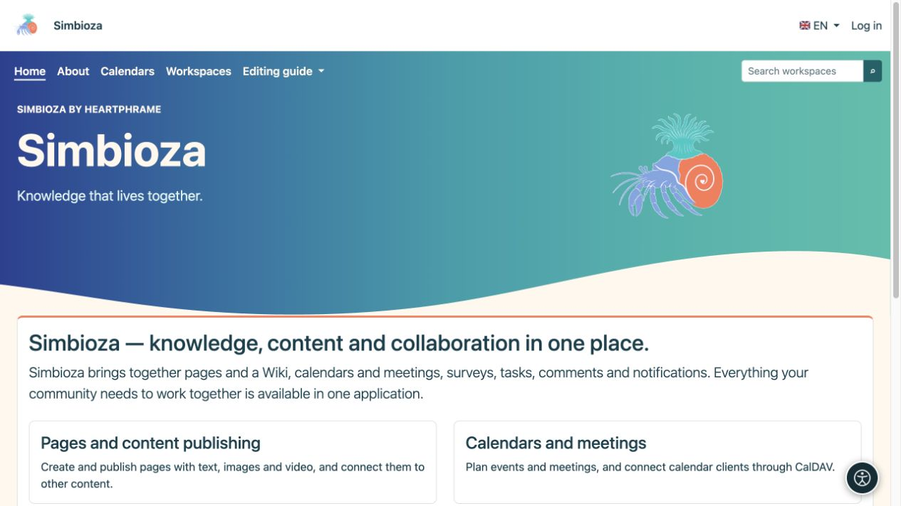

# Menüsichtbarkeit und Benutzerberechtigungen

> Die Bildschirmaufnahmen zeigen die englische Benutzeroberfläche.

[Menüs](izbornici_de.md)

Ein Link ist eine Möglichkeit, Inhalte zu erreichen. **Eine sichtbare Schaltfläche gewährt keinen Zugriff und eine ausgeblendete Schaltfläche entzieht ihn nicht.** Lese-, Erstellungs-, Bearbeitungs- und Veröffentlichungsberechtigungen gehören zum jeweiligen Inhalt oder Modul.

## Wer darf Menüs ändern?

| Rolle | Zulässiger Bereich |
|---|---|
| Site-Administrator | Gemeinsames Hauptmenü, Einstellungsmenü und Spezialmenüs. |
| Arbeitsbereichsmanager | Die speziellen oberen und linken Menüs ihres Arbeitsbereichs mit der Berechtigung „Verwalten“. |
| Herausgeber, Autor oder Herausgeber ohne Arbeitsbereichsverwaltung | Verwendet Navigation; Mit dieser Rolle allein ist die Bearbeitung von Arbeitsbereichsmenüs nicht möglich. |
| Gast oder gewöhnlicher Leser | Verwendet verfügbare Links und kann die Verwaltung nicht bearbeiten. |

Das Eintragformular verfügt über kein universelles Kontrollkästchen „Nur diese Gruppe darf zugreifen“. Um diese Einschränkung durchzusetzen, öffnen Sie die Berechtigungen des Arbeitsbereichs, der Seite, der Umfrage oder des Kalenders selbst.

## Was steuert, ob ein Element angezeigt wird?

- **Aktiv** bestimmt, ob ein Element im ausgewählten Menü angezeigt wird.
- Ein spezielles Menü erscheint nur auf den konfigurierten Bildschirmen.
- Links, die die verfügbaren Anwendungsrouten verwenden, können ausgeblendet werden, wenn das Zielmodul nicht verfügbar ist oder sein Zugriffsprüfer die Anzeige ablehnt.
- Die Anzeige einer Gruppe hängt auch von ihren sichtbaren untergeordneten Elementen ab. Überprüfen Sie nach dem Deaktivieren eines Elements die gesamte Gruppe, nicht nur die Zeile im Editor.
- Eine manuell eingegebene URL wird nicht zu einer Zugriffsregel. Es kann auch dann sichtbar bleiben, wenn sein Ziel den Benutzer zur Anmeldung auffordert oder den Zugriff verweigert. Geben Sie im Link-Label keine vertraulichen Informationen preis.

Durch das Ausblenden eines Menülinks wird ein privates Dokument nicht zusätzlich geschützt und ein öffentliches Dokument nicht privat gemacht. Beim direkten Öffnen der Adresse müssen weiterhin dieselben Berechtigungen erzwungen werden.

## Überprüfen Sie mehrere Rollen

*Der Administrator sieht die Einstellungen auf derselben Startseite. Das Anzeigen eines Elements und die Berechtigung, sein Ziel zu verwenden, sind separate Prüfungen.*

*Ein Gast hat keinen Einstellungseintrag; Öffentliche Inhalte und erlaubte Links bleiben ohne Anmeldung verfügbar.*

1. Speichern Sie das Menü und öffnen Sie das gewünschte Ziel mit Ihrem Konto.
2. Melden Sie sich als jemand an, der Zugriff haben sollte, und prüfen Sie, ob das Ziel funktioniert.
3. Überprüfen Sie einen Benutzer ohne diese Berechtigungen, einschließlich direktem Zugriff auf die Adresse.
4. Melden Sie sich bei öffentlichen Inhalten ab und überprüfen Sie die öffentliche Ansicht.
5. Überprüfen Sie mindestens eine Seite außerhalb des Spezialmenüs: Die gemeinsame Navigation dort sollte wie erwartet bleiben.

**Ergebnis:** Die Navigation führt Menschen zum richtigen Ort, während der Inhalt seine Zielgruppe behält. Verwenden Sie [Benutzer und Berechtigungen](admin-korisnici-i-pristup_de.md) und das entsprechende Modulhandbuch, um den Zugriff zuzuweisen.

Wenn ein Element fehlt, überprüfen Sie Aktiviert, das ausgewählte Spezialmenü, das installierte Modul und Ihre Berechtigungen. Wenn die Bezeichnung nur in einer Sprache fehlt, öffnen Sie die [Beschriftungsübersetzungen](izbornici-stavke_de.md) und vervollständigen Sie diese Sprache.
