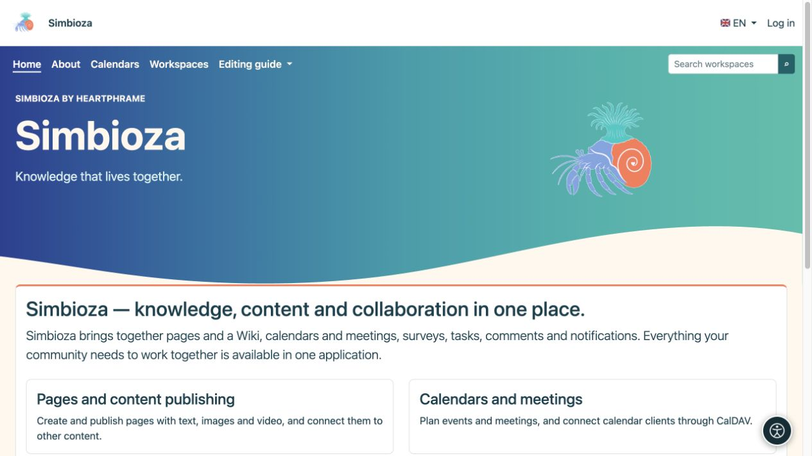

# Menu visibility and user permissions

[Menus](izbornici_en.md)

A link is a way to reach content. **A visible button does not grant access, and a hidden button does not revoke it.** Reading, creation, editing, and publication permissions belong to the relevant content or module.

## Who may change menus?

| Role | Allowed scope |
|---|---|
| Site administrator | Shared top menu, settings menu, and special menus. |
| Workspace manager | Their workspace's special top and left menus, with Manage permission. |
| Editor, author, or publisher without workspace management | Uses navigation; that role alone does not allow editing workspace menus. |
| Guest or ordinary reader | Uses available links and cannot edit administration. |

The item form has no universal “only this group may access” checkbox. To impose that restriction, open the permissions of the workspace, page, survey, or calendar itself.

## What controls whether an item appears?

- **Active** determines whether an item appears in the selected menu.
- A special menu appears only on its configured screens.
- Links using the available application routes can be hidden when the destination module is unavailable or its access checker rejects display.
- A group's display also depends on its visible children. Check the whole group after disabling an item, not just the row in the editor.
- A manually entered URL does not become an access rule. It can remain visible even when its destination asks the user to sign in or denies access. Do not expose confidential information in its link label.

Hiding a menu link does not further protect a private document or make a public document private. Opening its address directly must still enforce the same permissions.

## Check several roles

*The administrator sees Settings on the same home page. Showing an item and permission to use its destination are separate checks.*

*A guest has no Settings entry; public content and permitted links remain available without sign-in.*

1. Save the menu and open the intended destination with your account.
2. Sign in as someone who should have access and check that the destination works.
3. Check a user without those permissions, including direct access to the address.
4. For public content, sign out and check its public view.
5. Check at least one page outside the special menu: shared navigation there should remain as expected.

**Result:** navigation leads people to the correct place while content retains its intended audience. Use [users and permissions](admin-korisnici-i-pristup_en.md) and the relevant module's guide to assign access.

If an item is missing, check Enabled, the selected special menu, the installed module, and your permissions. If its label is missing in only one language, open its [label translations](izbornici-stavke_en.md) and complete that language.
