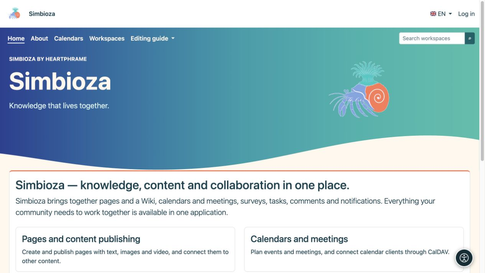

# Visibilidad de los menús y permisos de los usuarios

> Las capturas de pantalla muestran la interfaz en inglés.

[Menús](izbornici_es.md)

Un enlace es una forma de llegar al contenido. **Un botón visible no otorga acceso y un botón oculto no lo revoca.** Los permisos de lectura, creación, edición y publicación pertenecen al contenido o módulo relevante.

## ¿Quién puede cambiar los menús?

| Role | Alcance permitido |
|---|---|
| Administrador del sitio | Menú superior compartido, menú de configuración y menús especiales. |
| gestor del espacio de trabajo | Los menús especiales superior e izquierdo de su espacio de trabajo, con permiso de Administrar. |
| Editor, autor o editorial sin gestión del espacio de trabajo | Utiliza navegación; esa función por sí sola no permite editar los menús del espacio de trabajo. |
| Lector invitado o ordinario | Utiliza enlaces disponibles y no puede editar la administración. |

El formulario del elemento no tiene una casilla de verificación universal "solo este grupo puede acceder". Para imponer esa restricción, abra los permisos del espacio de trabajo, página, encuesta o calendario.

## ¿Qué controla si aparece un elemento?

- **Activo** determina si un elemento aparece en el menú seleccionado.
- Un menú especial aparece solo en sus pantallas configuradas.
- Los enlaces que utilizan las rutas de aplicaciones disponibles se pueden ocultar cuando el módulo de destino no está disponible o su verificador de acceso rechaza la visualización.
- La visualización de un grupo también depende de sus hijos visibles. Verifique todo el grupo después de deshabilitar un elemento, no solo la fila en el editor.
- Una URL ingresada manualmente no se convierte en una regla de acceso. Puede permanecer visible incluso cuando su destino solicita al usuario que inicie sesión o le niega el acceso. No exponga información confidencial en la etiqueta de su enlace.

Ocultar un enlace de menú no protege aún más un documento privado ni hace que un documento público sea privado. Abrir su dirección directamente aún debe aplicar los mismos permisos.

## Verifique varios roles

*El administrador ve la Configuración en la misma página de inicio. Mostrar un artículo y el permiso para usar su destino son comprobaciones independientes.*

*Un invitado no tiene entrada en Configuración; El contenido público y los enlaces permitidos permanecen disponibles sin iniciar sesión.*

1. Guarde el menú y abra el destino deseado con su cuenta.
2. Inicia sesión como alguien que debería tener acceso y comprueba que el destino funciona.
3. Verifique un usuario sin esos permisos, incluido el acceso directo a la dirección.
4. Para contenido público, cierre sesión y verifique su vista pública.
5. Verifique al menos una página fuera del menú especial: la navegación compartida allí debería permanecer como se esperaba.

**Resultado:** la navegación lleva a las personas al lugar correcto mientras el contenido retiene a su público objetivo. Utilice [usuarios y permisos](admin-korisnici-i-pristup_es.md) y la guía del módulo correspondiente para asignar acceso.

Si falta un elemento, marque Habilitado, el menú especial seleccionado, el módulo instalado y sus permisos. Si falta su etiqueta en un solo idioma, abra sus [traducciones de etiquetas](izbornici-stavke_es.md) y complete ese idioma.
