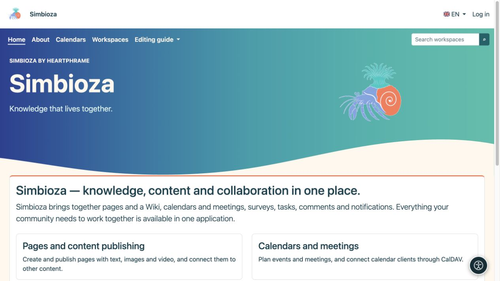

# Visibilité des menus et droits des utilisateurs

> Les captures d’écran présentent l’interface en anglais.

[Menus](izbornici_fr.md)

Un lien est un moyen d'accéder au contenu. **Un bouton visible n'accorde pas l'accès et un bouton masqué ne le révoque pas.** Les autorisations de lecture, de création, d'édition et de publication appartiennent au contenu ou au module concerné.

## Qui peut changer les menus ?

| Rôle | Portée autorisée |
|---|---|
| Administrateur du site | Menu supérieur partagé, menu des paramètres et menus spéciaux. |
| Gestionnaire d'espace de travail | Les menus spéciaux en haut et à gauche de leur espace de travail, avec l'autorisation Gérer. |
| Éditeur, auteur ou responsable de publication sans droit de gestion de l’espace de travail | Utilise la navigation ; ce rôle à lui seul ne permet pas de modifier les menus de l'espace de travail. |
| Invité ou lecteur ordinaire | Utilise les liens disponibles et ne peut pas modifier l'administration. |

Le formulaire d'élément n'a pas de case à cocher universelle « seul ce groupe peut accéder ». Pour imposer cette restriction, ouvrez les autorisations de l'espace de travail, de la page, du sondage ou du calendrier lui-même.

## Qu'est-ce qui contrôle si un élément apparaît ?

- **Actif** détermine si un élément apparaît dans le menu sélectionné.
- Un menu spécial apparaît uniquement sur ses écrans configurés.
- Les liens utilisant les routes d'application disponibles peuvent être masqués lorsque le module de destination est indisponible ou que son vérificateur d'accès refuse l'affichage.
- L'affichage d'un groupe dépend également de ses enfants visibles. Vérifiez l'ensemble du groupe après avoir désactivé un élément, pas seulement la ligne dans l'éditeur.
- Une URL saisie manuellement ne devient pas une règle d'accès. Il peut rester visible même lorsque sa destination demande à l'utilisateur de se connecter ou refuse l'accès. N'exposez pas d'informations confidentielles dans son étiquette de lien.

Masquer un lien de menu ne protège pas davantage un document privé ni ne rend un document public privé. L'ouverture directe de son adresse doit toujours appliquer les mêmes autorisations.

## Cochez plusieurs rôles

*L'administrateur voit les paramètres sur la même page d'accueil. L'affichage d'un élément et l'autorisation d'utiliser sa destination sont des contrôles distincts.*

*Un invité n'a pas d'entrée dans les paramètres ; le contenu public et les liens autorisés restent disponibles sans connexion.*

1. Enregistrez le menu et ouvrez la destination souhaitée avec votre compte.
2. Connectez-vous en tant que personne qui devrait avoir accès et vérifiez que la destination fonctionne.
3. Vérifiez un utilisateur sans ces autorisations, y compris l'accès direct à l'adresse.
4. Pour le contenu public, déconnectez-vous et vérifiez sa vue publique.
5. Vérifiez au moins une page en dehors du menu spécial : la navigation partagée doit y rester comme prévu.

**Résultat :** la navigation mène les internautes au bon endroit tandis que le contenu conserve son public cible. Utilisez [utilisateurs et autorisations](admin-korisnici-i-pristup_fr.md) et le guide du module correspondant pour attribuer l'accès.

Si un élément est manquant, cochez Activé, le menu spécial sélectionné, le module installé et vos autorisations. Si son étiquette est manquante dans une seule langue, ouvrez ses [traductions d'étiquettes](izbornici-stavke_fr.md) et complétez cette langue.
