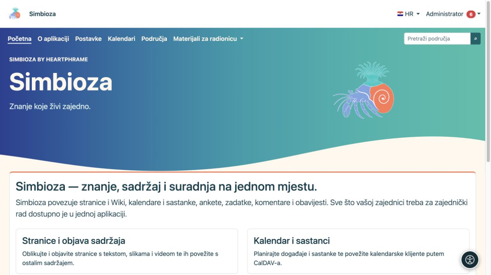
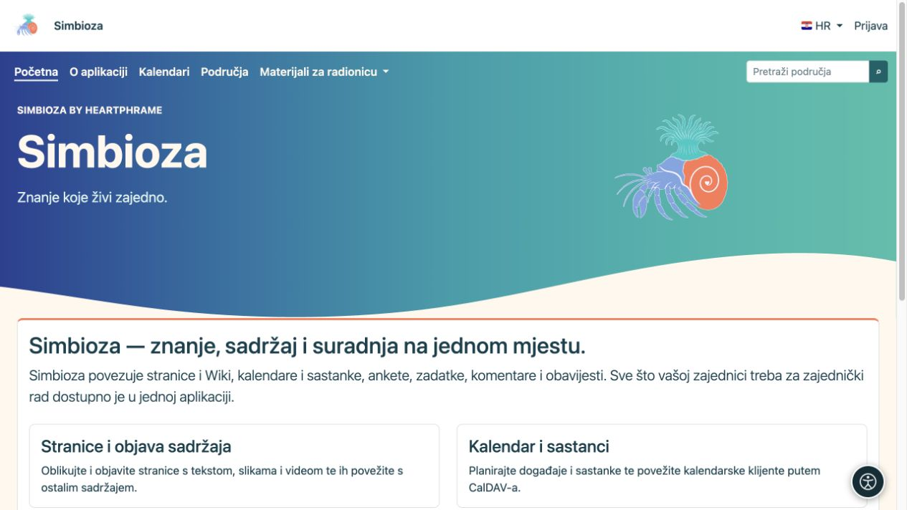

# Vidljivost izbornika i prava korisnika

[Izbornici](izbornici_hr.md)

Poveznica je put do sadržaja. **Vidljiv gumb ne daje pristup, a skriven gumb ga ne ukida.** Prava čitanja, dodavanja, uređivanja i objavljivanja određuju postavke odgovarajućeg sadržaja ili modula.

## Tko smije mijenjati izbornike?

| Uloga | Dopušteni opseg |
|---|---|
| Administrator cijele Simbioze | Zajednički gornji meni, meni postavki i posebni meniji. |
| Upravitelj područja | Posebni gornji i lijevi meni svojeg područja, uz pravo Upravljanje. |
| Urednik, autor ili objavitelj bez upravljanja područjem | Koristi navigaciju, ali ne uređuje izbornike područja samo na temelju te uloge. |
| Gost ili obični čitatelj | Koristi dostupne poveznice; ne uređuje administraciju. |

U administratorovom obrascu stavke nema univerzalne kućice „samo ova grupa smije pristupiti”. Za takvo ograničenje otvorite postavke prava samog područja, stranice, ankete ili kalendara.

## Što odlučuje hoće li se stavka vidjeti?

- **Aktivno** određuje prikazuje li se stavka u odabranom meniju.
- Poseban meni prikazuje se samo na ekranima za koje je podešen.
- Poveznice koje koriste ponuđene aplikacijske rute mogu se sakriti kada odredišni modul nije dostupan ili provjera pristupa odbije prikaz.
- Sadržaj skupine ovisi i o vidljivim podstavkama. Nakon isključivanja provjerite cijelu skupinu, ne samo jedan redak u obrascu.
- Ručno uneseni URL sam po sebi ne postaje pravilo prava pristupa. Može ostati prikazan i kada korisnik na odredištu dobije prijavu ili odbijen pristup. Ne stavljajte povjerljive podatke u takav naziv poveznice.

Isključivanjem poveznice u meniju privatni dokument nije dodatno zaštićen niti javni dokument postaje privatan. Izravno otvaranje njegove adrese mora i dalje provjeravati ista prava.

## Provjerite promjenu iz nekoliko uloga

*Administrator na istoj početnoj stranici vidi Postavke. Prikaz stavke i ovlast njezina odredišta dvije su provjere.*

*Gost nema stavku Postavke; javni sadržaj i dopuštene poveznice ostaju dostupni bez prijave.*

1. Spremite meni i otvorite željeno odredište svojim računom.
2. Prijavite se korisnikom koji treba imati pristup i provjerite da odredište radi.
3. Provjerite korisnika bez tih prava, uključujući izravno otvaranje adrese.
4. Ako je sadržaj javan, odjavite se i provjerite javni prikaz.
5. Provjerite barem jednu stranicu izvan posebnog menija: zajednička navigacija tamo treba ostati očekivana.

**Rezultat:** navigacija vodi korisnika na pravo mjesto, a sadržaj zadržava odgovarajuću publiku. Za praktično dodjeljivanje prava koristite [korisnike i ovlasti](admin-korisnici-i-pristup_hr.md) te upute pripadajućeg modula.

Ako stavka nedostaje, najprije provjerite Aktivno, odabrani poseban meni, instaliran modul i svoja prava. Ako je nestao naziv samo na jednom jeziku, otvorite [prijevode oznake](izbornici-stavke_hr.md) i dopunite taj jezik.
