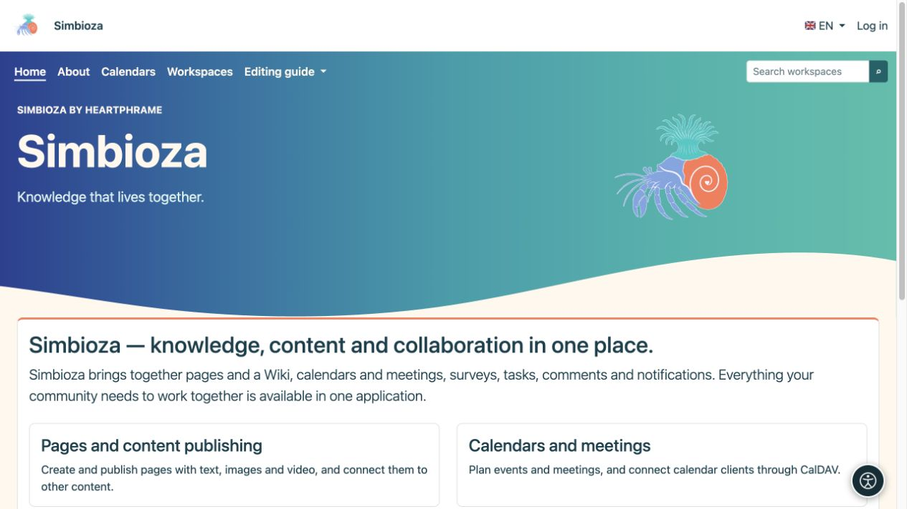

# Visibilità del menu e autorizzazioni dell'utente

> Le schermate mostrano l’interfaccia in inglese.

[Menu](izbornici_it.md)

Un collegamento è un modo per raggiungere il contenuto. **Un pulsante visibile non concede l'accesso e un pulsante nascosto non lo revoca.** Le autorizzazioni di lettura, creazione, modifica e pubblicazione appartengono al contenuto o al modulo pertinente.

## Chi può modificare i menu?

| Ruolo | Ambito consentito |
|---|---|
| Amministratore del sito | Menu principale condiviso, menu delle impostazioni e menu speciali. |
| Responsabile dell'area di lavoro | I menu speciali in alto e a sinistra dell'area di lavoro, con l'autorizzazione Gestisci. |
| Redattore, autore o responsabile della pubblicazione senza gestione dell'area di lavoro | Utilizza la navigazione; quel ruolo da solo non consente la modifica dei menu dell'area di lavoro. |
| Ospite o lettore ordinario | Utilizza i collegamenti disponibili e non può modificare l'amministrazione. |

Il modulo dell'elemento non ha una casella di controllo universale "solo questo gruppo può accedere". Per imporre tale restrizione, apri le autorizzazioni dell'area di lavoro, della pagina, del sondaggio o del calendario stesso.

## Cosa controlla se un elemento viene visualizzato?

- **Attivo** determina se un elemento viene visualizzato nel menu selezionato.
- Un menu speciale appare solo sulle schermate configurate.
- I collegamenti che utilizzano i percorsi dell'applicazione disponibili possono essere nascosti quando il modulo di destinazione non è disponibile o il suo controllo di accesso rifiuta la visualizzazione.
- La visualizzazione di un gruppo dipende anche dai suoi figli visibili. Controlla l'intero gruppo dopo aver disabilitato un elemento, non solo la riga nell'editor.
- Un URL inserito manualmente non diventa una regola di accesso. Può rimanere visibile anche quando la destinazione chiede all'utente di accedere o nega l'accesso. Non esporre informazioni riservate nella relativa etichetta di collegamento.

Nascondere un collegamento al menu non protegge ulteriormente un documento privato né rende privato un documento pubblico. L'apertura diretta del suo indirizzo deve comunque applicare le stesse autorizzazioni.

## Controlla diversi ruoli

*L'amministratore vede le Impostazioni nella stessa home page. La visualizzazione di un elemento e l'autorizzazione a utilizzare la sua destinazione sono controlli separati.*

*Un ospite non ha una voce Impostazioni; i contenuti pubblici e i link consentiti rimangono disponibili senza effettuare l'accesso.*

1. Salva il menu e apri la destinazione desiderata con il tuo account.
2. Accedi come qualcuno che dovrebbe avere accesso e verifica che la destinazione funzioni.
3. Controlla un utente senza tali autorizzazioni, incluso l'accesso diretto all'indirizzo.
4. Per i contenuti pubblici, esci e controlla la visualizzazione pubblica.
5. Controlla almeno una pagina fuori dal menu speciale: la navigazione condivisa dovrebbe rimanere come previsto.

**Risultato:** la navigazione porta le persone al posto giusto mentre i contenuti mantengono il pubblico a cui sono destinati. Utilizzare [utenti e autorizzazioni](admin-korisnici-i-pristup_it.md) e la guida del modulo pertinente per assegnare l'accesso.

Se manca un elemento, seleziona Abilitato, il menu speciale selezionato, il modulo installato e le tue autorizzazioni. Se la sua etichetta manca in una sola lingua, apri le sue [traduzioni etichetta](izbornici-stavke_it.md) e completa quella lingua.
