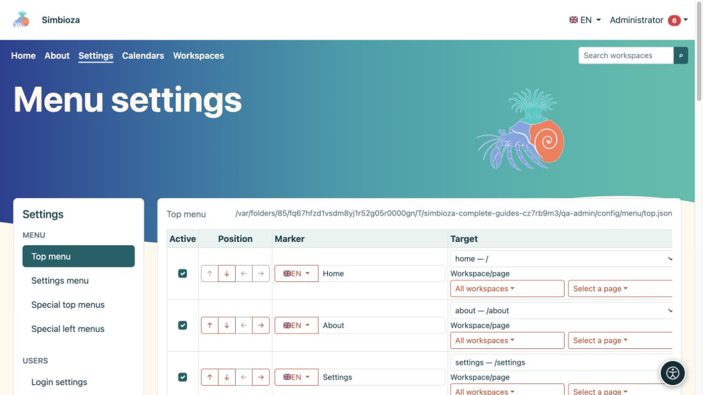

# Simbioza-Menüs einrichten

> Die Bildschirmaufnahmen zeigen die englische Benutzeroberfläche.

Mithilfe von Menüs können Benutzer Inhalte und verfügbare Tools finden. **Das Ändern eines Menüs ändert nicht die Zugriffsberechtigung auf das Ziel.** Legen Sie fest, wer den Inhalt zuerst lesen oder bearbeiten darf, und fügen Sie dann den Link hinzu.

**Zielgruppe:** Der Site-Administrator bearbeitet die installationsweiten Menüs. Ein Arbeitsbereichs-Manager kann die Spezialmenüs seines eigenen Arbeitsbereich bearbeiten, wenn er über dessen Verwaltungsberechtigung verfügt.

*Das obere Menü hat ein eigenes Formular, während die linke Spalte andere Menütypen öffnet.*

## Wählen Sie das richtige Menü

Unter **Einstellungen → Menü** wählt der Administrator:

| Eintrag | Was es verändert |
|---|---|
| Top-Menü | Gemeinsame Hauptnavigation wie „Startseite“, „Info“, „Kalender“ und „Arbeitsbereiche“. |
| Einstellungsmenü | Navigation zwischen Verwaltungseinstellungen. Normalen Benutzern wird kein Zugriff auf diese Einstellungen gewährt. |
| Spezielle Top-Menüs | Hauptnavigation auf ausgewählten Bildschirmen oder innerhalb ausgewählter Arbeitsbereiche. |
| Spezielle linke Menüs | Ein zusätzlicher Seitenleistenblock mit Links in einem ausgewählten Teil der Anwendung. Es handelt sich nicht um den Seitenbaum des Arbeitsbereichs. |

**Ergebnis:** Sie ändern den ausgewählten Teil der Navigation. Durch das Speichern des oberen Menüs wird nicht auch ein an anderer Stelle geöffnetes linkes Menü gespeichert.

## Beginnen Sie mit einer Änderung

1. Öffnen Sie das entsprechende Menü und lesen Sie die vorhandenen Elemente.
2. Fügen Sie einen eindeutigen Link hinzu oder positionieren Sie ein vorhandenes Element neu.
3. Wählen Sie die Schaltfläche **Menükonfiguration speichern** oder **Dieses Menü speichern**.
4. Öffnen Sie den Teil der Anwendung, in dem er erscheinen soll, und testen Sie den Link.
5. Wiederholen Sie den Vorgang mit einem normalen Benutzer und für öffentliche Inhalte ohne Anmeldung.

Beginnen Sie mit [einem Element und seinen Übersetzungen](izbornici-stavke_de.md). Verwenden Sie [spezielle Menüs](izbornici-podrucja_de.md) für unterschiedliche Navigation innerhalb eines Arbeitsbereichs. [Sichtbarkeit und Berechtigungen](izbornici-vidljivost_de.md) erklären, warum Links nicht unbedingt für jeden Besucher sichtbar sind.

Aussehen, Farben, Navigationsplatzierung und die Anzeige der verfügbaren Symbole gehören zum Design. Das Bearbeiten des Menütexts ist unabhängig vom Bearbeiten des Designs. siehe [Designs](teme_de.md).

Wenn das Speichern fehlschlägt oder das Formular schon längere Zeit geöffnet war, öffnen Sie es erneut, bevor Sie die Änderung vornehmen. Durch das Speichern in einem anderen Tab kann die ältere Sicherheitsbestätigung ungültig werden. Vermeiden Sie es, jede Aktion auf mehreren Registerkarten zu wiederholen.
