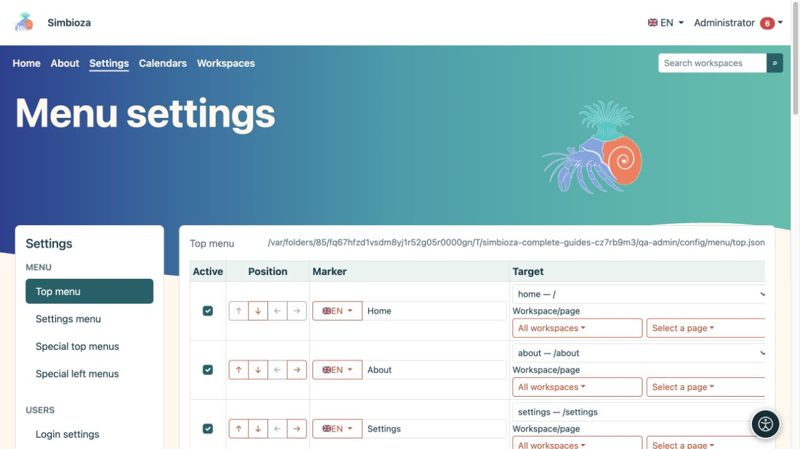

# Configure Simbioza menus

Menus help people find content and available tools. **Changing a menu does not change permission to access its destination.** Set who may read or edit the content first, then add the link.

**Audience:** the site administrator edits installation-wide menus. A workspace manager can edit the special menus of their own workspace when they hold its management permission.

*The top menu has its own form, while the left column opens other menu types.*

## Choose the correct menu

Under **Settings → Menu**, the administrator chooses:

| Entry | What it changes |
|---|---|
| Top menu | Shared main navigation, such as Home, About, Calendars, and Workspaces. |
| Settings menu | Navigation between administrative settings. It does not grant ordinary users access to those settings. |
| Special top menus | Main navigation on selected screens or within selected workspaces. |
| Special left menus | An additional sidebar block of links in a selected part of the application. It is not the workspace page tree. |

**Result:** you change the selected part of navigation. Saving the top menu does not also save a left menu open elsewhere.

## Start with one change

1. Open the appropriate menu and read its existing items.
2. Add one clear link or reposition an existing item.
3. Choose its **Save menu configuration** or **Save this menu** button.
4. Open the part of the application where it should appear and test the link.
5. Repeat with an ordinary user and, for public content, without signing in.

Begin with [an item and its translations](izbornici-stavke_en.md). Use [special menus](izbornici-podrucja_en.md) for different navigation within a workspace. [Visibility and permissions](izbornici-vidljivost_en.md) explain why links are not necessarily visible to every visitor.

Appearance, colours, navigation placement, and the display of available icons belong to the theme. Editing menu text is separate from editing the theme; see [themes](teme_en.md).

If saving fails or the form has been open for a long time, reopen it before making the change. Saving in another tab can invalidate the older security confirmation. Avoid repeating every action in several tabs.
